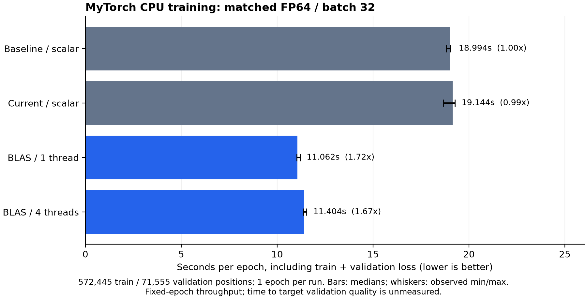

# Linux CPU BLAS measurements, 7 November 2026

AMD Ryzen 7 7840HS, GCC, OpenBLAS 0.3.26 pthread build. Matched `-O2`, FP64,
network 777 → 128 → 64 → 3, sigmoid/softmax, Xavier, seed 43, SGD learning rate
0.01, batch 32. CPU frequency/governor and thermal state were not pinned.

Baseline numerical source: `9cbcaca`; accelerated numerical source: `dc5849e`.
Complete source hashes and the source diff are in the manifests. The original
working directory and the running experiment's executable/results were preserved.
All measurements began after that experiment runner exited. Jobs ran sequentially
in shuffled order, with no active training campaign detected.

Full dataset: 572,445 train and 71,555 validation positions, one epoch,
three runs per configuration. Subset: 8,192 train and 2,048 validation positions,
five epochs, five runs per configuration, comparing 1/2/4/8 requested threads.
Timing includes shuffling, SGD updates and complete train/validation losses;
parsing, initialization, warm-up, serialization and final accuracy are excluded.

Best full-dataset setting: `--threads 1`, 1.72x faster than
baseline (18.994s → 11.062s per epoch).
Maximum absolute final parameter difference: 7.77e-16; maximum validation
loss difference: 0; identical validation accuracy in all comparisons.
Each run starts from the same fresh network. Its final train/validation losses
are 1.052599364486758 / 1.052620056445607 and validation accuracy is
42.38278247501922%; these one-epoch values are correctness checks, not the
quality of the independently trained experiment's model.

`full-*` and `subset-*` retain the compact raw results, schedules, environment,
build commands, hashes, phase durations and numerical comparisons in Git.
The PNG/SVG figures are generated by `../../plot.py` from the full summary.

Larger local evidence: `/home/mathys/3/CNA/mytorch-blas-evidence/`, including
pre-edit sources, frozen build inputs/binaries, original fixtures, every final
model and full test/build logs. Keep that directory for the defense. It is
separate from the experiment outputs and survives project reorganization if
retained as a unit. Full-dataset build inputs reference the identical frozen
sources/binaries in `prepared-03`; `prepare-full.py` records that derivation.

These are matched fixed-epoch throughput results, not a measurement of time to
reach a validation-quality target. Do not extrapolate a long-run quality claim
or a Mac speedup from them. Accelerate integration has not been run on macOS.
