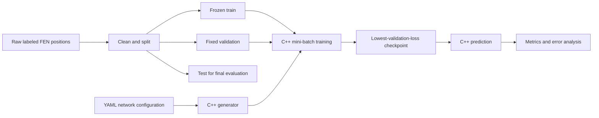
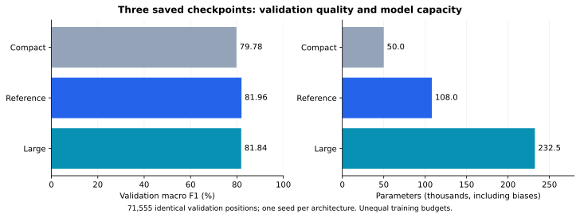
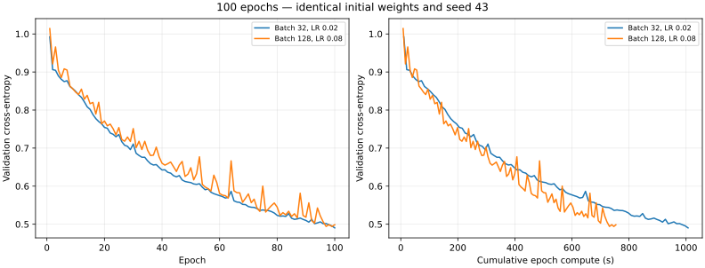
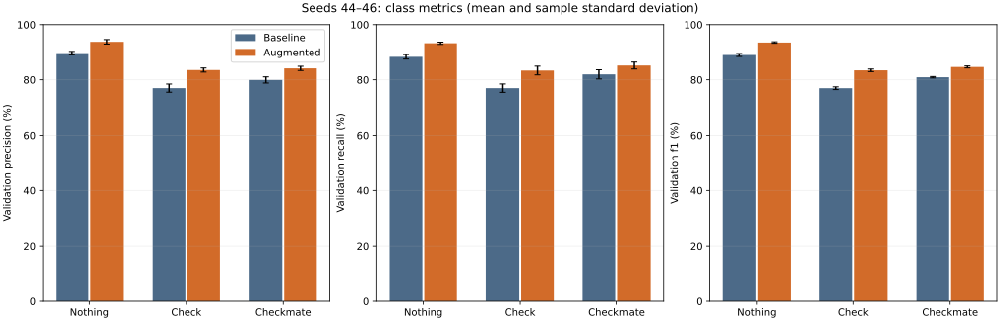
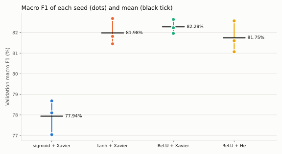
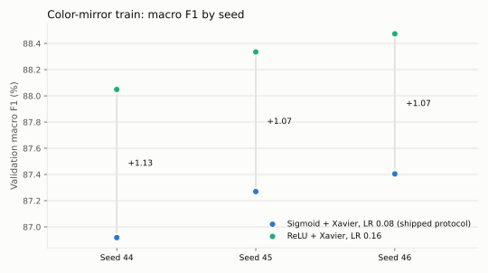
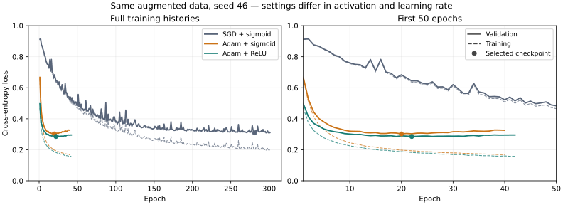

# MyTorch — Model benchmarks and defense summary

**Evidence snapshot: 8 November 2026.** This document brings together the
recorded model experiments, their visual evidence and the arguments to present
during the defense. Scores below are validation scores unless explicitly marked
as test. It does not promote a checkpoint or report a new experiment.

> **Main result:** color-mirror augmentation raises mean validation macro F1
> from **82.28% to 87.20%** over three seeds. ReLU with a tuned learning rate
> reaches **88.29% mean macro F1** over three seeds. The larger ReLU + Adam
> candidate reaches **89.25% accuracy / 88.58% macro F1**, measured on one seed.
> The delivered model is a 777 → 256 → 128 → 3 ReLU + Adam network with dropout,
> trained on the left-right ×4 train: **93.66% accuracy / 93.15% macro F1 on the
> test split**, evaluated once (93.78% validation accuracy).

## Presentation map

| Part | Question answered | Evidence to show |
| --- | --- | --- |
| 1–2 | What did we build, and why these inputs? | System flow and network contract |
| 3–4 | How can we trust the comparisons? | Dataset counts, split rules and metrics |
| 5–9 | Which choices improved the models? | Controlled comparisons, scores and curves |
| 10–11 | Where does the model still fail? | Train/validation gap, confusion matrix and error audit |
| 12–13 | What is actually delivered, and can it be reproduced? | Exact checkpoints, hashes and commands |
| 14–15 | How should we demonstrate and defend it? | Demonstration sequence and answers to likely questions |

## 1. Problem and project requirements

Given a chess position in six-field FEN notation, predict exactly one state:

| Class | Meaning | Target vector |
| --- | --- | --- |
| `Nothing` | Neither check nor checkmate; stalemate has no separate class | `[1, 0, 0]` |
| `Check` | Side to move is in check, with at least one legal reply | `[0, 1, 0]` |
| `Checkmate` | Side to move is in checkmate | `[0, 0, 1]` |

The project uses **supervised learning**, with a generic neural module written
in C++17. No neural network framework computes predictions or training updates.
The analyzer classifies a position; it does not choose a move or search a game tree.

The supplied MyTorch brief v2.6.0 requires network creation, saving/loading and
training, an analyzer with training and prediction modes, a README, retained
training scripts/data, and a committed pretrained model named `my_torch_network…`.
It also asks for numerical analysis and optimization methods, requires an attempt
to avoid overfitting, and recommends professional benchmark documentation with
visual proof. It does not provide a numerical accuracy threshold in that brief.

| Requirement | Concrete evidence in this project |
| --- | --- |
| Generic neural module | `src/neural/`: configurable layers, initialization, forward pass, backpropagation, SGD/Adam and serialization |
| Supervised chess learning | Numeric FEN features paired with three-class labels; cross-entropy minimization |
| Create / train / save / reload | Generator and analyzer commands; model and CLI tests |
| Overfitting mitigation | Separate validation data, patience-based early stopping and restoration of the lowest-validation-loss checkpoint |
| Justified design choices | Architecture, activation, initialization, batch/LR, augmentation and optimizer comparisons below |
| Numerical and visual benchmarks | Versioned JSON measurements, SVG curves, confusion matrices and class metrics |
| Reproduction | YAML protocols, scripts, seeds, fingerprints and retained local datasets |
| Pretrained artifact | Root `my_torch_network.nn`, distinct from the shared Adam candidate |

This mapping describes evidence, not a claim that every item of an external
grading grid has been validated.

## 2. System and model design



Python prepares data, invokes the C++ programs and computes reports. C++ performs
the forward pass, loss, gradients and optimizer updates. The optional
`python-chess` library generates/audits data offline; the shipped predictor does
not use it to calculate the answer. BLAS supplies matrix operations, not a neural
network implementation.

### Input representation

| Feature | Values | Reason |
| --- | ---: | --- |
| Piece placement | 64 squares × 12 piece identities = 768 | One-hot identity/color without an artificial ordering between pieces |
| Side to move | 1 | Determines whose king must be checked |
| En passant target file | 8 | Retains information that can affect legal replies |
| **Total** | **777 binary inputs** | Same encoding in cleaning, splitting, training and inference |

Castling rights and move counters are validated but not encoded. For the three
current states, castling cannot be a legal escape from check; move counters do
not decide whether a king is in check or checkmate. En passant rank follows from
the side to move. The label and any expected color suffix never enter the inputs.

### Network choices

The reference has layers **777 → 128 → 64 → 3**, with **108,035 trainable
parameters**, including biases. The larger candidate is **777 → 256 → 128 → 3**,
with **232,451 parameters**. The compact alternative is **777 → 64 → 3**,
with **49,987 parameters**.

Hidden layers were compared with sigmoid, tanh and ReLU. Softmax outputs three
scores whose sum is one; argmax selects the predicted class. Categorical
cross-entropy matches these mutually exclusive targets. Xavier initializes
weights with a variance based on layer widths; He initialization was also tested
with ReLU. Biases start at zero.

The gradient of softmax plus cross-entropy at the output is `prediction − target`.
Backpropagation propagates it through the hidden activations. Mini-batch SGD
updates parameters using an averaged batch gradient; Adam uses bias-corrected
first and second gradient moments. Model serialization retains learned weights,
biases, configuration and, for Adam, its optimizer state.

Sources: [architecture](architecture.md), [input contract](datasets.md),
[output contract](output-encoding.md), [training calculations](training.md).

## 3. Datasets and leakage controls

### Frozen original reference: `chess-v1`

| Stage / split | Positions | Nothing | Check | Checkmate |
| --- | ---: | ---: | ---: | ---: |
| Raw | 723,025 | 300,000 | 249,305 | 173,719 |
| Cleaned | 715,555 | 297,563 | 248,133 | 169,859 |
| Train | 572,445 | 238,051 | 198,507 | 135,887 |
| Validation | 71,555 | 29,756 | 24,813 | 16,986 |
| Test | 71,555 | 29,756 | 24,813 | 16,986 |

The raw total includes one malformed row without a valid class. Cleaning removes
that row and **7,469 duplicates**, with zero conflicting retained input groups.
The split is stratified **80/10/10**, seed **42**, without class balancing.

Deduplication uses the inputs actually visible to the model: board, side to move
and en passant file. Positions differing only in ignored FEN fields cannot cross
splits as apparently different examples. Exact encoded-input overlap is zero.
This does not establish independence of near-duplicate or related positions.

| Split | Permitted role |
| --- | --- |
| Train | Weight updates and train-only augmentation |
| Validation | Checkpoint selection, early stopping, hyperparameter/model comparison |
| Test | Evaluation after fixing the model; no choice of hyperparameters from its score |

**Important history:** the older epoch-338 reference already has a recorded test
score. The project test set is therefore not a never-consulted blind holdout.
The delivered model was tested once, after validation fixed its settings:
**93.66% accuracy / 93.15% macro F1**. Two larger variants were also scored on
test before its size was chosen; the shared Adam candidate has no test result
([delivered model limits](report/2026-11-08-mirror-view-ensemble.md#limits)).

### Color-mirror augmentation

Reflect ranks, exchange piece colors, swap the side to move and transform FEN
metadata. The chess state remains the same. The procedure retains **568,698**
new inputs, bringing train to **1,141,143 unique positions**:

| Nothing | Check | Checkmate | Validation |
| ---: | ---: | ---: | --- |
| 474,275 | 396,185 | 270,683 | Unchanged: 71,555 positions |

Mirrors already in train or matching validation/test inputs are excluded.
Held-out membership checks use FEN inputs, not their labels or prediction scores.
Each augmented epoch processes about **1.993×** as many examples as an original
epoch: **8,916** optimizer updates instead of **4,473** at batch 128.

### Generated legal-game positions

Separate frozen references add 60,000 legal-game positions to the original
train (**632,445 rows**) and optionally mirror that train (**1,260,989 rows**).
They preserve the original held-outs. Dataset generation and integrity checks
do not establish an improvement in model quality. No model score for these
references is included in this synthesis; do not attribute the reported
color-mirror gains to generated games.

The original external data source, generator and redistribution rights remain
unknown. A later independent label audit checks all **644,000 original train and
validation labels** against chess rules and finds 100% agreement. It flags
9 train and 2 validation positions as invalid under the oracle's validity checks;
label agreement alone does not certify full legality or real-game coverage.

Sources: [dataset guide](datasets.md), [augmentation report](report/2026-11-08-color-mirror-augmentation/README.md),
[label audit](report/2026-11-08-label-and-error-audit/README.md).

## 4. Evaluation protocol and how to read the results

| Metric | Interpretation |
| --- | --- |
| Accuracy | Correct predictions / all positions |
| Per-class precision | Among predictions of a class, how many are correct? |
| Per-class recall | Among actual positions of a class, how many are found? |
| Per-class F1 | Harmonic mean of precision and recall |
| Macro F1 | Unweighted mean of the three class F1 scores |
| Cross-entropy | Training objective and checkpoint-selection quantity |
| Confusion matrix | Counts of actual → predicted classes |

Macro F1 gives each state equal weight, while accuracy weights positions equally.
For scale, always predicting the train-majority class `Nothing` would score
**41.58% validation accuracy**, calculated from `29,756 / 71,555`; it completely
misses both other classes. This is a count-derived diagnostic, not a trained
baseline or a separately timed benchmark.

Checkpoints are selected by **minimum validation loss**, and their classification
metrics are then compared. They are not necessarily the checkpoints with maximum
F1 over the trajectory: intermediate F1 was not measured at every epoch.

Most later protocols use maximum 500 epochs, batch 128, patience 20,
`min_delta = 0.0001` and one BLAS thread. Each report specifies exceptions.
The minimum-loss checkpoint is saved, including the initial model if appropriate;
`min_delta` controls the patience reference. Selected epoch and completed epochs
are different quantities.

Three-seed results report the mean and **sample standard deviation**, not a
confidence interval. A single-seed best score is not comparable to a three-seed
mean as evidence of consistent superiority. Validation has been reused during
tuning, so these are development results rather than unbiased final estimates.

## 5. Benchmark overview: what has actually been measured?

| Experiment | Main validation finding | Strength and scope |
| --- | --- | --- |
| Historical continuation | Macro F1 72.28% → 81.96% | Same network, partly documented original training |
| Compact / reference / large sigmoid | 79.78% / 81.96% / 81.84% macro F1 | One seed; unequal training histories |
| Batch 32 / LR 0.02 vs batch 128 / LR 0.08 | 77.72% vs 77.71% macro F1; 25.1% less epoch compute for batch 128 | Matched 100-epoch budget, one seed |
| Selected sigmoid setting, original train | 82.28% ± 0.39 pp macro F1 | Three additional seeds 44–46 |
| Color-mirror train | 87.20% ± 0.25 pp macro F1; +4.91 pp | Three paired seeds, same initial weights per pair |
| Hidden activations, original train | ReLU/Xavier 82.28% ± 0.34 pp vs sigmoid 77.94% ± 0.83 pp | Three seeds each, at most 100 epochs |
| ReLU + augmented train, SGD LR 0.16 | 88.29% ± 0.22 pp macro F1; +1.09 pp vs augmented sigmoid | Three seeds, cross-platform comparison |
| Small ReLU + Adam LR 0.001 | 88.74% accuracy / 88.13% macro F1 | One seed |
| Large ReLU + Adam LR 0.001 | 89.25% accuracy / 88.58% macro F1 | One seed; only widths change vs small Adam |

These rows summarize different experiments, not a single controlled leaderboard.
Use each within-experiment comparison to justify its corresponding decision.

## 6. Architecture and batch/learning-rate decisions

### Capacity alone did not improve the early sigmoid models

| Sigmoid model | Parameters | Accuracy | Macro F1 |
| --- | ---: | ---: | ---: |
| Compact: 777 → 64 → 3 | 49,987 | 80.41% | 79.78% |
| Reference: 777 → 128 → 64 → 3 | 108,035 | 82.57% | 81.96% |
| Large: 777 → 256 → 128 → 3 | 232,451 | 82.36% | 81.84% |



**Read the figure:** compact loses 2.19 macro-F1 points for 53.73% fewer
parameters. The large network has 2.15× the reference parameters without an
aggregate gain in this experiment. More parameters alone did not solve the task.
This is not a general rejection of larger networks: training histories differ,
and the later ReLU + Adam width comparison has a different outcome.

The compact/large runners flagged a changed analyzer during their historical
training. Their saved checkpoints were subsequently evaluated with one frozen
analyzer. That validates the prediction comparison, not the provenance of every
training step. See [full architecture report](report/2026-11-07-three-models/README.md).

### A larger batch needs a suitable learning rate

Initial screens at unchanged LR 0.01 showed faster epochs with batches 128/256
but slower early learning per compute time. After LR tuning, a matched comparison
restarted both configurations from identical seed-43 Xavier weights:

| Configuration | Epoch budget | Epoch compute | Selected epoch | Accuracy | Macro F1 |
| --- | ---: | ---: | ---: | ---: | ---: |
| Batch 32 / LR 0.02 | 100 | 1,007.192 s | 100 | 78.13% | 77.72% |
| Batch 128 / LR 0.08 | 100 | 754.048 s | 99 | 78.11% | 77.71% |



**Read the figure:** compare both the epoch axis and compute-time axis. Batch 128
uses **25.1% less epoch compute** with a **−0.01 pp** checkpoint-F1 difference
at this horizon. This is a comparison of two complete batch/LR settings, not an
isolated causal effect of batch size or proof of statistical equivalence.
Loading, saving and final classification are excluded from epoch compute.

The longer selected sigmoid configuration reaches **82.78% macro F1** on tuning
seed 43. Additional seeds 44–46 give **82.28% ± 0.39 pp**, range 81.84–82.54%.
The tuning seed is excluded from that mean.

Sources: [100-epoch comparison](report/2026-11-07-batch-learning-rate-100epochs/README.md),
[seed robustness](report/2026-11-08-reference-seed-robustness/README.md).

## 7. Data augmentation: the largest repeated gain

The same initial model is used for each original/augmented seed pair. Network,
activation, batch, LR and stopping settings remain fixed.

| Seed | Original train macro F1 | Augmented train macro F1 | Gain |
| --- | ---: | ---: | ---: |
| 44 | 81.84% | 86.92% | +5.08 pp |
| 45 | 82.48% | 87.27% | +4.79 pp |
| 46 | 82.54% | 87.40% | +4.87 pp |
| **Mean ± sample SD** | **82.28% ± 0.39 pp** | **87.20% ± 0.25 pp** | **+4.91 pp mean** |



**Read the figure:** gains appear in every class, across all three seeds.
Mean Check recall improves from **76.95% to 83.35%**. This is more persuasive
than choosing the most favorable seed from a large set of trials.

The augmented campaign uses **2.69× the historical epoch compute** of the
original campaign. It processes nearly twice as many positions each epoch and
also reaches different stopping epochs. The result measures augmentation plus
the existing stopping protocol; it does not isolate new information from extra
optimization work. Timing baselines are historical, not interleaved measurements.

Source: [paired augmentation report and numerical evidence](report/2026-11-08-color-mirror-augmentation/README.md).

## 8. Activations and initialization: faster learning, then better quality

### Original train: common 100-epoch maximum, seeds 42–44

| Hidden activation / initialization | Mean macro F1 ± sample SD | Mean accuracy | Mean selected epoch |
| --- | ---: | ---: | ---: |
| Sigmoid / Xavier | 77.94% ± 0.83 pp | 78.43% | 99.7 |
| Tanh / Xavier | 81.98% ± 0.63 pp | 82.53% | 57.7 |
| ReLU / Xavier | 82.28% ± 0.34 pp | 82.95% | 23.0 |
| ReLU / He | 81.75% ± 0.76 pp | 82.40% | 23.0 |



**Read the figure:** every tanh/ReLU seed exceeds every sigmoid seed at this
budget. The alternatives are not separated from each other under the report's
predeclared rule. The measured gaps do not establish that Xavier is universally
better than He.

Longer original-train sigmoid runs reach the same **82.28% mean macro F1**,
selecting epochs 185–203 versus ReLU's 20–28: about **8× fewer epochs** for ReLU.
Those campaigns use different machines, so this is not an 8× wall-time speedup.

### Augmented train: tune ReLU's LR, then repeat seeds

Seed-46 screening tried LR **0.02, 0.04, 0.08, 0.16 and 0.32**. Their macro F1
scores were **86.22%, 86.75%, 87.80%, 88.47% and 88.34%**, respectively.
LR 0.16 was retained and evaluated on two additional seeds.

| Seed | Augmented sigmoid, LR 0.08 | Augmented ReLU, LR 0.16 | Macro-F1 gain |
| --- | ---: | ---: | ---: |
| 44 | 86.92% | 88.05% | +1.13 pp |
| 45 | 87.27% | 88.34% | +1.07 pp |
| 46 | 87.40% | 88.47% | +1.07 pp |
| **Mean ± sample SD** | **87.20% ± 0.25 pp** | **88.29% ± 0.22 pp** | **+1.09 pp mean** |



**Read the figure:** the lowest ReLU score is above the highest sigmoid score.
ReLU selects epochs 35–42, against sigmoid's 227–281: **6.6× fewer updates to the
checkpoint on average**. This compares activation/LR configurations together.

ReLU runs use Apple M5/Accelerate; sigmoid runs use Linux/OpenBLAS. C++ shuffle
implementations differ across standard libraries, so equal seeds do not imply
identical orders across those machines. Validation was reused for LR selection.

Sources: [activation comparison](report/2026-11-08-hidden-activations/README.md),
[augmented ReLU comparison](report/2026-11-08-relu-color-mirror/README.md).

## 9. Optimizer and capacity follow-up

All rows below use the same augmented train and validation inputs. Do not read
this table as an isolated test of Adam: activation and LR also change between
several rows.

| Model / setting | Seed | Accuracy | Macro F1 | Selected / completed epochs |
| --- | ---: | ---: | ---: | --- |
| Small sigmoid + SGD, LR 0.08 — previously delivered | 46 | 88.06% | 87.40% | 281 / 301 |
| Same checkpoint, SGD continuation LR 0.008 | 46 | 88.23% | 87.57% | +1 / +21 |
| Small sigmoid + Adam, LR 0.003 | 46 | 87.98% | 87.46% | 20 / 40 |
| Small ReLU + Adam, LR 0.001 | 46 | 88.74% | 88.13% | 22 / 42 |
| **Large ReLU + Adam, LR 0.001 — candidate** | **46** | **89.25%** | **88.58%** | **9 / 29** |

For context, ReLU + SGD at LR 0.16 reaches **89.11% accuracy / 88.47% macro F1**
on seed 46 and has the three-seed evidence in section 8. The large Adam result
exceeds that seed's F1 by approximately **0.11 pp**; this small difference does
not establish a repeatable advantage over SGD.

The small/large ReLU + Adam follow-up changes only layer widths and matches
dataset/executable hashes and all other training settings:

| Quantity | Small Adam | Large Adam |
| --- | ---: | ---: |
| Hidden widths | 128 / 64 | 256 / 128 |
| Parameters | 108,035 | 232,451 |
| Full-run wall time | 612.57 s | 959.17 s |
| Train accuracy | 92.77% | 94.74% |
| Validation accuracy | 88.74% | 89.25% |
| Train macro F1 | 92.27% | 94.33% |
| Validation macro F1 | 88.13% | 88.58% |
| Checkpoint size, including Adam state | 10.92 MB | 23.54 MB |

The large model makes **365 fewer validation errors** at about **57% longer
full-run wall time**. Checkmate F1 does not improve: **85.90% → 85.86%**.
The aggregate improvement mainly concerns Nothing and Check.

Historical sigmoid-SGD timing uses older dense input storage; Adam runs use
compact storage. Their duration ratio cannot be attributed to the optimizer.
The small/large Adam timings are still single observations, not repeated timing
benchmarks. Checkpoint byte size includes text serialization and optimizer state;
it is not a measurement of peak RAM or inference latency.

Source: [Adam and capacity report](report/2026-11-08-adam-optimizer/README.md),
[portable metrics](report/2026-11-08-adam-optimizer/data.json).

## 10. Overfitting: what the curves prove



**How to explain this graph:** training loss measures fit to examples used for
updates; validation loss measures fit to the separate selection set. When train
loss continues downward but validation rises after its minimum, later weights
fit train better without improving validation. The saved checkpoint is the
minimum-loss point, not the last completed epoch. This graph belongs to the
**small ReLU + Adam run**, not the larger candidate.

The larger candidate selects epoch **9** and stops after epoch **29** on patience.
Its train/validation accuracy gap is **5.49 pp**. The smaller Adam model's gap is
**4.03 pp**. More capacity improves measured validation modestly while widening
the gap. At the same time, neither model reaches perfect train accuracy.
Residual fitting error and overfitting can coexist; the results do not isolate
representational capacity from optimization as the sole remaining bottleneck.

Separate splits detect generalization gaps. Early stopping and restoration
actively limit retaining worse late checkpoints. They do not eliminate leakage
from repeated validation tuning or guarantee performance on a new data source.

## 11. Confusions and remaining weaknesses

### Large ReLU + Adam candidate: validation confusion matrix

Rows are actual states; columns are predicted states. Class color suffixes are
normalized away for these three-state metrics.

| Actual ↓ / predicted → | Nothing | Check | Checkmate | Support |
| --- | ---: | ---: | ---: | ---: |
| Nothing | **27,869** | 1,677 | 210 | 29,756 |
| Check | 1,211 | **21,402** | 2,200 | 24,813 |
| Checkmate | 186 | 2,210 | **14,590** | 16,986 |

| Class | Precision | Recall | F1 |
| --- | ---: | ---: | ---: |
| Nothing | 95.23% | 93.66% | 94.44% |
| Check | 84.63% | 86.25% | 85.43% |
| Checkmate | 85.82% | 85.89% | 85.86% |

There are **7,694 errors** among 71,555 positions. **4,410** are Check↔Checkmate,
about **57.3%** of all errors. Distinguishing an attacked king with a legal reply
from a king with no escape remains difficult.

### Rule-based audit of a separate ReLU + SGD checkpoint

The detailed pattern audit uses **ReLU + SGD, LR 0.16, seed 46**, not the Adam
candidate above. It reports 89.11% validation accuracy and 7,791 errors.

| Position pattern | Error rate | Interpretation |
| --- | ---: | --- |
| Nothing with one piece blocking an enemy sliding-piece line to the king | 26.4% | Occlusion/line-of-sight reasoning is difficult |
| Nothing without that pattern | 3.1% | Much lower error away from that pattern |
| Check with only 1–2 legal replies | 24.5% | Positions close to mate are often confused |
| Check with 3–5 legal replies | 9.6% | More obvious escapes are easier |
| Queen checkmates | 7.9% | Common pattern is better recognized |
| Bishop / knight / pawn checkmates | 28.5% / 25.0% / 26.6% | Rarer patterns remain weaker |

These are observed correlations, not proof of what a hidden neuron represents.
They support the hypothesis that dense square inputs make long-range blocking
and legal-escape relationships harder to learn. They do not justify blaming
label noise: all audited original train/validation labels match the oracle.

Sources: [candidate confusion counts](report/2026-11-08-adam-optimizer/data.json),
[rule and error audit](report/2026-11-08-label-and-error-audit/README.md).

## 12. Delivered artifact versus experimental candidates

| Item | Delivered model | Previously delivered model | Shared large Adam candidate |
| --- | --- | --- | --- |
| File | `my_torch_network.nn` | Replaced; kept in Git history | `models/large-relu-adam-seed46-lr0.001.nn` |
| Layers | 777 → 256 → 128 → 3 | 777 → 128 → 64 → 3 | 777 → 256 → 128 → 3 |
| Hidden activation / optimizer | ReLU / Adam, dropout 0.1 | Sigmoid / SGD | ReLU / Adam |
| Learning rate / seed | 0.001 with decay / 49 | 0.08 / 46 | 0.001 / 46 |
| Training data | Left-right ×4 train (2,275,774 positions) | Color-mirror train | Color-mirror train |
| Selected epoch | 47 / 57 | 281 | 9 |
| Validation accuracy / macro F1 | 93.78% / 93.27% | 88.06% / 87.40% | 89.25% / 88.58% |
| File bytes | 2,426,610 | 3,379,663 | 23,544,584 |
| Test accuracy / macro F1 | 93.66% / 93.15%, evaluated once | Not recorded | Not recorded |

SHA-256 fingerprints:

```text
Delivered: e01c8346fa23541144dd883e8298dbd652159b6856f6d2e398ada31dc13dc13b
Previous:  3ce70f8052f213573905e7fe8cd8a278309759083212b68768f424352aa392bf
Candidate: 55944eb130c71cbcee29fddd6dc1e2239848fd9ec4697f5fc8017f6f8f0d911b
```

The current analyzer emits `Nothing`, `Check White/Black` or
`Checkmate White/Black`. The model predicts only the state; the suffix identifies
the attacking side from FEN side to move. No color classification is learned.
An older delivery report records legacy three-state output; use the current
[output contract](output-encoding.md) when demonstrating the executable.

The older epoch-338 reference has **82.13% test accuracy / 81.49% test macro F1**.
That is a different model. Do not attach that test score to any artifact in
this table or compare its test score with a new validation score as a measured
generalization gain.

**Decision supported by the evidence:** the delivered model keeps the changes with
measured validation gains: ReLU + Adam at 256/128 (+1.2 points), left-right
mirrors (+3.6) and dropout (+0.9, one seed). Reading each position in four views
adds 1.3 points but costs 5.7× the computation, so it is documented, not delivered.

Sources: [delivered model provenance](report/2026-11-08-mirror-view-ensemble.md),
[previous delivered model](report/2026-11-08-color-mirror-augmentation/README.md#delivered-model),
[shared candidate](../models/README.md), [historical test report](report/2026-11-07-reference-checkpoints/README.md#separate-test-evaluation).

## 13. Reproduction and retained evidence

### What must remain available for the defense

| Versioned in Git | Retained locally; not restored by a normal clone |
| --- | --- |
| C++ source, Python tools, requirements and YAML protocols | Original/frozen training datasets and raw sources |
| Dataset manifests and fingerprints | Full run directories: logs, predictions, histories, checkpoints |
| Portable report JSON and SVG figures | Historical frozen executables/libraries and one-off reproduction tools |
| Delivered model and explicitly shared candidate | Other ignored historical models and notebook-dependent raw results |

Reproduction needs the recorded source data. A clone alone does not supply
ignored datasets or local `results/`. The portable JSON and SVGs keep the main
benchmark evidence readable without those directories.

### Safe demonstration commands

Run from the repository root, with build dependencies installed. `positions.fen`
must be an existing demonstration file with one FEN per line.

```sh
make
./my_torch_analyzer --help
./my_torch_analyzer --predict my_torch_network.nn positions.fen
./my_torch_analyzer --predict models/large-relu-adam-seed46-lr0.001.nn positions.fen
sha256sum my_torch_network.nn models/large-relu-adam-seed46-lr0.001.nn
```

Use the matching dataset only after verifying/restoring its retained files:

```sh
python3 -m scripts.reference_dataset verify
python3 scripts/evaluate.py my_torch_network.nn \
  dataset/references/chess-v1/splits/validation.txt \
  --output results/evaluation/defense-delivered-validation-01
```

The output directory must be new. This evaluates validation; it does not train
or evaluate the reserved test split. On macOS, `shasum -a 256` replaces
`sha256sum` if necessary.

### Replaying training: protocol entry points

These are pointers to recorded protocols, not commands to run during a short
presentation. They require the exact datasets referenced inside each YAML.

| Experiment | Protocol / reconstruction source |
| --- | --- |
| Original-train sigmoid | [`train-reference-b128.yml`](../configs/protocols/train-reference-b128.yml) |
| Color-mirror sigmoid, seeds 44–46 | [`train-color-mirror.yml`](../configs/protocols/train-color-mirror.yml); prepare/verify augmentation as described in its report |
| Hidden activations, seeds 42–44 | [`compare-hidden-activations.yml`](../configs/protocols/compare-hidden-activations.yml) |
| Augmented ReLU, seed 46 at LR 0.16 | [`compare-relu-color-mirror-lr-high.yml`](../configs/protocols/compare-relu-color-mirror-lr-high.yml) |
| Augmented ReLU, additional seeds 44/45 | [`train-relu-color-mirror-lr016-seeds.yml`](../configs/protocols/train-relu-color-mirror-lr016-seeds.yml) |
| Large ReLU + Adam, seed 46 | [`train-large-relu-adam.yml`](../configs/protocols/train-large-relu-adam.yml); paths refer to retained local Adam-campaign data |
| Delivered model: dropout, left-right ×4 train, seed 49 | [`train-delivered-model.yml`](../configs/protocols/train-delivered-model.yml); dropout masks differ from the experimental build, so a rerun repeats the method, not the exact weights |

The runner accepts `python3 scripts/experiment.py CONFIG --output NEW_DIRECTORY`.
Use one BLAS thread as in the reports: `OPENBLAS_NUM_THREADS=1`,
`OPENBLAS_DEFAULT_NUM_THREADS=1`, `OMP_NUM_THREADS=1` on Linux;
`VECLIB_MAXIMUM_THREADS=1` on macOS.

The original train SHA-256 is
`76b038dda01a24c50e0980d407038d068538394d760c9637e717902b9540e167`;
the augmented train is
`78481ab5110970c19d9283ff1549075a5b3d9788a9597b50afff134eeb520279`;
the left-right ×4 train of the delivered model is
`b03123716029236ed8f285eb5959ffc40aad9b7ea377f0333d090869acabeb7e`;
validation is
`7628b12280cc1d83f7aa569483d757b127245d36e305e3f6325c03e75efa08df`.

Seeds alone do not guarantee identical results across platforms: standard-library
shuffle and normal-sampling algorithms, compiler/BLAS versions and floating-point
ordering can differ. Exact historical replay requires the preserved environment
and tools; matching hashes and settings makes differences inspectable.

## 14. Suggested defense sequence

| Approximate duration | Demonstration / explanation | Main point |
| --- | --- | --- |
| 1 minute | Problem, three outputs, C++/Python boundary | It is a supervised classifier written from scratch |
| 1 minute | Input layout and dataset table | The model receives board features, not the answer |
| 2 minutes | Batch/LR and architecture comparisons | Choices are justified by quality and cost, with limits |
| 2 minutes | Augmentation and ReLU seed plots | The strongest repeated gains come from data and learning dynamics |
| 1 minute | Adam capacity table and confusion matrix | Capacity gain, class tradeoffs and remaining errors |
| 1 minute | Train/validation curve | Early stopping retains the useful checkpoint |
| 2 minutes | Load delivered model and predict; explain reproduction artifacts | The delivered artifact is usable and traceable |

For the live functional demonstration, prepare a small labeled/unlabeled FEN
fixture and a tiny independent train/validation fixture in advance. Show network
generation, a short training run, saving to another path, reloading and predicting
using the commands from the [training guide](training.md). A tiny demonstration
proves the workflow, not the headline benchmark score. Avoid launching a full
500-epoch campaign during the defense.

Before presenting, verify which checkpoint is in the delivered path, that the
demonstration inputs and retained datasets are available, and that figures render
in the chosen Markdown viewer. A model change after this snapshot requires an
updated artifact/provenance section and its own evaluation; the old figures must
keep their original experiment identities.

## 15. Answers to likely questions

| Question | Answer supported by the evidence |
| --- | --- |
| Why a neural network when chess rules can compute the answer? | The subject requires supervised learning. Rules are an offline data oracle; production classification uses learned parameters. |
| Why 777 inputs? | Piece identities on each square, side to move and en passant information; no expected class enters the vector. |
| Why macro F1 as well as accuracy? | The states have different frequencies; macro F1 prevents the majority state from dominating the aggregate. |
| Why not just enlarge the network? | Early sigmoid widening did not help; widening ReLU + Adam later gives +0.51 accuracy points at a higher cost. Architecture interacts with optimization. |
| Why ReLU? | At the tested original-train budget it learns sooner; on augmented train, the tuned ReLU setting improves all three observed seeds. |
| Why not claim Adam is definitely best? | Its best candidate is one seed, and the gap to the best measured ReLU/SGD seed is small; activation and LR also differ. |
| How did you avoid overfitting? | Separate validation data, loss histories, early stopping and best-checkpoint restoration; residual gaps remain visible. |
| Is 89.25% the final test score? | No. It is reused-validation accuracy for the large Adam candidate. The delivered model scores 93.78% on validation and 93.66% on test. |
| Does the model know legal moves? | It learns three states from features. It does not enumerate moves during inference. Errors cluster on blocked attack lines and positions near mate. |
| Are the seeds fully portable? | No. They document randomness within the environment; C++ library algorithms differ across platforms. |
| Are inference speed and memory benchmarked? | Parameter/file sizes are known. This evidence does not contain a repeated model-inference latency or peak-memory benchmark. |
| Do generated games improve accuracy? | The references are prepared and checked. This summary contains no model-quality result proving a gain from them. |
| What remains before calling the delivery final? | The checkpoint is chosen and tested once (93.66%). Verify it from a fresh checkout and retain the data/reproduction evidence. |

### Additional performance evidence, if asked

The separate [CPU/BLAS benchmark](../benchmarks/cpu_blas/results/linux-2026-11-07/README.md)
measures **1.72× faster epoch computation** on the full original dataset with one
thread (**18.994 s → 11.062 s**). It uses three runs/configuration and numerical
checks: maximum final-parameter difference **7.77e−16**, zero maximum validation
loss difference and identical accuracy. Those one-epoch outputs verify backend
equivalence; they are not trained-model quality results. This is supporting
engineering evidence alongside the model benchmarks above.

For detailed protocols, measurements and histories, use the
[report index](report/README.md) and each report's versioned numerical evidence.
