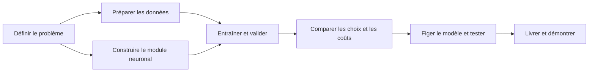

# MyTorch — Feuille de route

Créer, entraîner et justifier un réseau de neurones qui classe les positions
d’échecs en **Nothing · Check · Checkmate**. Cette liste couvre le développement,
les expériences, la documentation et la livraison dans le temps disponible.

**Légende :** ☑ réalisé, même en PR non fusionnée · ☐ restant ou à confirmer · ◇ optionnel.
Les cases suivent le travail réalisé ; la fusion et la livraison restent des étapes distinctes.

**Point au 4 novembre 2026 :** le nettoyage, les splits, les outils d’évaluation
et l’orchestration de `--train` sont fusionnés. La référence `chess-v1` est prête
et vérifiée en PR #24, encore non fusionnée. Gustave est proche de terminer le
moteur d’apprentissage (#5), selon le point d’équipe ; son intégration et sa
validation réelle restent à confirmer. La fermeture de #7 ne signifie pas que
l’apprentissage complet a déjà été validé.

## Vue d’ensemble

| Axe | État actuel | Prochain résultat attendu |
| --- | --- | --- |
| Problème et conception | Contrats d’entrée/sortie documentés | Justifier les choix liés à l’apprentissage |
| Données | Nettoyage/splits fusionnés ; référence `chess-v1` vérifiée en PR #24 | Fusionner la référence ; conserver les fichiers locaux |
| Module neuronal | Génération, sauvegarde, chargement et prédiction disponibles ; #5 presque terminé par Gustave | Finaliser, vérifier et intégrer le moteur d’apprentissage |
| Entraînement | Boucle, validation, arrêt anticipé, historique et sauvegarde implémentés | Valider le parcours avec le vrai moteur ; connecter le runner |
| Qualité des prédictions | Évaluateur, métriques et notebooks disponibles | Mesurer les modèles entraînés et comparer à la classe majoritaire |
| Expériences et coûts | Runner et protocole prêts ; entraînement non connecté | Lancer les comparaisons, mesurer les coûts et choisir un modèle |
| Documentation et livraison | Guides existants ; résultats à produire | Rapport reproductible et modèle entraîné |

## 1 · Problème et conception

- [x] Définir les caractéristiques FEN, l’ordre des classes et la prédiction.
- [x] Séparer le module neuronal C++ générique du traitement des échecs.
- [x] Documenter l’architecture et la répartition des responsabilités C++/Python.
- [ ] Justifier les activations, l’initialisation et la fonction de perte retenues.
- [x] Préciser les limites : classer une position ne signifie pas jouer aux échecs ;
      vérifier le format ne garantit ni la légalité ni la justesse du label.

**À présenter :** schéma du système et tableau choix → raison → compromis.

## 2 · Qualité et préparation des données

- [x] Réaliser le nettoyage et le découpage ; traiter les lignes invalides,
      les doublons et les conflits de labels. **Fusionné.**
- [x] Produire la provenance des positions, les rapports et les effectifs par classe.
- [x] Générer des fichiers train/validation/test reproductibles avec graine et empreinte d’entrée.
- [x] Vérifier l’absence d’entrées visibles par le modèle communes aux différents jeux.
- [x] Conserver les données brutes sans les modifier.
- [x] Figer `chess-v1` : manifeste, empreintes, effectifs, environnement et commandes
      de vérification/recréation ; reproduction des sept fichiers vérifiée. **PR #24.**
- [ ] Fusionner la PR #24 pour intégrer la référence aux expériences sur `main`.
- [x] Documenter les informations connues et signaler explicitement les origines,
      licences et droits d’utilisation externes inconnus.
- [ ] Retrouver ces informations externes si possible ; ne pas présenter les droits comme établis.
- [x] Décrire les effectifs, distributions et limites des labels dans le guide des données.
- [ ] Analyser les limites de l’échantillonnage et leurs effets sur les résultats réels.

| Train | Validation | Test |
| --- | --- | --- |
| Mettre à jour les poids | Choisir réglages, point de sauvegarde et modèle | Mesurer le modèle final après gel des choix |
| Équilibrage éventuel ici uniquement | Distribution d’origine | Distribution d’origine ; aucun réglage dessus |

**À présenter :** flux `brut → nettoyé → jeux séparés`, effectifs et rapport de préparation.

## 3 · Module neuronal et validité de l’entraînement

- [x] Générer des réseaux concrets ; initialiser, sauvegarder, charger et prédire.
- [x] Préparer et tester la fonction de sauvegarde vers le fichier source ou un autre fichier.
- [ ] Terminer la rétropropagation : perte/sortie compatibles, dérivées, gradients,
      mise à jour des poids/biais et rejet des paramètres invalides. **#5 : Gustave,
      presque terminé ; validation/fusion encore à confirmer.**
- [ ] Vérifier les gradients par différences finies et les mises à jour sur des valeurs connues.
- [ ] Montrer une baisse de perte sur un petit problème déterministe.
- [x] Implémenter l’orchestration de `--train` : époques, mini-lots, taux du modèle
      et ordre reproductible ; tests avec méthodes neuronales de substitution.
- [ ] Intégrer les vrais calculs `trainBatch` et `loss` de #5 et vérifier leur contrat.
- [ ] Vérifier le parcours complet d’entraînement : deux modes de sauvegarde,
      rechargement du modèle entraîné et diagnostics d’erreur.

**À présenter :** vérifications des calculs et démonstration générer → entraîner → sauvegarder → recharger.

## 4 · Apprentissage et surapprentissage

- [x] Exporter les pertes train/validation par époque en CSV ; proposer un historique
      automatique par exécution ou un chemin explicite sans écrasement.
- [x] Séparer les calculs de validation des mises à jour dans la boucle d’entraînement.
- [x] Implémenter l’arrêt anticipé sur validation et restaurer la meilleure sauvegarde,
      y compris le modèle initial si aucune époque ne l’améliore.
- [x] Définir les paramètres de la commande : 100 époques, mini-lots de 32,
      patience 10, amélioration minimale 0,0001 ; pertes moyennes après chaque époque.
- [ ] Vérifier ces comportements avec le vrai moteur, notamment l’absence de mise
      à jour pendant la validation, puis fixer le budget commun des expériences.
- [ ] Produire les courbes réelles ; relever les métriques de validation et les temps
      d’entraînement avec le runner et les outils d’évaluation.
- [ ] Examiner les problèmes réellement observés : divergence, stagnation, instabilité ou classe unique prédite.

**À présenter :** courbes train/validation avec meilleure époque et époque d’arrêt.
Le découpage aide à détecter le surapprentissage ; l’arrêt et la restauration agissent dessus.

## 5 · Qualité des prédictions

| Mesure | Ce qu’elle indique |
| --- | --- |
| Exactitude globale — accuracy | Proportion de positions correctement classées |
| Précision / rappel / F1 par classe | Fausses alertes, cas manqués et qualité par classe |
| Macro-F1 | Moyenne des F1 donnant le même poids aux trois classes |
| Effectifs et matrice de confusion | Nombre d’exemples et nature des erreurs |

- [x] Créer le script d’évaluation ; vérifier les métriques sur des exemples calculés à la main.
- [x] Rejeter les prédictions manquantes/en trop, les classes inconnues et les exécutions échouées.
- [ ] Comparer à une référence prédisant toujours la classe majoritaire du train.
- [x] Fournir les exports numériques, la matrice de confusion et les notebooks
      d’inspection/comparaison ; fonctionnement testé, sans résultat d’apprentissage livré.
- [ ] Générer les rapports et graphiques des vrais modèles entraînés.
- [ ] Examiner des erreurs représentatives ; distinguer observations et hypothèses.

**À présenter :** tableau référence/modèle, matrice de confusion et quelques erreurs expliquées.
Sélectionner sur la macro-F1 de validation ; fixer les critères de départage avant comparaison.
L’accuracy seule peut masquer l’échec sur une classe minoritaire.

## 6 · Hyperparamètres, alternatives et coûts

Conserver les mêmes données et règles de comparaison. Changer d’abord un facteur
à la fois et enregistrer tous les essais, y compris les échecs. Fixer un budget
avant les expériences ; répéter les finalistes avec plusieurs graines si possible.

- [x] Préparer le runner configuration × graine, les manifestes d’exécution et
      le protocole de comparaison sur validation ; réserver test au modèle final.
- [ ] Connecter le vrai `--train` au runner via un adaptateur qui valide et applique
      les réglages de `training.json` ; renseigner commande et paramètres dans la configuration.
- [ ] Fixer une petite grille justifiée, le budget et la règle de sélection du modèle.
- [ ] Exécuter les comparaisons ci-dessous et conserver les résultats, y compris les échecs.

| Comparaison | Expérience minimale utile | À relever |
| --- | --- | --- |
| Architecture | Réseau de référence contre un réseau plus petit | Couches, activations, paramètres, qualité en validation |
| Réglages d’apprentissage | Quelques taux d’apprentissage ; tailles de lots si disponibles | Courbes, stabilité, époques, qualité en validation |
| Alternative concrète | Train original contre train équilibré | Rappel par classe, macro-F1, surcoût, décision motivée |
| Coût d’entraînement | Même matériel et règle d’arrêt déclarée | Temps total/par époque, exemples traités, environnement et graines |
| Coût de prédiction | Même fichier ; mesures courtes répétées | Temps médian, positions/seconde, inclusion du chargement et du décodage FEN |
| Taille du modèle | Comparaison des candidats | Nombre de paramètres, taille du fichier ; mémoire si mesurée |

**À présenter :** tableau comparatif et graphique qualité/coût ; expliquer le compromis retenu.
Répéter des positions augmente le travail par époque : comparer aussi le temps et
les exemples traités. Un résultat négatif mesuré permet également de justifier un choix.

## 7 · Journal d’expériences et documentation

- [x] Fournir les manifestes du runner : commandes, réglages, graines, empreintes,
      environnement, états des exécutions, modèles et résultats disponibles.
- [ ] Utiliser ces manifestes pour les vrais entraînements ; compléter la révision
      du projet et les informations d’arrêt/sélection nécessaires à leur reproduction.
- [ ] Ajouter le logger partagé génération/entraînement (#13) ; l’historique CSV
      de pertes existe déjà et ne remplace pas ce journal.
- [ ] Conserver les valeurs derrière les graphiques ; indiquer axes, unités et expériences.
- [ ] Tenir un journal court des problèmes et décisions significatifs :

| Exécution / observation | Hypothèse | Vérification ou changement | Avant → après | Décision / limite |
| --- | --- | --- | --- | --- |
| À remplir pendant les expériences | Cause supposée | Investigation contrôlée | Mesures obtenues | Conserver, rejeter ou approfondir |

| Document | Déjà disponible | À compléter |
| --- | --- | --- |
| Guide des données | Guide consolidé ; référence, effectifs et limites documentés en PR #24 | Origines/droits inconnus à clarifier si possible ; limites observées |
| Guide d’entraînement | Commande, contrat neuronal, réglages, arrêt, historique et sauvegarde documentés | Confirmer le contrat avec #5 et vérifier les commandes avec le vrai moteur |
| Guide d’évaluation | Runner, notebooks et protocole de comparaison disponibles | Brancher l’entraînement et renseigner les expériences réelles |
| Rapport d’expériences | À produire | Essais, courbes, coûts, alternatives, problèmes et choix final |
| README | Compilation, génération, prédiction et liens vers les guides | Usage validé de l’entraînement, modèle livré et liens vers les résultats |

## 8 · Modèle final et soutenance

- [ ] Sélectionner sur validation, figer les réglages, puis évaluer le modèle final sur test.
- [ ] Livrer et pousser un modèle entraîné nommé `my_torch_network…`.
- [ ] Vérifier que le fichier livré se charge et prédit une classe par entrée, dans l’ordre.
- [ ] Conserver scripts, configurations, commandes et données d’entraînement pour la reproduction.
- [ ] Démontrer l’indépendance du module, la génération, l’entraînement, la sauvegarde et la prédiction.
- [ ] Justifier les choix par des mesures, avec les limites et les essais infructueux.

**Preuves attendues :** modèle fonctionnel, commandes reproductibles, résultats
chiffrés, graphiques lisibles et compromis justifiés. Le barème fourni décrit un
état passé : démontrer l’état actuel sans présenter du travail prévu comme réalisé.

## Ordre de travail avant le rendu

| Quand | Priorité |
| --- | --- |
| Maintenant, #5 proche de la fin | Fusionner #24 ; préparer l’adaptateur du runner et la grille d’essai ; avancer #13 en parallèle |
| À la livraison de #5 | Vérifier les calculs et une baisse de perte ; tester `--train`, les sauvegardes et le rechargement avec le vrai moteur |
| Dès que le parcours complet fonctionne | Connecter le runner ; entraîner une référence et examiner courbes, arrêt et comparaison à la classe majoritaire |
| Après une référence stable | Comparer quelques architectures/réglages et une alternative concrète |
| Dernière passe | Figer le modèle, mesurer qualité/coûts finaux, terminer le rapport et vérifier les livrables |

**◇ Après l’essentiel uniquement :** parallélisation, recherches plus larges,
optimiseurs supplémentaires, calibration ou classes supplémentaires. Priorité à
un modèle entraîné fonctionnel, documenté et reproductible.

Fondations existantes : [architecture](architecture.md),
[contrat d’entrée](datasets.md), [contrat de sortie](output-encoding.md).
