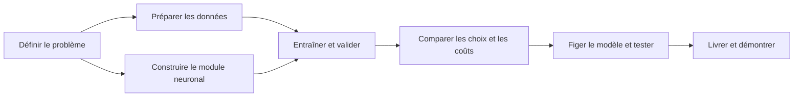

# MyTorch — Feuille de route

Créer, entraîner et justifier un réseau de neurones qui classe les positions
d’échecs en **Nothing · Check · Checkmate**. Cette liste couvre le développement,
les expériences, la documentation et la livraison dans le temps disponible.

**Légende :** ☑ réalisé, même en PR non fusionnée · ☐ restant ou à confirmer · ◇ optionnel.
Les cases suivent le travail réalisé ; la fusion et la livraison restent des étapes distinctes.

**Point au 7 novembre 2026 :** génération, sauvegarde, rechargement,
rétropropagation, entraînement et runner `builtin` sont disponibles. La branche
`feat/experiment-progress` ajoute la progression des expériences en direct et
le résumé de `--predict` avec accuracy sur les positions labellisées.
Une référence entraînée et sa continuation disposent de résultats locaux :
macro-F1 de validation **72,28 % → 81,96 %**, et **81,49 % sur test** pour le
checkpoint retenu à l’époque totale 338. Ce sont deux checkpoints du même réseau,
pas une comparaison d’architectures. Les benchmarks CPU BLAS sont versionnés ;
les modèles et résultats d’entraînement restent locaux et ignorés par Git.
Les priorités sont les comparaisons contrôlées, leur synthèse et la livraison.

## Vue d’ensemble

| Axe | État actuel | Prochain résultat attendu |
| --- | --- | --- |
| Problème et conception | Contrats d’entrée/sortie documentés | Justifier les choix liés à l’apprentissage |
| Données | Nettoyage/splits et référence `chess-v1` fusionnés et vérifiés | Conserver les fichiers locaux pour les expériences |
| Module neuronal | Génération, sauvegarde, chargement, prédiction et rétropropagation disponibles | Mesurer et optimiser les entraînements complets |
| Entraînement | Runner connecté au vrai moteur ; arrêt anticipé, continuation et progression disponibles | Comparer les réglages à budget commun |
| Qualité des prédictions | Référence évaluée en validation et sur test ; métriques par classe disponibles localement | Comparer au diagnostic majoritaire et analyser les erreurs |
| Expériences et coûts | Continuation mesurée ; benchmark BLAS reproductible et versionné | Comparer architectures, learning rates et tailles de lots |
| Documentation et livraison | Guides, CI et preuves locales disponibles | Versionner les preuves retenues et livrer le modèle final |

## 1 · Problème et conception

- [x] Définir les caractéristiques FEN, l’ordre des classes et la prédiction.
- [x] Séparer le module neuronal C++ générique du traitement des échecs.
- [x] Documenter l’architecture et la répartition des responsabilités C++/Python.
- [ ] Justifier les activations, l’initialisation et la fonction de perte retenues.
- [x] Préciser les limites : classer une position ne signifie pas jouer aux échecs ;
      vérifier le format ne garantit ni la légalité ni la justesse du label.

**À présenter :** schéma du système et tableau choix → raison → compromis.

## 2 · Qualité et préparation des données

- [x] Réaliser le nettoyage et le découpage ; traiter les lignes invalides,
      les doublons et les conflits de labels. **Fusionné.**
- [x] Produire la provenance des positions, les rapports et les effectifs par classe.
- [x] Générer des fichiers train/validation/test reproductibles avec graine et empreinte d’entrée.
- [x] Vérifier l’absence d’entrées visibles par le modèle communes aux différents jeux.
- [x] Conserver les données brutes sans les modifier.
- [x] Figer `chess-v1` : manifeste, empreintes, effectifs, environnement et commandes
      de vérification/recréation ; reproduction des sept fichiers vérifiée. **PR #24.**
- [x] Fusionner la PR #24 pour intégrer la référence aux expériences sur `main`.
- [x] Documenter les informations connues et signaler explicitement les origines,
      licences et droits d’utilisation externes inconnus.
- [ ] Retrouver ces informations externes si possible ; ne pas présenter les droits comme établis.
- [x] Décrire les effectifs, distributions et limites des labels dans le guide des données.
- [x] Fournir le notebook d’analyse des distributions, de la couverture et des raccourcis
      statistiques (classe majoritaire et règles simples ajustées sur train).
- [ ] Relier ces observations aux erreurs du modèle et documenter les limites de généralisation.

| Train | Validation | Test |
| --- | --- | --- |
| Mettre à jour les poids | Choisir réglages, point de sauvegarde et modèle | Mesurer le modèle final après gel des choix |
| Équilibrage éventuel ici uniquement | Distribution d’origine | Distribution d’origine ; aucun réglage dessus |

**À présenter :** flux `brut → nettoyé → jeux séparés`, effectifs et rapport de préparation.

## 3 · Module neuronal et validité de l’entraînement

- [x] Générer des réseaux concrets ; initialiser, sauvegarder, charger et prédire.
- [x] Préparer et tester la fonction de sauvegarde vers le fichier source ou un autre fichier.
- [x] Terminer la rétropropagation : perte/sortie compatibles, dérivées, gradients,
      mise à jour des poids/biais et rejet des paramètres invalides.
- [x] Vérifier les gradients par différences finies et les mises à jour sur des valeurs connues.
- [x] Montrer une baisse de perte sur un petit problème déterministe.
- [x] Implémenter l’orchestration de `--train` : époques, mini-lots, taux du modèle
      et ordre reproductible ; tests avec méthodes neuronales de substitution.
- [x] Intégrer les vrais calculs `trainBatch` et `loss` de #5 et vérifier leur contrat.
- [x] Vérifier le parcours complet d’entraînement : deux modes de sauvegarde,
      rechargement du modèle entraîné et diagnostics d’erreur.

**À présenter :** vérifications des calculs et démonstration générer → entraîner → sauvegarder → recharger.

## 4 · Apprentissage et surapprentissage

- [x] Exporter les pertes train/validation par époque en CSV ; proposer un historique
      automatique par exécution ou un chemin explicite sans écrasement.
- [x] Séparer les calculs de validation des mises à jour dans la boucle d’entraînement.
- [x] Implémenter l’arrêt anticipé sur validation et restaurer la meilleure sauvegarde,
      y compris le modèle initial si aucune époque ne l’améliore.
- [x] Définir les paramètres de la commande : 100 époques, mini-lots de 32,
      patience 10, amélioration minimale 0,0001 ; pertes moyennes après chaque époque.
- [x] Vérifier le parcours CLI avec le vrai moteur et l’exclusion de la validation
      des mises à jour dans les tests de la boucle.
- [ ] Fixer le budget commun des expériences.
- [x] Conserver les historiques réels, les métriques de validation et le temps de
      continuation ; les notebooks permettent de tracer les courbes.
- [ ] Préparer les courbes retenues pour la défense avec meilleure époque, arrêt, axes et unités.
- [x] Mesurer le gain de la continuation et identifier les confusions entre classes.
- [ ] Diagnostiquer les essais compacts interrompus/échoués avant de les relancer ;
      conserver leurs traces et distinguer problème d’exécution et problème d’apprentissage.
      Le manifeste de `2026-11-07-compact-blas-01` signale un exécutable analyzer
      modifié pendant l’expérience : relancer avec un binaire figé dans un nouveau dossier.

**À présenter :** courbes train/validation avec meilleure époque et époque d’arrêt.
Le découpage aide à détecter le surapprentissage ; l’arrêt et la restauration agissent dessus.

## 5 · Qualité des prédictions

| Mesure | Ce qu’elle indique |
| --- | --- |
| Exactitude globale — accuracy | Proportion de positions correctement classées |
| Précision / rappel / F1 par classe | Fausses alertes, cas manqués et qualité par classe |
| Macro-F1 | Moyenne des F1 donnant le même poids aux trois classes |
| Effectifs et matrice de confusion | Nombre d’exemples et nature des erreurs |

- [x] Créer le script d’évaluation ; vérifier les métriques sur des exemples calculés à la main.
- [x] Rejeter les prédictions manquantes/en trop, les classes inconnues et les exécutions échouées.
- [x] Implémenter le diagnostic majoritaire ajusté sur train dans le notebook de données.
- [ ] Présenter côte à côte ses scores et ceux du modèle sur la même validation.
- [x] Fournir les exports numériques, la matrice de confusion et les notebooks
      d’inspection/comparaison ; évaluations réelles disponibles localement.
- [x] Évaluer la référence continuée : macro-F1 validation 81,96 %, test 81,49 %.
- [x] Afficher avec `--predict` le nombre de positions, de labels, de bonnes réponses
      et l’accuracy sur les seules positions labellisées.
- [ ] Versionner une synthèse des modèles entraînés et les graphiques nécessaires à la défense.
- [ ] Examiner des erreurs représentatives ; distinguer observations et hypothèses.

**À présenter :** tableau référence/modèle, matrice de confusion et quelques erreurs expliquées.
Sélectionner sur la macro-F1 de validation ; fixer les critères de départage avant comparaison.
L’accuracy seule peut masquer l’échec sur une classe minoritaire.

## 6 · Hyperparamètres, alternatives et coûts

Conserver les mêmes données et règles de comparaison. Changer d’abord un facteur
à la fois et enregistrer tous les essais, y compris les échecs. Fixer un budget
avant les expériences ; répéter les finalistes avec plusieurs graines si possible.

- [x] Préparer le runner configuration × graine, les manifestes d’exécution et
      le protocole de comparaison sur validation ; réserver test au modèle final.
- [x] Connecter le vrai `--train` au runner `builtin`, avec validation des réglages
      et enregistrement de la commande réellement exécutée.
- [x] Afficher en direct l’essai courant, les époques, les pertes, leur durée
      et les étapes d’évaluation, tout en conservant `training.log`.
- [x] Comparer le moteur CPU initial au moteur BLAS avec contrôle numérique :
      gain mesuré de 1,72× sur le dataset complet avec un thread.
- [x] Mesurer 1/2/4/8 threads sur un sous-ensemble ; conserver les mesures
      même quand davantage de threads ralentissent le calcul.
- [ ] Comparer quelques learning rates, puis deux tailles de lots, à protocole commun.
- [ ] Comparer compact/référence depuis des initialisations neuves et répéter
      les finalistes sur plusieurs graines. Le protocole existant utilise encore
      100 époques/patience 10 ; harmoniser son budget avant la campagne.
- [ ] Fixer une petite grille justifiée, le budget et la règle de sélection du modèle.
- [ ] Exécuter les comparaisons ci-dessous et conserver les résultats, y compris les échecs.

| Comparaison | Expérience minimale utile | À relever |
| --- | --- | --- |
| Architecture | Réseau de référence contre un réseau plus petit | Couches, activations, paramètres, qualité en validation |
| Réglages d’apprentissage | Quelques taux d’apprentissage, puis deux tailles de lots | Courbes, stabilité, époques, qualité en validation |
| Alternative concrète | Moteur initial contre BLAS : mesures disponibles ; équilibrage du train en complément si utile | Vitesse, équivalence numérique ; qualité par classe pour l’équilibrage |
| Coût d’entraînement | Même matériel et règle d’arrêt déclarée | Temps total/par époque, exemples traités, environnement et graines |
| Coût de prédiction | Même fichier ; mesures courtes répétées | Temps médian, positions/seconde, inclusion du chargement et du décodage FEN |
| Taille du modèle | Comparaison des candidats | Nombre de paramètres, taille du fichier ; mémoire si mesurée |

**À présenter :** tableau comparatif et graphique qualité/coût ; expliquer le compromis retenu.
Répéter des positions augmente le travail par époque : comparer aussi le temps et
les exemples traités. Un résultat négatif mesuré permet également de justifier un choix.

## 7 · Journal d’expériences et documentation

- [x] Fournir les manifestes du runner : commandes, réglages, graines, empreintes,
      environnement, états des exécutions, modèles et résultats disponibles.
- [x] Utiliser les manifestes pour les vrais entraînements, avec révision Git,
      état du checkout et informations d’arrêt/sélection.
- [ ] Lancer les prochaines comparaisons depuis un état Git propre et publié ;
      ne pas reconstruire des métadonnées historiques manquantes par supposition.
- [x] Ajouter le logger partagé génération/entraînement (#13) ; l’historique CSV
      de pertes existe déjà et ne remplace pas ce journal ([journaux](logging.md)).
- [x] Versionner les mesures brutes, environnements et figures du benchmark BLAS.
- [ ] Publier de la même manière les preuves d’apprentissage retenues, sans copier
      les datasets dans les résultats ; indiquer axes, unités et expériences.
- [ ] Tenir un journal court des problèmes et décisions significatifs :

| Exécution / observation | Hypothèse | Vérification ou changement | Avant → après | Décision / limite |
| --- | --- | --- | --- | --- |
| À remplir pendant les expériences | Cause supposée | Investigation contrôlée | Mesures obtenues | Conserver, rejeter ou approfondir |

| Document | Déjà disponible | À compléter |
| --- | --- | --- |
| Guide des données | Guide consolidé ; référence, effectifs et limites documentés en PR #24 | Origines/droits inconnus à clarifier si possible ; limites observées |
| Guide d’entraînement | [Guide unifié](training.md) : commande, boucle, rétropropagation et intégration | Réglages retenus et résultats |
| Guide d’évaluation | Runner connecté, notebooks et métriques réelles locales | Synthétiser les comparaisons contrôlées |
| Rapport d’expériences | Rapport de référence local ; benchmark BLAS versionné | Publier essais, courbes, coûts, problèmes et choix final |
| README | Compilation, génération, prédiction et liens vers les guides | Modèle livré et liens vers les résultats |

## 8 · Modèle final et soutenance

- [x] Évaluer sur test le checkpoint de référence à l’époque 338.
- [ ] Figer les réglages finaux et la règle de sélection avant leur évaluation finale.
      Le score de test de la référence est déjà connu : ne pas présenter ce jeu
      comme un nouvel échantillon aveugle pour les prochaines expériences.
- [ ] Livrer et pousser un modèle entraîné nommé `my_torch_network…`.
- [ ] Vérifier que le fichier livré se charge et prédit une classe par entrée, dans l’ordre.
- [ ] Préparer les éléments de reproduction : scripts, configurations, commandes,
      empreintes et accès aux données ; conserver les datasets hors des résultats.
- [ ] Sélectionner explicitement les modèles et preuves à publier : `models/` et
      `results/` sont ignorés par Git. Vérifier la livraison depuis un checkout neuf.
- [x] Disposer d’une CI de compilation/tests et du miroir Epitech après validation sur `main`.
- [ ] Ajouter une vérification explicite du moteur OpenBLAS à la CI, en complément
      du moteur sans BLAS ; ne pas supposer le chemin accéléré couvert.
- [ ] Préparer une courte démonstration reproductible : générer, entraîner,
      sauvegarder, recharger, prédire ; créer une release si utile pour les livrables.
- [ ] Démontrer l’indépendance du module, la génération, l’entraînement, la sauvegarde et la prédiction.
- [ ] Justifier les choix par des mesures, avec les limites et les essais infructueux.

**Preuves attendues :** modèle fonctionnel, commandes reproductibles, résultats
chiffrés, graphiques lisibles et compromis justifiés. Le barème fourni décrit un
état passé : démontrer l’état actuel sans présenter du travail prévu comme réalisé.

## Ordre de travail avant le rendu

| Quand | Priorité |
| --- | --- |
| Maintenant | Vérifier les échecs compacts ; fixer les budgets et grilles learning rate/batch/architectures ; compléter la CI BLAS |
| Ensuite | Exécuter les comparaisons sur validation ; conserver les échecs ; répéter les finalistes sur plusieurs graines |
| Après les mesures | Synthétiser qualité/coût, courbes de surapprentissage, références simples et justification des choix |
| Dernière passe | Figer le modèle, publier les preuves et le modèle retenus, vérifier la livraison et répéter la démonstration |

**◇ Après l’essentiel uniquement :** recherches plus larges, optimiseurs
supplémentaires, calibration ou changement d’encodage. Ne pas refaire les 777
entrées sans hypothèse mesurable et budget de réentraînement.

Preuve versionnée : [benchmark CPU BLAS](../benchmarks/cpu_blas/results/linux-2026-11-07/README.md).
Preuves locales à conserver et sélectionner pour publication :
`results/training/2026-11-07-continue-reference-01/`,
`results/evaluation/2026-11-07-reference-test-01/`, `docs/report/` et les modèles.
Les états des essais dans les manifestes décrivent la dernière trace enregistrée ;
ils ne prouvent pas à eux seuls qu’un processus tourne encore.

Fondations existantes : [architecture](architecture.md),
[contrat d’entrée](datasets.md), [contrat de sortie](output-encoding.md).
