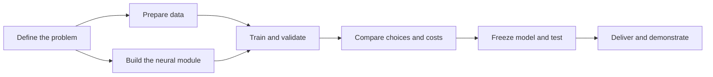

# MyTorch — Project roadmap

Build, train, and justify a neural network that classifies chess positions as
**Nothing · Check · Checkmate**. This checklist covers implementation,
experiments, documentation, and delivery within the project deadline.

**Reading key:** ☑ available · ☐ to complete or verify · ◇ optional.
An implemented feature still needs evidence in the final demonstration.

## At a glance

| Axis | Current position | Next outcome |
| --- | --- | --- |
| Problem and design | Input/output contracts documented | Explain choices and limits |
| Data | Cleaning and splitting prepared in separate PRs | Integrate and freeze reference datasets |
| Neural module | Generation, save/load, and prediction available | Finish and verify backpropagation |
| Training | CLI integration incomplete | Train, validate, stop, and save a usable model |
| Prediction quality | Prediction CLI available | Metrics, baseline, confusion matrix |
| Experiments and costs | Comparisons pending | Measured architecture and training choices |
| Documentation and delivery | Guides available; results pending | Reproducible report and trained model |

## 1 · Problem and design

- [x] Define FEN features, class order, and prediction behavior.
- [x] Separate the generic C++ neural module from chess-specific processing.
- [ ] Explain architecture, language split, activations, initialization, and loss.
- [ ] State limits: position classification is not a chess-playing engine;
      format validation does not establish chess legality or label correctness.

**Show:** a system diagram and a short decision table: choice → reason → tradeoff.

## 2 · Data quality and preparation

- [ ] Integrate cleaning/splitting; inspect malformed rows, duplicates, and conflicts.
- [ ] Record sources, permission/license information, and counts by class.
- [ ] Freeze reproducible train/validation/test files; retain seed and input hashes.
- [ ] Verify no identical model-visible inputs occur across splits.
- [ ] Preserve raw data and explain sampling, label, and class-distribution limits.

| Train | Validation | Test |
| --- | --- | --- |
| Update weights | Choose settings, checkpoint, and model | Final measurement after choices are frozen |
| Optional balancing here only | Original distribution | Original distribution; no tuning |

**Show:** data flow `raw → cleaned → splits`, class-count table, preparation report.

## 3 · Neural module and training correctness

- [x] Generate concrete networks; initialize, save, load, and predict.
- [ ] Complete backpropagation: compatible loss/output, derivatives, gradients,
      weight/bias updates, and invalid-parameter checks.
- [ ] Check gradients with finite differences and updates against known values.
- [ ] Demonstrate decreasing loss on a small deterministic learning problem.
- [ ] Connect `--train`: epochs, batch size, learning rate, seeded sample order.
- [ ] Verify both save modes, reloadable trained models, and failure diagnostics.

**Show:** meaningful correctness checks and a generate → train → save → reload demo.

## 4 · Learning behavior and overfitting

- [ ] Save per-epoch train/validation loss, classification metrics, and elapsed time.
- [ ] Keep validation inference separate from gradient updates.
- [ ] Implement validation-based early stopping and restore the best checkpoint.
- [ ] Declare maximum epochs, patience, minimum improvement, and loss aggregation.
- [ ] Inspect divergence, stagnation, instability, or class collapse if observed.

**Show:** train/validation curves with best and stopping epochs marked.
Splitting helps detect overfitting; stopping/restoration provides active control.

## 5 · Prediction quality

| Measure | What it tells us |
| --- | --- |
| Accuracy | Fraction of all positions classified correctly |
| Precision / recall / F1 per class | False alarms, missed cases, and class-level quality |
| Macro-F1 | Equal-weight summary across the three classes |
| Class counts and confusion matrix | Evidence size and the mistakes being made |

- [ ] Build the evaluator; verify metrics on hand-computed examples.
- [ ] Reject missing/extra predictions, unknown classes, and failed processes.
- [ ] Compare with an always-majority-class baseline defined from train data.
- [ ] Export numerical results and a readable confusion matrix.
- [ ] Inspect representative errors; distinguish observations from hypotheses.

**Show:** baseline/model table, confusion matrix, and a few explained mistakes.
Use validation macro-F1 to select models; declare tie-breakers before comparing.
Accuracy alone can hide failure on a minority class.

## 6 · Hyperparameters, alternatives, and costs

Keep datasets and comparison rules fixed. Change one factor at a time initially;
record every attempted setting, including failed runs. Limit the experiment
budget before starting and repeat finalists with several seeds if time permits.

| Comparison | Minimum useful experiment | Record |
| --- | --- | --- |
| Model architecture | Reference versus one smaller network | Layer widths, activations, parameter count, validation quality |
| Learning settings | Small learning-rate comparison; batch sizes if supported | Loss curves, stability, epochs, validation quality |
| Practical alternative | Original versus balanced training data | Per-class recall, macro-F1, extra computation, accept/reject decision |
| Training cost | Same hardware and declared stopping policy | Total/epoch time, processed samples, environment and seeds |
| Prediction cost | Same input file; repeat short timings | Median runtime, positions/second, inclusion of loading/parsing |
| Model footprint | Compare candidate models | Parameter count and saved file size; memory only if measured |

**Show:** comparison table and quality-versus-cost chart; explain the selected
compromise. Repeated training rows change work per epoch: compare processed
samples and time too. A measured negative result is a useful decision.

## 7 · Experiment journal and documentation

- [ ] Keep a run manifest: commit, commands, settings, seeds, data hashes,
      environment, stopping policy, checkpoint, and artifact locations.
- [ ] Retain numerical histories behind charts; label axes, units, and runs.
- [ ] Keep a brief journal for meaningful problems and decisions:

| Run / observation | Hypothesis | Check or change | Before → after | Decision / limit |
| --- | --- | --- | --- | --- |
| Fill from actual experiments | Suspected cause | Controlled investigation | Measured evidence | Keep, reject, or investigate |

**Documents to finish:**

| Document | Content |
| --- | --- |
| Data guide | Sources, preparation, distributions, permissions, limits |
| Training guide | Working command, settings, loss, updates, stopping and saving |
| Experiment report | Protocol, tried settings, curves, costs, alternatives, problems, final rationale |
| README | Build, train/predict entry points, delivered model, links to detailed guides |

## 8 · Final model and defense

- [ ] Select on validation, freeze settings, then evaluate the final model on test.
- [ ] Deliver and push a trained model named `my_torch_network…`.
- [ ] Verify the exact delivered file loads and predicts one class per input in order.
- [ ] Preserve scripts, configurations, commands, and training data for reproduction.
- [ ] Demonstrate module independence, generation, training, save/load, and prediction.
- [ ] Explain choices using measurements, including limits and unsuccessful attempts.

**Defense evidence:** working model + reproducible commands + numerical results
+ readable charts + justified tradeoffs. The earlier assessment describes a
past state; demonstrate current behavior without claiming credit for planned work.

## Execution order before the deadline

| When | Focus |
| --- | --- |
| Now, while backpropagation is pending | Integrate data work; prepare evaluator, baseline, result format, and experiment settings |
| Once training works | Run a small correctness case, then a reference chess model; inspect curves and stopping |
| After a stable reference | Compare a bounded set of architectures/settings and one practical alternative |
| Final pass | Freeze model, measure test quality/costs, finish report, verify delivered artifacts |

**◇ Only after the essentials:** parallel training, larger searches, additional
optimizers, calibration, or extra chess classes. Do not sacrifice a working,
documented, reproducible trained model for optional features.

Existing foundations: [architecture](architecture.md),
[input contract](data-encoding.md), [output contract](output-encoding.md).
