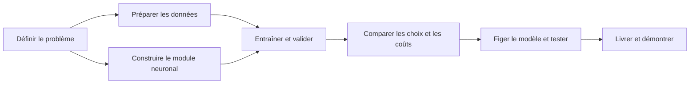

# MyTorch — Feuille de route

Créer, entraîner et justifier un réseau de neurones qui classe les positions
d’échecs en **Nothing · Check · Checkmate**. Cette liste couvre le développement,
les expériences, la documentation et la livraison dans le temps disponible.

**Légende :** ☑ réalisé, même en PR non fusionnée · ☐ restant ou à confirmer · ◇ optionnel.
Les cases suivent le travail réalisé ; la fusion et la livraison restent des étapes distinctes.

## Vue d’ensemble

| Axe | État actuel | Prochain résultat attendu |
| --- | --- | --- |
| Problème et conception | Contrats d’entrée/sortie documentés | Justifier les choix liés à l’apprentissage |
| Données | Nettoyage, découpage et rapports réalisés ; PR ouvertes | Fusionner et figer les données de référence |
| Module neuronal | Génération, sauvegarde, chargement, prédiction et rétropropagation disponibles | Accélérer l’entraînement si nécessaire |
| Entraînement | Commande `--train` fonctionnelle de bout en bout | Entraîner le modèle de référence sur les données complètes |
| Qualité des prédictions | Commande de prédiction disponible | Métriques, référence et matrice de confusion |
| Expériences et coûts | Comparaisons à réaliser | Mesurer les compromis et choisir un modèle |
| Documentation et livraison | Guides existants ; résultats à produire | Rapport reproductible et modèle entraîné |

## 1 · Problème et conception

- [x] Définir les caractéristiques FEN, l’ordre des classes et la prédiction.
- [x] Séparer le module neuronal C++ générique du traitement des échecs.
- [x] Documenter l’architecture et la répartition des responsabilités C++/Python.
- [ ] Justifier les activations, l’initialisation et la fonction de perte retenues.
- [x] Préciser les limites : classer une position ne signifie pas jouer aux échecs ;
      vérifier le format ne garantit ni la légalité ni la justesse du label.

**À présenter :** schéma du système et tableau choix → raison → compromis.

## 2 · Qualité et préparation des données

- [x] Réaliser le nettoyage et le découpage ; traiter les lignes invalides,
      les doublons et les conflits de labels. **Prêt en PR, non fusionné.**
- [x] Produire la provenance des positions, les rapports et les effectifs par classe.
- [x] Générer des fichiers train/validation/test reproductibles avec graine et empreinte d’entrée.
- [x] Vérifier l’absence d’entrées visibles par le modèle communes aux différents jeux.
- [x] Conserver les données brutes sans les modifier.
- [ ] Fusionner les travaux et figer les jeux de référence pour les expériences.
- [ ] Documenter l’origine externe des données, leurs licences et droits d’utilisation.
- [ ] Expliquer les limites des labels, de l’échantillonnage et de la distribution des classes.

| Train | Validation | Test |
| --- | --- | --- |
| Mettre à jour les poids | Choisir réglages, point de sauvegarde et modèle | Mesurer le modèle final après gel des choix |
| Équilibrage éventuel ici uniquement | Distribution d’origine | Distribution d’origine ; aucun réglage dessus |

**À présenter :** flux `brut → nettoyé → jeux séparés`, effectifs et rapport de préparation.

## 3 · Module neuronal et validité de l’entraînement

- [x] Générer des réseaux concrets ; initialiser, sauvegarder, charger et prédire.
- [x] Préparer et tester la fonction de sauvegarde vers le fichier source ou un autre fichier.
- [x] Terminer la rétropropagation : perte/sortie compatibles, dérivées, gradients,
      mise à jour des poids/biais et rejet des paramètres invalides.
- [x] Vérifier les gradients par différences finies et les mises à jour sur des valeurs connues.
- [x] Montrer une baisse de perte sur un petit problème déterministe.
- [ ] Brancher `--train` : époques, taille des lots, taux d’apprentissage et ordre reproductible.
- [ ] Vérifier le parcours complet d’entraînement : deux modes de sauvegarde,
      rechargement du modèle entraîné et diagnostics d’erreur.

**À présenter :** vérifications des calculs et démonstration générer → entraîner → sauvegarder → recharger.

## 4 · Apprentissage et surapprentissage

- [ ] Enregistrer par époque les pertes train/validation, les métriques et le temps écoulé.
- [x] Garantir que la validation ne met jamais à jour les poids.
- [ ] Implémenter l’arrêt anticipé sur validation et restaurer la meilleure sauvegarde.
- [ ] Fixer le nombre maximal d’époques, la patience, l’amélioration minimale et le calcul de la perte moyenne.
- [ ] Examiner les problèmes réellement observés : divergence, stagnation, instabilité ou classe unique prédite.

**À présenter :** courbes train/validation avec meilleure époque et époque d’arrêt.
Le découpage aide à détecter le surapprentissage ; l’arrêt et la restauration agissent dessus.

## 5 · Qualité des prédictions

| Mesure | Ce qu’elle indique |
| --- | --- |
| Exactitude globale — accuracy | Proportion de positions correctement classées |
| Précision / rappel / F1 par classe | Fausses alertes, cas manqués et qualité par classe |
| Macro-F1 | Moyenne des F1 donnant le même poids aux trois classes |
| Effectifs et matrice de confusion | Nombre d’exemples et nature des erreurs |

- [ ] Créer le script d’évaluation ; vérifier les métriques sur des exemples calculés à la main.
- [ ] Rejeter les prédictions manquantes/en trop, les classes inconnues et les exécutions échouées.
- [ ] Comparer à une référence prédisant toujours la classe majoritaire du train.
- [ ] Exporter les résultats numériques et une matrice de confusion lisible.
- [ ] Examiner des erreurs représentatives ; distinguer observations et hypothèses.

**À présenter :** tableau référence/modèle, matrice de confusion et quelques erreurs expliquées.
Sélectionner sur la macro-F1 de validation ; fixer les critères de départage avant comparaison.
L’accuracy seule peut masquer l’échec sur une classe minoritaire.

## 6 · Hyperparamètres, alternatives et coûts

Conserver les mêmes données et règles de comparaison. Changer d’abord un facteur
à la fois et enregistrer tous les essais, y compris les échecs. Fixer un budget
avant les expériences ; répéter les finalistes avec plusieurs graines si possible.

| Comparaison | Expérience minimale utile | À relever |
| --- | --- | --- |
| Architecture | Réseau de référence contre un réseau plus petit | Couches, activations, paramètres, qualité en validation |
| Réglages d’apprentissage | Quelques taux d’apprentissage ; tailles de lots si disponibles | Courbes, stabilité, époques, qualité en validation |
| Alternative concrète | Train original contre train équilibré | Rappel par classe, macro-F1, surcoût, décision motivée |
| Coût d’entraînement | Même matériel et règle d’arrêt déclarée | Temps total/par époque, exemples traités, environnement et graines |
| Coût de prédiction | Même fichier ; mesures courtes répétées | Temps médian, positions/seconde, inclusion du chargement et du décodage FEN |
| Taille du modèle | Comparaison des candidats | Nombre de paramètres, taille du fichier ; mémoire si mesurée |

**À présenter :** tableau comparatif et graphique qualité/coût ; expliquer le compromis retenu.
Répéter des positions augmente le travail par époque : comparer aussi le temps et
les exemples traités. Un résultat négatif mesuré permet également de justifier un choix.

## 7 · Journal d’expériences et documentation

- [ ] Tenir une fiche par exécution : commit, commandes, réglages, graines,
      empreintes des données, environnement, arrêt, sauvegarde et résultats.
- [ ] Conserver les valeurs derrière les graphiques ; indiquer axes, unités et expériences.
- [ ] Tenir un journal court des problèmes et décisions significatifs :

| Exécution / observation | Hypothèse | Vérification ou changement | Avant → après | Décision / limite |
| --- | --- | --- | --- | --- |
| À remplir pendant les expériences | Cause supposée | Investigation contrôlée | Mesures obtenues | Conserver, rejeter ou approfondir |

| Document | Déjà disponible | À compléter |
| --- | --- | --- |
| Guide des données | Contrats ; guides de nettoyage/découpage en PR | Origines, droits, distributions et limites |
| Guide d’entraînement | [Commande](training-command.md) et [rétropropagation](backpropagation.md) | Réglages retenus et résultats |
| Rapport d’expériences | À produire | Protocole, essais, courbes, coûts, alternatives, problèmes et choix final |
| README | Compilation, génération et prédiction | Entraînement, modèle livré et liens vers les résultats |

## 8 · Modèle final et soutenance

- [ ] Sélectionner sur validation, figer les réglages, puis évaluer le modèle final sur test.
- [ ] Livrer et pousser un modèle entraîné nommé `my_torch_network…`.
- [ ] Vérifier que le fichier livré se charge et prédit une classe par entrée, dans l’ordre.
- [ ] Conserver scripts, configurations, commandes et données d’entraînement pour la reproduction.
- [ ] Démontrer l’indépendance du module, la génération, l’entraînement, la sauvegarde et la prédiction.
- [ ] Justifier les choix par des mesures, avec les limites et les essais infructueux.

**Preuves attendues :** modèle fonctionnel, commandes reproductibles, résultats
chiffrés, graphiques lisibles et compromis justifiés. Le barème fourni décrit un
état passé : démontrer l’état actuel sans présenter du travail prévu comme réalisé.

## Ordre de travail avant le rendu

| Quand | Priorité |
| --- | --- |
| Maintenant, pendant la rétropropagation | Fusionner les données ; préparer évaluateur, référence, format des résultats et réglages d’essai |
| Dès que l’entraînement fonctionne | Petit cas de vérification, puis modèle de référence ; examiner courbes et arrêt |
| Après une référence stable | Comparer quelques architectures/réglages et une alternative concrète |
| Dernière passe | Figer le modèle, mesurer qualité/coûts finaux, terminer le rapport et vérifier les livrables |

**◇ Après l’essentiel uniquement :** parallélisation, recherches plus larges,
optimiseurs supplémentaires, calibration ou classes supplémentaires. Priorité à
un modèle entraîné fonctionnel, documenté et reproductible.

Fondations existantes : [architecture](architecture.md),
[contrat d’entrée](datasets.md), [contrat de sortie](output-encoding.md).
