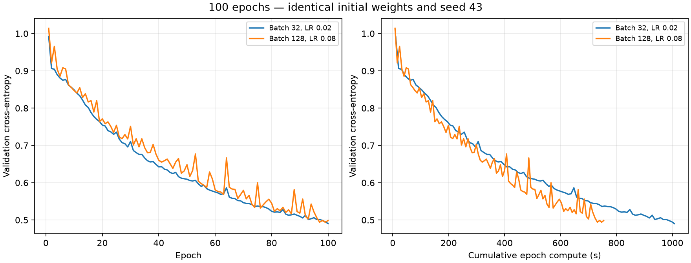

# Batch size and learning rate: matched 100-epoch comparison

## Purpose and protocol

The [twenty-epoch control](2026-11-07-batch-learning-rate-control.md) identified two useful settings: batch 32 / LR 0.02 and batch 128 / LR 0.08. This run extends the comparison horizon to 100 epochs without adding configurations.

Both runs restart from the same original Xavier weights, seed 43, with the 777 → 128 → 64 → 3 network. They use the full 572,445-position training split and 71,555-position validation split, a frozen analyzer, OpenBLAS limited to one thread, min-delta 0.0001 and patience 101 to ensure exactly 100 epochs. The runs are sequential; their order is randomized once using seed 43. The driver checks for another analyzer training before each run. All frozen input and output hashes are verified, and both first-twenty-epoch loss histories reproduce the earlier runs exactly.

Native epoch compute includes shuffling, updates and full train/validation loss. Loading, saving and post-training classification evaluation are excluded; process wall time is recorded separately. The saved checkpoint is selected by minimum validation cross-entropy. F1 and accuracy are measured on that checkpoint, not necessarily epoch 100. No test data are used.

## Results

| Batch / LR | 100 epochs compute (s) | Process wall (s) | Selected epoch | Selected validation loss | Macro F1 | Accuracy |
| --- | ---: | ---: | ---: | ---: | ---: | ---: |
| 32 / 0.02 | 1007.192 | 1010.937 | 100 | 0.490284 | 77.72% | 78.13% |
| 128 / 0.08 | 754.048 | 758.052 | 99 | 0.494038 | 77.71% | 78.11% |

Batch 128 uses **25.1% less epoch compute time** and its selected-checkpoint macro F1 differs by **-0.01 percentage points** from batch 32.

| Class | Batch 32 / LR 0.02 F1 | Batch 128 / LR 0.08 F1 |
| --- | ---: | ---: |
| Nothing | 84.31% | 84.32% |
| Check | 69.76% | 69.97% |
| Checkmate | 79.09% | 78.85% |

## Quality against time

At the common epoch-compute budget of 754.048 seconds, using completed epochs only:

| Batch / LR | Completed epochs | Best observed validation loss |
| --- | ---: | ---: |
| 32 / 0.02 | 74 | 0.536171 |
| 128 / 0.08 | 100 | 0.494038 |

For context, the following loss thresholds come from the completed smaller-batch trajectory. They are descriptive milestones, not quality targets specified before tuning. No interpolation is used.

| Batch-32 loss milestone | Threshold | First batch-32 time at/below threshold (s) | First batch-128 time at/below threshold (s) |
| --- | ---: | ---: | ---: |
| Epoch 20 | 0.754505 | 205.228 (epoch 20) | 182.014 (epoch 23) |
| Epoch 50 | 0.609374 | 507.928 (epoch 50) | 414.215 (epoch 54) |
| Epoch 100 | 0.490284 | 1007.192 (epoch 100) | Not reached in 100 epochs |

Classification was evaluated only on the saved checkpoints. These loss comparisons cannot establish time to a macro F1 target.

## Interpretation

The observed result at the 100-epoch horizon is a 25.1% compute-time saving for batch 128 with a -0.01-point F1 difference. The twenty-epoch F1 gap has narrowed to a practically tiny observed difference. Batch 128 reaches almost the same checkpoint F1 in 12 min 34 s of compute instead of 16 min 47 s. It also has lower best validation loss at the common compute budget, although it does not reach the smaller-batch final loss threshold within its 100 epochs. For the remaining deadline, retain batch 128 / LR 0.08 as the preferred speed configuration for any subsequently authorized final run; stop expanding the tuning grid. Keep batch 32 / LR 0.02 as the control. The larger-batch loss curve has visible spikes, so validation-loss checkpoint selection remains useful. This recommendation applies to the measured horizon and does not prove equal final quality or statistical equivalence. The experiment changes batch and learning rate together; it compares two selected training configurations rather than isolating a pure batch-size effect.

This is one seed, one trajectory and one timing observation per setting. Run order is not counterbalanced, and CPU frequency and thermal state are not pinned. A 100-epoch horizon does not establish final convergence or the time needed to reach the established reference checkpoint quality. Validation has been used for tuning; these are not final test estimates.

No further training or 500-epoch run is started automatically. Review the trajectories and achieved quality before choosing the final training protocol.

## Evidence

- [Portable measurements and class metrics](data/2026-11-07-batch-learning-rate-100epochs.json)
- Local experiment: `results/experiments/2026-11-07-batch-lr-100epochs-01/` (protocol, commands, frozen inputs, hashes, raw logs, histories, evaluated checkpoints and metrics).
