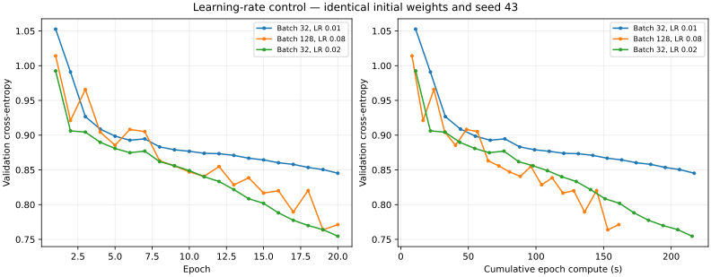

# Batch 32 / LR 0.02: control for the early larger-batch gain

## Why this control?

The [previous twenty-epoch comparison](../2026-11-07-batch-learning-rate-followup/README.md) changed both batch size and learning rate. Batch 128 / LR 0.08 beat batch 32 / LR 0.01, but that did not establish whether the larger batch was responsible for better early learning. This additional run uses batch 32 / LR 0.02, matching the larger-batch candidate’s LR/batch ratio. Matching that ratio is a heuristic control; stochastic updates at different batch sizes are not mathematically equivalent.

## Protocol

One fresh 20-epoch run, seed 43, the same 777 → 128 → 64 → 3 architecture, Xavier weights, full 572,445-position training and 71,555-position validation splits. SHA-256 checks confirm that the analyzer, data and initial weights match the prior two runs. OpenBLAS uses one thread, patience 21, min-delta 0.0001. The prior runs are reused rather than rerun. No test data are used.

Epoch compute includes shuffling, updates and full train/validation loss. Parsing, saving and classification evaluation are excluded; process time is also recorded. The evaluated checkpoint has the best validation loss, which can precede epoch 20. These are single-seed trajectories and single timing observations; run order and thermal state are not controlled.

## Results

| Batch / LR | Epoch compute (s) | Process wall (s) | Selected epoch | Selected validation loss | Macro F1 | Accuracy |
| --- | ---: | ---: | ---: | ---: | ---: | ---: |
| 32 / 0.01 | 217.015 | 220.813 | 20 | 0.845192 | 58.02% | 59.34% |
| 128 / 0.08 | 161.255 | 165.044 | 19 | 0.763731 | 62.73% | 63.74% |
| 32 / 0.02 | 215.496 | 219.412 | 20 | 0.754505 | 63.96% | 64.50% |

| Class | Batch 32 / LR 0.01 F1 | Batch 128 / LR 0.08 F1 | Batch 32 / LR 0.02 F1 |
| --- | ---: | ---: | ---: |
| Nothing | 69.14% | 73.17% | 73.16% |
| Check | 48.89% | 50.81% | 53.64% |
| Checkmate | 56.04% | 64.21% | 65.07% |

## At equal compute time

At 161.255 seconds of epoch compute, counting completed epochs only:

| Batch / LR | Completed epochs | Best validation loss within budget |
| --- | ---: | ---: |
| 32 / 0.01 | 14 | 0.866825 |
| 128 / 0.08 | 20 | 0.763731 |
| 32 / 0.02 | 14 | 0.808494 |

This table compares cross-entropy. Macro F1 was measured only on each saved checkpoint, so no time-to-F1 curve can be inferred.

## Interpretation

Raising only the batch-32 learning rate from 0.01 to 0.02 improves the selected-checkpoint macro F1 by 5.93 points with nearly unchanged compute time. The earlier classification improvement over batch 32 / LR 0.01 therefore does not establish a larger-batch quality benefit.

Against this stronger control, batch 128 / LR 0.08 uses 25.2% less compute for twenty epochs but ends with a saved-checkpoint macro F1 1.23 points lower and accuracy 0.76 points lower. The small-batch advantage is concentrated in Check F1 (53.64% versus 50.81%); Nothing F1 is effectively equal. At the common 161.255-second budget, however, the larger batch has a better observed best cross-entropy: 0.763731 versus 0.808494. There is an early quality/time tradeoff, not a single winner across every measure.

Retain batch 128 / LR 0.08 as the speed candidate and batch 32 / LR 0.02 as the quality control. Stop the short learning-rate search here. The next useful stage is a longer matched comparison (for example 100 epochs from the original weights), recording loss against compute time and checkpoint F1, before deciding whether a full convergence comparison is justified. No such run has been launched. That longer comparison must still avoid treating equal epoch counts as equal achieved quality.

Twenty epochs characterize early learning, not convergence. The control checks one smaller-batch learning rate and does not exhaust the tuning space. Final quality and robustness across seeds remain unmeasured. No further or 500-epoch training is launched automatically.

## Evidence

- [Portable results and checkpoint metrics](data.json)
- New local run: `results/experiments/2026-11-07-batch32-lr002-control-01/`.
- Reused matched runs: `results/experiments/2026-11-07-batch-lr-20epochs-01/`.
- Each experiment retains frozen inputs, commands, histories, model hashes, logs and checkpoints.
