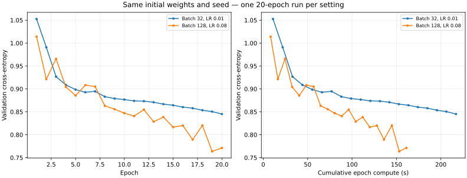

# Batch and learning rate: five-epoch selection, then twenty-epoch comparison

## Question

Can a larger batch reduce training time while preserving validation quality when its learning rate is adjusted? Epoch throughput alone cannot answer this.

## Protocol

The 777 → 128 → 64 → 3 network starts from the exact same Xavier weights, seed 43, on the full 572,445-position training split and 71,555-position validation split. The analyzer, data and initial models are frozen and checked with SHA-256. OpenBLAS is limited to one thread; runs are sequential and the driver refuses to start when another analyzer training process is detected. Native epoch times include shuffling, parameter updates and full training/validation losses. Loading, saving and post-training classification evaluation are excluded; process wall times are retained separately.

Batch 128 learning rates 0.02 and 0.08 were screened for five epochs, alongside the existing matched 0.04 result. The selection rule was recorded before the neighbor results: highest validation macro F1, with validation loss as tie-breaker. Failed or nonfinite trials would be excluded. This is validation tuning, not an independent final evaluation.

The selected setting and batch 32 / LR 0.01 were then restarted from the original weights for exactly 20 epochs each, with patience 21. Both five-epoch prefixes reproduce their previous loss histories exactly. Each new setting has one trajectory, one seed and one timing observation; timing repetitions from the earlier five-epoch screen are not independent training seeds. The saved checkpoint is selected by validation loss; reported F1 and accuracy apply to that checkpoint.

## Five-epoch screening

| Batch | Learning rate | Epoch compute (s) | Validation loss at epoch 5 | Saved-checkpoint macro F1 |
| ---: | ---: | ---: | ---: | ---: |
| 128 | 0.02 | 41.455 | 0.950947 | 50.72% |
| 128 | 0.04 | 41.041 | 0.905445 | 54.17% |
| 128 | 0.08 | 41.959 | 0.885488 | 55.86% |

The 0.04 timing is the median of three repetitions; 0.02 and 0.08 are single observations. Five epochs select a candidate; they do not establish convergence.

## Twenty-epoch results

| Setting | Epoch compute (s) | Process wall time (s) | Selected epoch | Final validation loss | Saved-checkpoint macro F1 | Accuracy |
| --- | ---: | ---: | ---: | ---: | ---: | ---: |
| Batch 32, LR 0.01 | 217.015 | 220.813 | 20 | 0.845192 | 58.02% | 59.34% |
| Batch 128, LR 0.08 | 161.255 | 165.044 | 19 | 0.771230 | 62.73% | 63.74% |

Per-class F1 on the selected checkpoints:

| Class | Control F1 | Candidate F1 |
| --- | ---: | ---: |
| Nothing | 69.14% | 73.17% |
| Check | 48.89% | 50.81% |
| Checkmate | 56.04% | 64.21% |

At 20 epochs the candidate uses **25.7% less epoch compute time**. Its saved-checkpoint macro F1 differs by **+4.71 percentage points**, and accuracy by **+4.40 points**.

## Quality versus time

The following loss thresholds are descriptive comparisons against the control trajectory, not targets specified before tuning. Only completed epochs are counted, with no interpolation. They measure cross-entropy, not time to a macro F1 target.

| Control loss milestone | Threshold | Control time (s) | First candidate time at or below threshold (s) |
| --- | ---: | ---: | ---: |
| Epoch 5 | 0.898546 | 55.175 | 40.508 (epoch 5) |
| Epoch 10 | 0.876770 | 109.808 | 64.604 (epoch 8) |
| Epoch 20 | 0.845192 | 217.015 | 88.395 (epoch 11) |

At the common epoch-compute budget of 161.255 seconds:

| Setting | Completed epochs | Best validation loss within budget |
| --- | ---: | ---: |
| Batch 32, LR 0.01 | 14 | 0.866825 |
| Batch 128, LR 0.08 | 20 | 0.763731 |

## Interpretation

Batch 128 / LR 0.08 is the strongest early candidate measured here. Its epochs are faster, and its saved checkpoint improves F1 in all three classes. It reaches the control epoch-20 loss threshold at epoch 11 in 88.395 seconds versus 217.015 seconds: 59.3% less compute time for that particular loss threshold. This is not a measured time saving to the final model quality. The candidate trajectory is also visibly noisier, so keeping the best validation-loss checkpoint matters.

Both batch size and learning rate changed. The epoch throughput advantage is consistent with the earlier fixed-learning-rate batch screen, but the learning improvement cannot be attributed to batch size alone. The batch-32 control learning rate has not been optimized; these results do not establish batch 128 as the best batch size.

The next useful control is batch 32 / LR 0.02 over the same twenty epochs: it matches the candidate learning-rate-to-batch ratio while retaining the smaller batch. That would help distinguish an effective step-size improvement from a larger-batch advantage. A longer matched comparison is then needed before replacing the established training protocol. No additional training is started by this report.

Twenty epochs cannot establish final convergence or a time saving at the reference model’s final quality. This remains a single-seed validation comparison. The twenty-epoch run order is not counterbalanced; CPU frequency and thermal state were not pinned. Timing differences therefore include normal system variability. No test data were used in this experiment and no 500-epoch training was launched automatically.

## Follow-up

The [batch 32 / LR 0.02 control](2026-11-07-batch-learning-rate-control.md) has since completed. It improves the smaller-batch baseline and qualifies the interpretation of the earlier gain.

## Evidence

- [Portable measurements](data/2026-11-07-batch-learning-rate-followup.json)
- Raw local experiment: `results/experiments/2026-11-07-batch-lr-20epochs-01/` (manifest, commands, histories, logs, checkpoints and metrics).
- Neighbor screen: `results/experiments/2026-11-07-batch-lr-neighbors-01/`.
