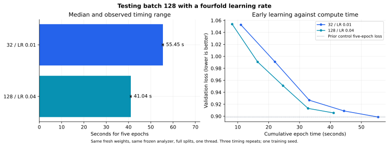

# Batch 128 with learning rate 0.04: does scaling recover learning speed?

Date: 2026-11-07

## Hypothesis and protocol

The prior screen showed that increasing batch size alone made epochs faster but
learning slower. This test multiplies learning rate by four when moving from
batch 32 to 128. The hypothesis is that larger steps can offset fewer updates;
it does not assume that the two SGD trajectories are mathematically equivalent.

The reference network is `777 → 128 → 64 → 3`, sigmoid/softmax, seed 43.
Both arms start from exactly the same fresh Xavier weights. Only learning rate
differs between their initial model configurations. Both use one BLAS thread,
five epochs, patience 20, min_delta 0.0001 and the complete frozen splits:
572,445 train / 71,555 validation positions. No test data is read.

Each arm runs three times, sequentially, with order shuffled within repetitions.
These repetitions measure timing variability, not variability across seeds.
Executables, data and helper sources come from the previous frozen screen.
Fingerprints and initial weight identity are verified. The rerun control exactly
reproduces the previous control history and final parameters.

## Results after five epochs

| Setting | Median time (s) | Min–max (s) | Validation loss | Accuracy | Macro F1 |
| --- | ---: | ---: | ---: | ---: | ---: |
| 32 / LR 0.01 | 55.453 | 55.140–55.771 | 0.898546 | 55.70% | 53.80% |
| 128 / LR 0.04 | 41.041 | 40.809–41.282 | 0.905445 | 55.33% | 54.17% |

The scaled setting takes **26.0% less epoch compute time** over five epochs
(1.35× throughput). Macro F1 changes by **+0.37 points**,
accuracy by **-0.38 points**, and validation loss by **+0.006899**.
Classification metrics use each saved loss-selected checkpoint; epoch-five loss
is shown separately. These are initial learning results, not the delivered model scores.

The earlier unscaled batch-128 setting ended at loss 1.041382 and macro F1
31.84%. Scaling learning rate recovers most of that early learning deficit.
This comparison uses its saved scores, not a newly timed third arm.

## Quality targets and time

Targets were copied from the prior batch-32 screen: validation loss
0.8985458818830362 and saved-checkpoint macro F1 0.5379949445010911.
Both metrics are reported rather than retaining only the favorable one.

The scaled candidate clears the prior macro-F1 target at its saved checkpoint,
but its validation loss does not reach the strict prior-control loss target
within the five observed epochs. Its accuracy is slightly lower as well.
The result is therefore **faster early learning with a small metric tradeoff**,
not proof that quality is identical under every criterion.

Macro F1 is computed only after training on the saved checkpoint. We cannot
deduce its first attainment time from epoch loss history. Loss is observed at
epoch boundaries; no interpolated time-to-quality claim is made.

| Setting | Completed epochs within common compute budget | Best observed validation loss |
| --- | ---: | ---: |
| 32 / LR 0.01 | 3 | 0.926700 |
| 128 / LR 0.04 | 5 | 0.905445 |

The common budget is 41.041 seconds of native epoch compute time.
Timings include shuffling, SGD updates and full train/validation loss evaluation.
Loading, initialization, serialization and chart export are outside those native
epoch timers; native-process wall times are also retained. Post-training F1
evaluation is outside both training timers. CPU clocks were not pinned.

## Decision

Batch 128 / LR 0.04 passes a useful initial screen: it preserves roughly the same
early classification level while shortening the measured run. Keep it as a
candidate for a longer controlled comparison, not as the new production setting.
Five epochs do not establish final convergence, stable later training, or the
81.96% validation macro F1 of the existing trained reference checkpoint.

A longer comparison must keep initialization, executable, splits and checkpoint
policy fixed, and assess wall time to a predeclared validation target as well as
the final selected-checkpoint scores. The existing batch-32 model remains the
delivery baseline. No long training is launched automatically from this test.

## Evidence

- [Raw six-trial experiment](../../../results/experiments/2026-11-07-batch-lr-screen-01/README.md)
- [Manifest, targets, per-epoch traces and aggregate results](data.json)
- [Previous batch-only screen](../2026-11-07-batch-size-screen/README.md)
