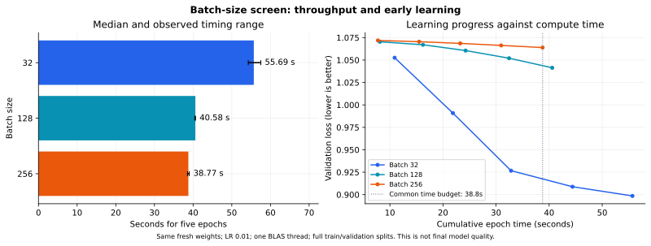

# Batch size: faster epochs, and what happens to learning?

Date: 2026-11-07

## Protocol

This is a five-epoch screening experiment, not a full training comparison.
Batch size is the only training setting changed. Every trial starts from the same
fresh `777 → 128 → 64 → 3` weights: Xavier initialization, seed 43, sigmoid/softmax,
SGD learning rate 0.01, one BLAS thread. Inputs are the full frozen splits:
572,445 train and 71,555 validation positions. The test split is not used.

Three timing repetitions per batch run sequentially, in shuffled order within
each repetition. These are repeated timings with one initialization, not three
independent training seeds. Executables and datasets were copied before launch;
their fingerprints are checked. The source executable can be rebuilt elsewhere
without changing this experiment. All trials finish exactly five epochs.

The main timer sums the five native epoch durations, including shuffling, updates
and complete train/validation losses. Process wall time is retained separately;
it also includes loading, initialization, saving and chart generation. No other
training process was detected before each trial. CPU clocks were not pinned.

## Measurements

| Batch | Updates / epoch | Five epochs, median (s) | Min–max (s) | Epoch speedup | Validation loss after epoch 5 |
| --- | ---: | ---: | ---: | ---: | ---: |
| 32 | 17,889 | 55.693 | 54.259–57.513 | 1.00× | 0.898546 |
| 128 | 4,473 | 40.579 | 40.428–40.620 | 1.37× | 1.041382 |
| 256 | 2,237 | 38.774 | 38.544–39.015 | 1.44× | 1.063914 |

The repeated trials produce byte-identical selected models for each batch.
The speed measurements are repeatable; final convergence is not measured here.

## Quality at a common compute budget

The shortest median five-epoch run gives a common budget of **38.774 s**.
Below is the best recorded loss among epochs completed within that budget. Evaluation
occurs only at epoch boundaries, so these are coarse checkpoints, not continuous
time-to-quality measurements. Loading is outside this compute budget.

| Batch | Epochs completed within budget | Selected epoch | Validation loss |
| --- | ---: | ---: | ---: |
| 32 | 3 | 3 | 0.926700 |
| 128 | 4 | 4 | 1.052039 |
| 256 | 5 | 5 | 1.063914 |

## What this means

As an early-learning illustration, batch 32 reaches loss 1.052620 in 10.89s;
batch 128 takes 32.45s to reach that threshold. Batch 256 does not reach it in five epochs.
This descriptive threshold is the batch-32 first-epoch loss, chosen after observing the screen;
it is not a predeclared final-quality objective.

Batch 32 reaches a validation loss of 0.926700 within the common budget,
versus 1.052039 for 128 and 1.063914 for 256.
Under these fixed settings, the larger batches do not improve early learning per unit compute time.

A larger batch amortizes work such as parameter updates and buffer allocation.
It also reduces SGD update frequency: batch 128 performs about four times fewer
updates per epoch than batch 32, and batch 256 about eight times fewer. At a fixed
learning rate, a faster epoch therefore does not imply faster learning.

Selected-checkpoint classification scores are saved in the raw trials. They
describe models after at most five epochs; they are not estimates of the final
quality of an architecture and must not replace the trained reference scores.

## Decision before any long training

Keep the existing batch-32 reference checkpoint as the delivery baseline.
Do not claim a time-to-final-quality improvement from these timings. A long run
is not started automatically: the speed/quality tradeoff must be reviewed first.

If larger batches save substantial epoch time but lag in learning, the next
controlled test should explicitly examine the learning rate as a separate setting.
Scaling it by the batch ratio is a hypothesis to test, not an equivalence or a
guarantee of stable convergence. A full run would then need to demonstrate equal
or better validation quality within less wall time.

Follow-up: the [batch-128 / LR-0.04 screen](2026-11-07-batch-learning-rate-screen.md)
recovers most of the early learning deficit while shortening the run. Its macro F1
is slightly higher than the control, but accuracy and loss are slightly worse.
It is a candidate for further testing, not a confirmed final-quality speedup.

## Evidence

- [Raw experiment](../../results/experiments/2026-11-07-batch-screen-01/README.md)
- [Frozen manifest, timing schedule, per-run histories and summary](data/2026-11-07-batch-size-screen.json)
- [Three-model comparison and current reference choice](2026-11-07-three-models.md)
