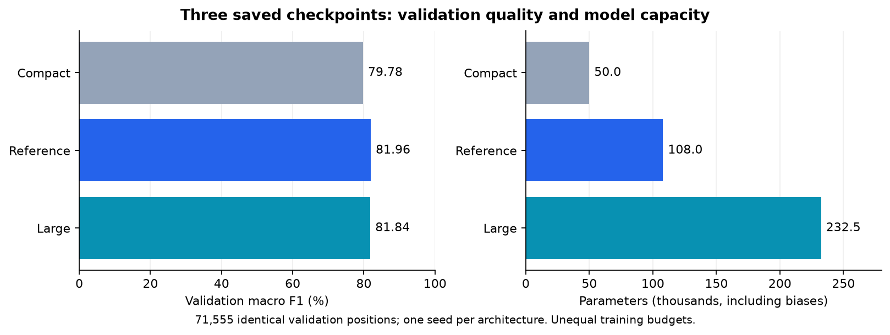
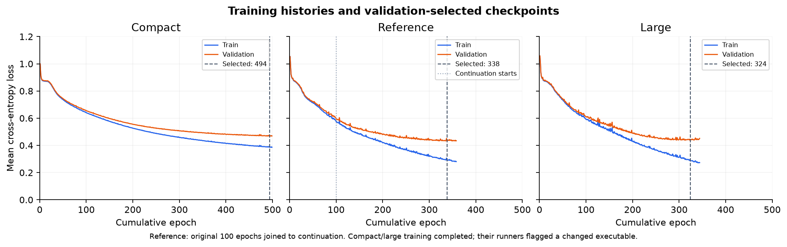

# Three chess classifiers: what did changing the network size buy us?

Date: 2026-11-07

**Keep the reference checkpoint.** The compact model saves parameters at a clear
loss of quality. The large model more than doubles the reference's parameters
without improving its overall validation score. The useful finding is where
their errors differ, rather than the small gap between their headline scores.

## What was compared

This run evaluates three existing checkpoints; it does not retrain them. All
71,555 validation positions are identical across evaluations: 29,756 Nothing,
24,813 Check and 16,986 Checkmate. One copy of the analyzer was frozen before
inference, and its fingerprint matches across all three reports. Model and data
fingerprints are recorded with the results.

| Setting | Compact | Reference | Large |
| --- | ---: | ---: | ---: |
| Layers | 777 → 64 → 3 | 777 → 128 → 64 → 3 | 777 → 256 → 128 → 3 |
| Parameters, including biases | 49,987 | 108,035 | 232,451 |
| Selected cumulative epoch | 494 | 338 | 324 |
| Completed cumulative epochs | 500 | 358 | 344 |
| Recorded training time | 39.32 min | 68.68 min, continuation only | 107.05 min |
| Stop | Epoch limit | Patience | Patience |

All models use seed 43, sigmoid hidden activations, softmax output and learning
rate 0.01. Compact and large start from Xavier initialization, with batch 32,
maximum 500 epochs, patience 20 and min_delta 0.0001. The reference starts from
an existing 100-epoch checkpoint and completes another 258 epochs. Its initial
training settings are only partly documented. Checkpoints minimize validation
loss; the comparison ranks their saved predictions by macro F1.

These are unequal training histories, not a controlled architecture search.
In particular, dividing the recorded durations would not measure a speedup:
reference timing omits its first 100 epochs, and backend conditions differ.

## Results

| Validation metric | Compact | Reference | Large |
| --- | ---: | ---: | ---: |
| Accuracy | 80.41% | **82.57%** | 82.36% |
| Macro F1 | 79.78% | **81.96%** | 81.84% |
| Nothing recall | 87.65% | **88.81%** | 87.89% |
| Check recall | 72.90% | 76.18% | **76.31%** |
| Checkmate recall | 78.71% | 80.98% | **81.51%** |
| Nothing F1 | 86.85% | **88.73%** | 88.37% |
| Check F1 | 73.58% | **76.41%** | 76.16% |
| Checkmate F1 | 78.90% | 80.76% | **80.98%** |

The compact removes **53.73% of the reference's parameters**, but loses **2.19
macro-F1 points**. The loss affects all three classes; Check suffers most.
This is a measurable size/quality tradeoff. Fewer parameters alone do not prove
lower inference latency or lower peak memory, neither of which was benchmarked.

The large has **2.15 times as many parameters** as the reference and trails it
by **0.13 macro-F1 points** and **0.21 accuracy points**. Differences are computed
before rounding. It is not worse on everything: it correctly classifies 89 more
Checkmate positions and 33 more Check positions, but 272 fewer Nothing positions.
That leaves **150 additional classification errors** overall.

## Similar scores, different mistakes

Matching predictions position by position reveals that the large model fixes
**4,804 reference errors**, while misclassifying **4,954 positions that the
reference gets right**. Their nearly equal scores therefore hide substantially
different decisions. Adding capacity changed the boundary between classes;
it did not produce a consistent improvement over the reference.

Check is the weakest class for every model. Its recall rises from 72.90% in the
compact to roughly 76.2–76.3% in the other two. For the reference, 2,979 actual
Check positions become Nothing and 2,931 become Checkmate. The difficulty is
on both sides of the class, not just failure to distinguish check from mate.
Inspecting these errors would be more informative than adding another layer
without a hypothesis about the mistakes it should fix.

## What the training curves explain

| Loss at the selected checkpoint | Compact | Reference | Large |
| --- | ---: | ---: | ---: |
| Train | 0.3863 | 0.2907 | **0.2847** |
| Validation | 0.4687 | **0.4325** | 0.4375 |

The large fits its training data slightly better than the reference while
generalizing slightly worse. This is consistent with extra capacity fitting
the train set without adding useful validation performance. It does not prove
that capacity alone caused the difference: training histories differ, and
learning rate and batch size were not tuned separately for each architecture.

After the large's selected epoch 324, train loss continues down to 0.2733 while
validation loss ends at 0.4516. Early stopping prevents retaining that later,
worse checkpoint. The compact reaches its minimum near the limit, at epoch 494
of 500; this run does not establish its best achievable performance either.

## What the evidence supports

There is one seed per architecture. The small reference/large gap does not
establish statistical significance or general superiority of the architecture.
Moreover, the best checkpoint by macro F1 need not be the one selected by loss;
only the saved loss-selected checkpoint is compared here.

Compact and large training completed and saved models, but their experiment
runners flagged a changed analyzer executable and stopped before classification
evaluation. Those failed manifests remain intact. This independent comparison
successfully evaluates the saved checkpoints with one frozen analyzer; it does
not retroactively certify the executable used throughout their training.

No test scores were used to rank these three models. Earlier test evaluations
already exist for reference and compact, so the project's test set cannot be
described as never previously consulted.

## Decision and next experiment

Use the reference for the current delivery. Its validation score is highest,
and the large offers no overall gain to justify doubling the parameters. Keep
the compact as a smaller alternative if an actual deployment constraint makes
its quality loss acceptable.

The next experiment should change **batch size on the reference**, rather than
network size again. First benchmark 32, 128 and 256 for five epochs under the
same conditions to screen throughput. That short run cannot establish final
quality. Only then train the promising setting long enough to compare the time
to comparable validation quality, retaining the batch-32 checkpoint as baseline.
Start with the same learning rate to isolate the change; a separate learning-rate
adjustment, if needed, must be recorded as a different experiment.

Follow-up: the [five-epoch batch screen](2026-11-07-batch-size-screen.md) is now
complete. Batches 128/256 shorten epochs but lag in early learning per compute
time at the unchanged learning rate. No long training was started from that screen.

Once the model and settings are fixed, report its final test score without
using that score to choose another variant. Until then, the evidence supports
one practical conclusion: **the reference is the best saved compromise so far;
increasing width alone did not improve the result.**

## Evidence

- [Comparison run and reproduction commands](../../results/comparisons/2026-11-07-three-models-01/README.md)
- [Recorded metrics, histories and fingerprints](data/2026-11-07-three-models.json)
- [Comparison notebook](../../notebooks/comparison.ipynb): scores, per-class results, confusion matrices and histories
- [Earlier reference checkpoint report](2026-11-07-reference-checkpoints.md)
- [Compact protocol](../../configs/protocols/train-compact.yml) and [large protocol](../../configs/protocols/train-large.yml)
