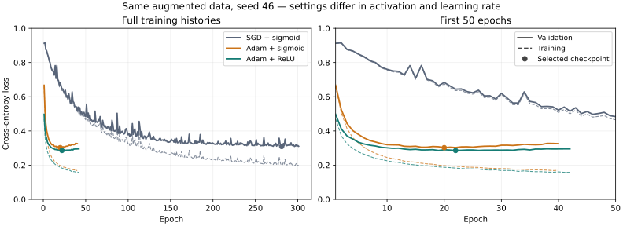

# Adam and ReLU: promising validation quality with short training

**The larger ReLU + Adam network is now the best measured local candidate:**
89.25% accuracy / 88.58% macro F1. See the capacity follow-up below.

The initial small-network ReLU + Adam run remains a useful baseline. This fresh run reaches
88.74% accuracy and 88.13% macro F1: +0.50 and +0.56 percentage points versus the
best measured SGD checkpoint. The gain is modest and comes from one seed on a
validation set already used for tuning; it does not establish a robust improvement
or predict the hidden evaluator's score.

## Protocol

One fresh run, no additional LR search: ReLU/softmax, Adam LR 0.001, Xavier,
seed 46, network 777 → 128 → 64 → 3, batch 128. Same 1,141,143 augmented training
positions and 71,555 validation positions as the earlier runs. Maximum 500 epochs,
patience 20, min_delta 0.0001, one CPU core. Training stopped after 42 epochs;
the checkpoint selected by validation loss is epoch 22 (loss 0.285603).

No network or data changes were made for this follow-up. Earlier Adam used sigmoid
and LR 0.003; SGD used sigmoid and LR 0.08. These are comparisons of complete
settings, so the gain cannot be attributed to ReLU alone.

## Validation comparison

All four checkpoints were evaluated with the same current analyzer and validation
file. Baseline scores and confusion matrices reproduce the recorded results exactly.

| Setting | Accuracy | Macro F1 | Selected epoch | Completed epochs |
| --- | ---: | ---: | ---: | ---: |
| SGD + sigmoid, LR 0.08 (delivered) | 88.06% | 87.40% | 281 | 301 |
| SGD + sigmoid, then LR 0.008 continuation | 88.23% | 87.57% | 281 + 1 | 301 + 21¹ |
| Adam + sigmoid, LR 0.003 | 87.98% | 87.46% | 20 | 40 |
| **Adam + ReLU, LR 0.001** | **88.74%** | **88.13%** | **22** | **42** |

¹ Continuation starts from the selected epoch-281 checkpoint, after the original
301-epoch run; it adds 21 epochs, selecting the first additional epoch.

| Class F1 | Best SGD | Adam + ReLU |
| --- | ---: | ---: |
| Nothing | 93.62% | **93.84%** |
| Check | 83.83% | **84.66%** |
| Checkmate | 85.26% | **85.90%** |

ReLU + Adam makes 360 fewer validation errors than the improved SGD checkpoint.
All three class F1 scores improve on this run.

## Training effort

The new full run took **612.57 seconds (10 min 13 s)**, versus 674.83 seconds
(11 min 15 s) for Adam + sigmoid and 4,374.21 seconds (72.90 min) for the original
SGD run. SGD continuation added 330.13 seconds. These are descriptive timings:
SGD used the older dense storage, while both Adam runs used compact storage;
this is not a repeated controlled speed benchmark.

The previous Adam LR search (0.0003 / 0.001 / 0.003) took another 30.88 minutes.
This ReLU follow-up used just one full run, without another search.

Validation loss bottoms out early, then rises while training loss continues to
fall. More epochs alone are not supported by this curve. Compare Gustave's
lower-LR ReLU results before choosing the delivered model. The delivered model
is unchanged and the test set has not been evaluated.

## Evidence

- [Portable measurements, hashes and histories](data.json).
- [Local ReLU + Adam run](../../../results/training/2026-11-08-relu-adam-01/README.md),
  [protocol](../../../results/training/2026-11-08-relu-adam-01/protocol.yml),
  [evaluation](../../../results/training/2026-11-08-relu-adam-01/evaluation/README.md).
- [Earlier Adam campaign](../../../results/experiments/2026-11-08-adam-screen-02/README.md).

Raw artifacts stay in the existing ignored results directories. No notebook,
permanent script or additional training option was added for these follow-ups.

## Capacity follow-up: 256 / 128 hidden units

One additional fresh seed-46 run doubles both hidden layer widths. All other
settings, dataset hashes and executable hashes match the small ReLU + Adam run.
The reproducible [protocol](../../../configs/protocols/train-large-relu-adam.yml)
uses the existing runner; there is no additional LR search.

**Validation accuracy rises from 88.74% to 89.25% (+0.51 pp, 365 fewer errors);
macro F1 rises from 88.13% to 88.58% (+0.44 pp).** Training took 959.17 seconds
(15 min 59 s), versus 612.57 seconds for the small model: about 57% longer.
Epoch 9 was selected out of 29; training stopped on patience. The checkpoint
is 23.54 MB including Adam state, versus 10.92 MB for the small model.

Both selected checkpoints were also evaluated on the same full augmented train:

| Hidden widths | Train accuracy | Validation accuracy | Train macro F1 | Validation macro F1 |
| --- | ---: | ---: | ---: | ---: |
| 128 / 64 | 92.77% | 88.74% | 92.27% | 88.13% |
| 256 / 128 | 94.74% | 89.25% | 94.33% | 88.58% |

Training scores are in-sample. The validation loss turns upward after its early
minimum while training loss continues down: extra capacity helps measured
validation quality modestly, but does not remove the generalization gap.
Checkmate F1 is essentially unchanged (85.90% → 85.86%); Nothing and Check improve.
Do not interpret the aggregate gain as a gain for every class.

Keep the large model as the current local candidate, and compare against Gustave's
SGD results before selecting the delivered checkpoint. This is one seed on reused
validation, with no guarantee of passing the hidden high-accuracy threshold.
No further training is started, the delivered model is unchanged, and test data
remain unevaluated.

- [Local run and curves](../../../results/training/2026-11-08-large-relu-adam-01/README.md).
- [Train evaluation](../../../results/training/2026-11-08-large-relu-adam-01/train-evaluation/README.md).
- [Shared exact checkpoint](../../../models/large-relu-adam-seed46-lr0.001.nn), with [usage and provenance](../../../models/README.md).
- Full metrics, train evaluations, hashes and history are in the portable JSON above.
