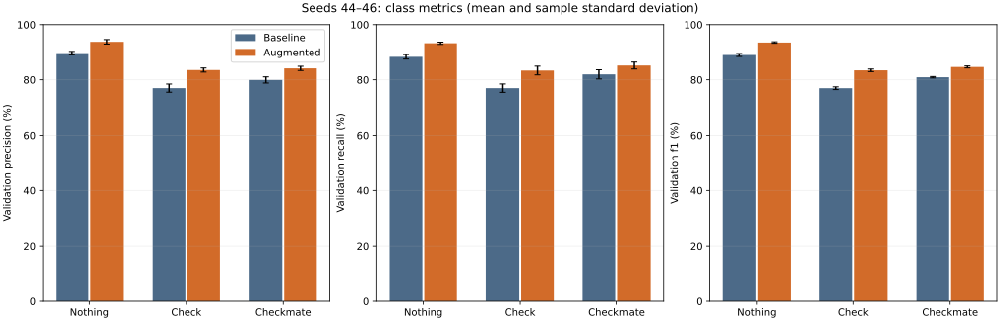
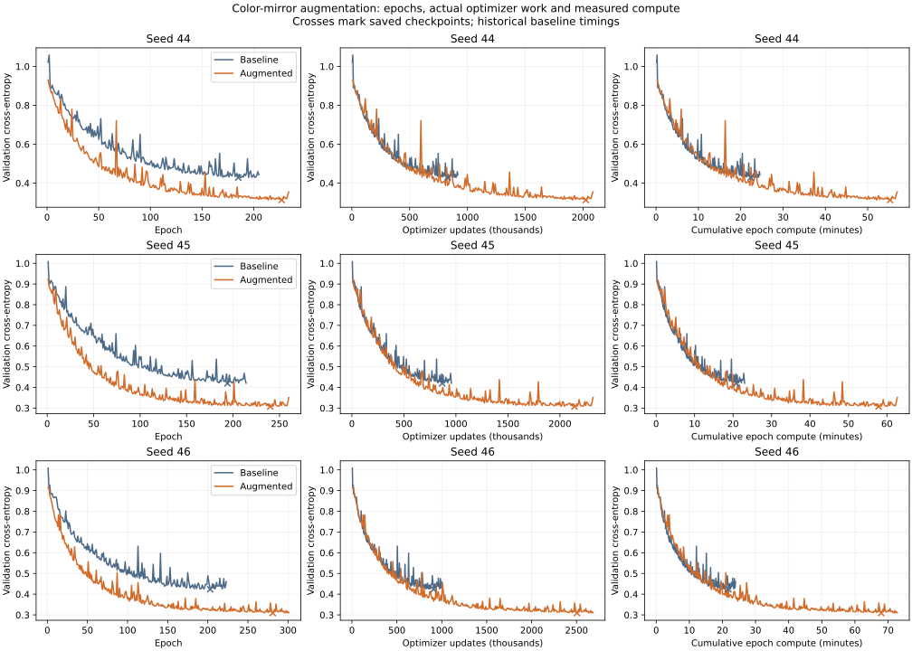
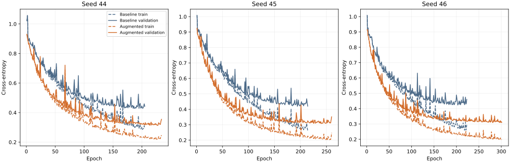

# Color-mirror train augmentation: paired seeds 44–46

## Decision

Use this augmentation as the better measured training-data variant for this fixed sigmoid model. Mean validation macro F1 changes from **82.28% to 87.20%** (**+4.91 percentage points**); 3/3 paired seeds improve. Total epoch compute is **2.69×** the historical baseline.

Mean Check recall rises from **76.95%** to **83.35%**.

This is a completed validation experiment, not a test result or a promoted checkpoint. It does not change activations, the encoder, or the selected network contract.

## Protocol

Fresh initialization and shuffle seeds **44, 45, 46**, run sequentially. Network **[777,128,64,3]**, sigmoid/softmax, Xavier, batch **128**, learning rate **0.08**, maximum **500 epochs**, patience **20**, min_delta **0.0001**, **one OpenBLAS thread**. Each seed's generated initial model is byte-identical to its matching unaugmented baseline initial model. Only training data change.

Comparison uses `results/experiments/2026-11-08-reference-seeds-02/runs/seed-{44,45,46}/`. The baseline analyzer and generator are copied and fingerprinted, along with original train, augmented train, validation, baseline models/configs/histories/metrics and the experiment scripts. Shared-library hashes and thread settings are recorded. Baseline inference is rerun on the frozen validation bytes and reproduces every class metric and confusion-matrix cell exactly.

Saved checkpoints minimize observed validation loss, including epoch zero; min_delta applies to the patience reference, not to saving a newly lower loss. The stopping and checkpoint rules are unchanged. Validation supports are Nothing 29,756, Check 24,813 and Checkmate 16,986 (71,555 total).

## Augmentation and integrity

The transform reflects ranks (a1↔a8; files stay fixed), swaps every piece's color, side to move, castling colors (K↔k, Q↔q), and en-passant rank (3↔6). Castling rights are emitted in standard KQkq order. Halfmove/fullmove counters and Nothing/Check/Checkmate class are preserved; optional White/Black suffixes are swapped. Training labels are never recomputed from chess rules.

Deduplication uses the exact information in the 777 encoded inputs: square piece identities, side to move and en-passant file. Castling rights and move counters are validated/transformed but ignored by the current encoder. Original rows keep their order, followed by retained mirrors in source order. No balancing or extra shuffling is applied before the trainer's seeded epoch shuffle.

| Accounting | Positions |
| --- | ---: |
| Original train rows / unique encoded inputs | 572,445 |
| Generated mirror candidates | 572,445 |
| Excluded: already in original train | 3,014 |
| Excluded: validation input overlap | 340 |
| Excluded: test input overlap | 393 |
| Retained added positions | 568,698 |
| Final unique augmented train | 1,141,143 |

| Class | Original | Added | Final |
| --- | ---: | ---: | ---: |
| Nothing | 238,051 | 236,224 | 474,275 |
| Check | 198,507 | 197,678 | 396,185 |
| Checkmate | 135,887 | 134,796 | 270,683 |

No original duplicates or class conflicts were found. Final encoded-input overlap with validation/test is zero. The held-out exclusion stage reads only the first six FEN fields; it does not parse, compare or tally their labels. Test is used only for input membership exclusion and file hashing, never inference, scoring, selection or tuning.

Verification: eight unit/integration tests, including randomized differential checks against production C++ encodeFEN, all castling subsets/orderings and all en-passant files. On full data, python-chess **1.11.2** independently verifies **572,445** transformed boards and all metadata; every training row passes a round trip. **1,144** deterministic pairs (including explicit castling, en-passant, check, mate and stalemate cases) also preserve the mapped legal move set and chess status. No source labels are judged by the oracle.

The C++ encoder agrees with the deduplication key on all **1,141,143** output rows and both 71,555-row held-out input sets. Original source file hashes are unchanged. Before training, the independent oracle rejected a nonstandard castling-field ordering; it was corrected, the candidate data rebuilt, and every check rerun. Rejected pre-training artifacts are isolated under `qa-rejected/`.

## Paired validation results

| Seed | Baseline macro F1 | Augmented macro F1 | Δ F1 (pp) | Baseline accuracy | Augmented accuracy |
| --- | ---: | ---: | ---: | ---: | ---: |
| 44 | 81.84% | 86.92% | +5.08 | 82.38% | 87.63% |
| 45 | 82.48% | 87.27% | +4.79 | 83.05% | 88.02% |
| 46 | 82.54% | 87.40% | +4.87 | 83.19% | 88.06% |

Mean macro F1 ± sample standard deviation: baseline **82.28% ± 0.39 pp**; augmented **87.20% ± 0.25 pp**. Paired F1 delta: mean **+4.91 pp**, sample SD **0.15 pp**, range **+4.79 to +5.08 pp**.

| Seed | Class | Baseline precision | Augmented precision | Baseline recall | Augmented recall | Baseline F1 | Augmented F1 |
| --- | --- | ---: | ---: | ---: | ---: | ---: | ---: |
| 44 | Nothing | 89.07% | 92.83% | 87.75% | 93.68% | 88.41% | 93.25% |
| 44 | Check | 75.87% | 84.24% | 76.98% | 81.59% | 76.42% | 82.90% |
| 44 | Checkmate | 80.49% | 83.37% | 80.87% | 85.87% | 80.68% | 84.60% |
| 45 | Nothing | 90.33% | 94.33% | 87.97% | 93.24% | 89.13% | 93.78% |
| 45 | Check | 76.36% | 82.76% | 78.46% | 84.69% | 77.40% | 83.72% |
| 45 | Checkmate | 80.67% | 84.91% | 81.13% | 83.73% | 80.90% | 84.31% |
| 46 | Nothing | 89.61% | 94.15% | 89.26% | 92.86% | 89.43% | 93.50% |
| 46 | Check | 78.65% | 83.61% | 75.42% | 83.76% | 77.00% | 83.69% |
| 46 | Checkmate | 78.64% | 84.14% | 83.89% | 85.93% | 81.18% | 85.03% |

| Class | Mean precision Δ (pp) | Mean recall Δ (pp) | Mean F1 Δ (pp) |
| --- | ---: | ---: | ---: |
| Nothing | +4.10 | +4.93 | +4.52 |
| Check | +6.58 | +6.40 | +6.49 |
| Checkmate | +4.21 | +3.21 | +3.73 |



## Training work and durations

Augmentation increases training examples per epoch by **1.99345×**. At batch 128 this means **4,473 → 8,916 optimizer updates per epoch**. An augmented epoch therefore is not comparable to an original epoch as an equal work budget. It also performs a full loss pass over the larger train. The validation pass stays the same size.

| Seed | Train | Completed / selected epoch | Total updates | Original-train-equivalent passes | Epoch compute (s) | Process wall (s) | Mean s/epoch |
| --- | --- | ---: | ---: | ---: | ---: | ---: | ---: |
| 44 | baseline | 205 / 185 | 916,965 | 205.00 | 1471.626 | 1475.199 | 7.179 |
| 44 | augmented | 234 / 227 | 2,086,344 | 466.47 | 3418.909 | 3427.546 | 14.611 |
| 45 | baseline | 214 / 194 | 957,222 | 214.00 | 1380.031 | 1383.429 | 6.449 |
| 45 | augmented | 260 / 240 | 2,318,160 | 518.30 | 3761.015 | 3768.050 | 14.465 |
| 46 | baseline | 223 / 203 | 997,479 | 223.00 | 1437.091 | 1440.504 | 6.444 |
| 46 | augmented | 301 / 281 | 2,683,716 | 600.03 | 4367.157 | 4374.213 | 14.509 |

Epoch compute includes batch updates plus train/validation loss passes. Process wall also includes dataset loading, integrity/overlap checks and checkpoint saving; generation and classification evaluation are separate. Time to the selected checkpoint and exact sample presentations are in the portable JSON. Baselines are historical, not interleaved new timing runs; CPU frequency, thermal state and memory pressure were not controlled. Timing ratios describe measured campaign cost, not a causal hardware speedup.



For a descriptive equal-update-budget check, the table compares the last complete epoch of each trajectory within their common total-update horizon. No intermediate checkpoints are inferred or evaluated. These endpoints are training trajectories, not the selected-checkpoint F1 scores above.

| Seed | Baseline epoch / updates | Baseline validation loss | Augmented epoch / updates | Augmented validation loss |
| --- | ---: | ---: | ---: | ---: |
| 44 | 205 / 916,965 | 0.442184 | 102 / 909,432 | 0.385015 |
| 45 | 214 / 957,222 | 0.420506 | 107 / 954,012 | 0.359057 |
| 46 | 223 / 997,479 | 0.460471 | 111 / 989,676 | 0.394871 |



## Interpretation and limits

The paired same-seed comparison measures the augmentation plus the existing epoch-based stopping protocol. The same seed gives identical initial weights, but a larger dataset changes the shuffle sequence and optimizer trajectory. More unique inputs also mean more updates per epoch. A gain cannot be attributed solely to symmetry rather than additional optimization without an independently authorized matched-compute original-data control. The work/time curves and the descriptive budget table expose that distinction.

Three seeds give observed variability, not a precise population confidence interval. Validation has already been used in prior experiments and is reused for stopping and this comparison. Excluding mirrored held-out inputs avoids exact encoded leakage; near duplicates and other symmetry-equivalent relationships are not independent samples. Mean augmented recall is Nothing 93.26%, Check 83.35%, Checkmate 85.18%. Gustave's activation work remains separate; no additional run, hyperparameter search, checkpoint promotion, or test evaluation follows this experiment.

## File fingerprints

SHA-256 values below identify the exact files. Complete model, initialization, snapshot and library fingerprints are in the portable JSON and local protocol.

| File | Bytes | SHA-256 |
| --- | ---: | --- |
| Source train | 32,571,014 | `76b038dda01a24c50e0980d407038d068538394d760c9637e717902b9540e167` |
| Source validation | 4,072,085 | `7628b12280cc1d83f7aa569483d757b127245d36e305e3f6325c03e75efa08df` |
| Source test | 4,070,233 | `a55710b1d4eba1257e87ff883b97769c3e8f16466eb7e9cb894cc62589f09ee8` |
| Generated train | 64,987,469 | `78481ab5110970c19d9283ff1549075a5b3d9788a9597b50afff134eeb520279` |
| Generated additions | 32,416,455 | `8395ceaa05ecd9788072efdeaaf7ce8c69b48984ef62036a7b261e8926373398` |
| Generated provenance | 7,992,603 | `a23605e2d8ada917f324814fd5cea0df6f85960c496b7736e39b89d82d5fd51d` |
| Frozen validation | 4,072,085 | `7628b12280cc1d83f7aa569483d757b127245d36e305e3f6325c03e75efa08df` |
| Frozen analyzer | 477,744 | `9c48b567004ee2bc93456b6959ffa352d15ac9af6cc0d008860abd76a901c1b3` |
| Frozen generator | 373,288 | `a9df3fac99e266ce4189c752c43e6d9a8b89aab9b68f676bee667885b333d45c` |

## Reproduction and evidence

The reusable `scripts/experiment.py` handles sequential seeds, fresh initialization, training, validation metrics and SVG exports. The one-off campaign and report builders are retained only with the local raw evidence under `reproduction/` (original frozen copies also remain under `snapshot/` and `postrun/`); they are not general project tools.

From the repository root, activate the project environment, install the isolated QA oracle if needed, and use a new dataset/run directory. These commands start a new three-seed campaign; they do not overwrite the recorded experiment:

```sh
. .venv/bin/activate
python3 -m pip install --target /tmp/mytorch-augmentation-oracle chess==1.11.2
python3 -m scripts.augment_dataset --splits dataset/references/chess-v1/splits --output dataset/processed/chess-v1-color-mirror
python3 -m scripts.verify_augmentation dataset/processed/chess-v1-color-mirror --oracle-path /tmp/mytorch-augmentation-oracle
export OPENBLAS_NUM_THREADS=1 OPENBLAS_DEFAULT_NUM_THREADS=1 OMP_NUM_THREADS=1 VECLIB_MAXIMUM_THREADS=1
python3 -m scripts.experiment configs/protocols/train-color-mirror.yml --output results/experiments/NEW-COLOR-MIRROR-RUN
```

The YAML fixes architecture, activations, initialization, seeds and stopping settings. It deliberately has no test evaluation. Dataset and executable hashes are recorded by the runner. For historical binary replay, call the existing Python API with the preserved executables instead of using a rebuilt analyzer:

```python
from scripts.experiment import run_experiment
from pathlib import Path
frozen = Path("results/experiments/2026-11-08-color-mirror-augmentation-01/tools")
run_experiment("configs/protocols/train-color-mirror.yml",
               "results/experiments/NEW-FROZEN-COLOR-MIRROR-RUN",
               generator=frozen / "my_torch_generator",
               analyzer=frozen / "my_torch_analyzer")
```

Activate the same single-thread environment for either entry point. Reproducing the hashes requires the original `chess-v1` split bytes; the augmentation is deterministic. Exact model bytes also depend on the frozen native executable/library environment; timings are machine-dependent. The cleaned workflow preserves the training settings and trajectories, while its result-directory layout and report exports follow the existing runner rather than the original one-off campaign layout.

- [Portable paired metrics, histories, work accounting and hashes](data.json)
- [Motivating reference error analysis](../2026-11-08-reference-error-analysis/README.md)
- Local raw campaign: `results/experiments/2026-11-08-color-mirror-augmentation-01/` (protocol/status, generated data, addition-to-source mapping, oracle/C++ verification, frozen executables and baselines, initial/final models, commands, logs/resource measurements and validation predictions). Raw artifacts remain separate from this report.
- `docs/training.md`, original splits and activation sources are unchanged; work remains on the current branch, uncommitted.

## Delivered model

`my_torch_network.nn` is an unchanged copy of the augmented seed 46 checkpoint
at epoch 281 (`runs/seed-46/model.nn` in the frozen campaign). It has the highest
validation macro F1 of the three augmented checkpoints: 87.40%, with 88.06%
accuracy. Selection uses validation only.

- Architecture: `[777, 128, 64, 3]`, sigmoid/softmax.
- Size: 3379663 bytes.
- SHA-256: `3ce70f8052f213573905e7fe8cd8a278309759083212b68768f424352aa392bf`.
- Output: `Nothing`, `Check`, or `Checkmate`, without a color suffix.
- Delivery smoke check: the current analyzer loads the copied model and returns
  three valid predictions for three unlabeled training positions, with exit 0.
- No test evaluation was performed.
