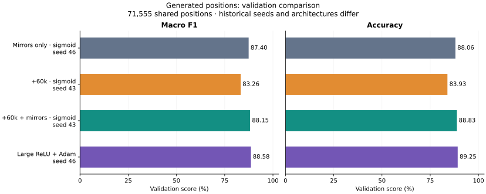
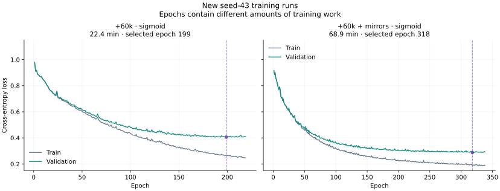

# Generated chess positions: 60k trial

**Experiment closed. The project retains Gustave's model.** Our generated +
mirrored run reaches 88.15% validation macro F1, below the measured local Adam
candidate (88.58%). The generated-only run reaches 83.26%. No further training
is planned for this trial; its results remain as experiment history.

## Results

All scores use the same 71,555 validation positions and single-view prediction.
No new test evaluation was performed.

| Model / train | Seed | Rows | Accuracy | Macro F1 | Selected / completed epoch | Full training time |
| --- | ---: | ---: | ---: | ---: | ---: | ---: |
| Sigmoid, mirrors only (historical delivered model) | 46 | 1,141,143 | 88.06% | 87.40% | 281 / 301 | 72m 54s |
| Sigmoid, original +60k | 43 | 632,445 | 83.93% | 83.26% | 199 / 219 | 22m 26s |
| **Sigmoid, original +60k + mirrors** | 43 | 1,260,989 | **88.83%** | **88.15%** | 318 / 338 | **68m 54s** |
| Large ReLU + Adam, mirrors only (local best) | 46 | 1,141,143 | 89.25% | 88.58% | 9 / 29 | 15m 59s |

The new mirrored run is **+0.75 macro-F1 points** above the historical delivered
sigmoid and **−0.42 points** below large Adam (deltas use unrounded measurements).
These are contextual comparisons: seeds differ, Adam also changes architecture
and optimization, and timing runs were not controlled. One new seed per dataset
does not establish a robust improvement from generated data alone.

## What was trained

Both new runs use 777 → 128 → 64 → 3, sigmoid/softmax, Xavier, SGD LR 0.08,
batch 128, seed 43, maximum 500 epochs, patience 20 and min-delta 0.0001.
The saved checkpoint minimizes validation loss.

Added positions: **15k Nothing, 20k Check, 25k Checkmate**, generated from legal
games, uniquely keyed by model inputs and excluded from validation/test inputs.
The mirrored variant adds 628,544 admissible color-swapped rank reflections of
both original and generated positions. It performs more updates per epoch.

## Final decision and retention

- Retain `chess-v1`, `chess-v1-generated-60k` and `chess-v1-generated-120k-mirror`.
  The generated-only reference remains the provenance parent of the latest one.
- The local `chess-v1-generated-60k-mirror` reference and its matching processed
  cache were removed. Its tracked manifest and protocol, trained model,
  full history and evaluation results are retained. That protocol now requires restoration
  of its archived dataset before rerunning.
- The **120k-mirror dataset has not been trained or evaluated in this report**.
  Gustave's model is the final project choice. His reported scores were not
  independently reproduced in this experiment and are not added to its charts.

Sources: [portable metrics and loss histories](data.json),
[mirror baseline](../2026-11-08-color-mirror-augmentation/README.md),
[Adam reference](../2026-11-08-adam-optimizer/README.md). Full runs and evaluations remain
in `results/training/generated-games*-seed43-01/` and matching
`results/evaluation/` directories. Rebuild SVGs with
`python3 -m scripts.plot_generated_experiment`.
