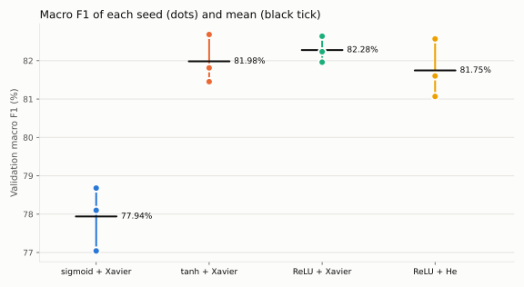
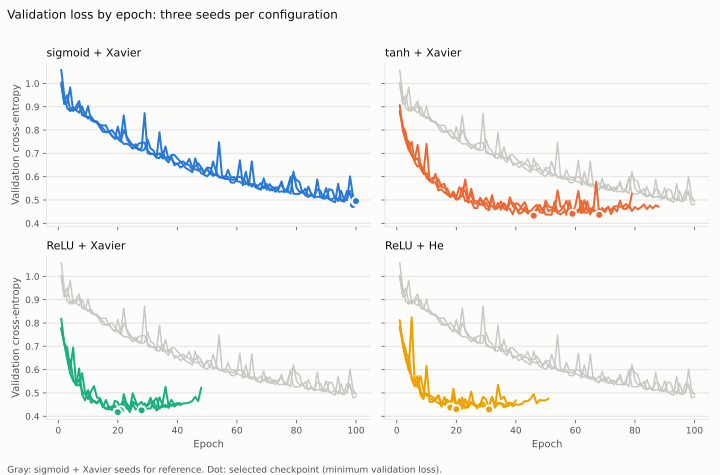

# Hidden activations: sigmoid, tanh and ReLU over three seeds

## Purpose and protocol

Earlier comparisons all kept sigmoid hidden layers. This experiment measures the
effect of the hidden activation at the selected training settings, with three
seeds per configuration.

| Configuration | Hidden activation | Initialization | What it isolates |
| --- | --- | --- | --- |
| sigmoid + Xavier | sigmoid | Xavier | Current choice |
| tanh + Xavier | tanh | Xavier | Activation only |
| ReLU + Xavier | ReLU | Xavier | Activation only |
| ReLU + He | ReLU | He | Initialization only, against ReLU + Xavier |

ReLU + He checks that ReLU is not judged only with an initialization designed for
sigmoid and tanh.

All runs use the 777 → 128 → 64 → 3 network, softmax with categorical
cross-entropy, and the [selected batch/LR setting](../2026-11-07-batch-learning-rate-100epochs/README.md):
batch 128 and learning rate 0.08. They run for at most 100 epochs, with patience 20
and min_delta 0.0001. Seeds 42, 43 and 44 set the initial weights and the epoch
order; every configuration ran every seed and none was discarded. The checkpoint
with minimum validation loss is saved, and macro F1 is measured on it. Data are the
frozen `chess-v1` splits: 572,445 training and 71,555 validation positions, with
validation SHA-256 `7628b122…` as in earlier reports. The test split is not used.

**Rule fixed before any result:** rank by mean validation macro F1. A configuration
is **ahead** only if all of its seeds score above all seeds of the other; otherwise
the two are **not separated**.

Runs were sequential on an Apple M5 (macOS 26.6, Accelerate BLAS, 1 thread,
analyzer SHA-256 `8e49ed6d…`), with hashes verified by the runner. Protocol:
[`compare-hidden-activations.yml`](../../../configs/protocols/compare-hidden-activations.yml)
(SHA-256 `de4ec7d5…`), run from revision `deb73a4`.

## Results

| Configuration | Macro F1 (mean ± SD) | Seed range | Accuracy | Worst-class recall | Selected validation loss |
| --- | ---: | ---: | ---: | ---: | ---: |
| sigmoid + Xavier | 77.94 ± 0.83% | 77.04–78.68% | 78.43 ± 0.68% | 68.98 ± 6.10% | 0.4889 |
| tanh + Xavier | 81.98 ± 0.63% | 81.45–82.68% | 82.53 ± 0.61% | 75.91 ± 1.59% | 0.4366 |
| **ReLU + Xavier** | **82.28 ± 0.34%** | 81.96–82.64% | **82.95 ± 0.31%** | **76.49 ± 1.63%** | **0.4229** |
| ReLU + He | 81.75 ± 0.76% | 81.07–82.57% | 82.40 ± 0.77% | 75.73 ± 1.05% | 0.4324 |

SD is the sample standard deviation over three seeds.



| Pair | Mean macro-F1 difference | Verdict |
| --- | ---: | --- |
| tanh + Xavier vs sigmoid + Xavier | +4.04 points | tanh ahead |
| ReLU + Xavier vs sigmoid + Xavier | +4.34 points | ReLU + Xavier ahead |
| ReLU + He vs sigmoid + Xavier | +3.81 points | ReLU + He ahead |
| ReLU + Xavier vs tanh + Xavier | +0.29 points | Not separated |
| tanh + Xavier vs ReLU + He | +0.24 points | Not separated |
| ReLU + Xavier vs ReLU + He | +0.53 points | Not separated |

| Configuration | Nothing F1 | Check F1 | Checkmate F1 | Check recall |
| --- | ---: | ---: | ---: | ---: |
| sigmoid + Xavier | 84.75% | 70.41% | 78.66% | 68.98 ± 6.10% |
| tanh + Xavier | 88.54% | 76.39% | 81.01% | 75.91 ± 1.59% |
| ReLU + Xavier | 89.30% | 77.06% | 80.47% | 76.49 ± 1.63% |
| ReLU + He | 88.63% | 76.37% | 80.23% | 76.12 ± 1.71% |

Check is the hardest class everywhere. The alternatives gain the most there: about
7 points of recall, with nearly four times less spread across seeds.

| Configuration | Seed | Macro F1 | Accuracy | Recall Nothing | Recall Check | Recall Checkmate | Selected epoch | Epochs run | Stop |
| --- | ---: | ---: | ---: | ---: | ---: | ---: | ---: | ---: | --- |
| sigmoid + Xavier | 42 | 78.68% | 79.16% | 84.68% | 71.46% | 80.73% | 99 | 100 | Epoch limit |
| sigmoid + Xavier | 43 | 78.10% | 78.30% | 81.66% | 73.45% | 79.52% | 100 | 100 | Epoch limit |
| sigmoid + Xavier | 44 | 77.04% | 77.82% | 88.58% | 62.03% | 82.02% | 100 | 100 | Epoch limit |
| tanh + Xavier | 42 | 81.45% | 82.06% | 88.79% | 74.83% | 80.84% | 59 | 79 | Patience |
| tanh + Xavier | 43 | 82.68% | 83.22% | 88.44% | 77.73% | 82.12% | 68 | 88 | Patience |
| tanh + Xavier | 44 | 81.81% | 82.32% | 86.81% | 75.16% | 84.92% | 46 | 66 | Patience |
| ReLU + Xavier | 42 | 82.64% | 83.28% | 88.57% | 78.18% | 81.45% | 28 | 48 | Patience |
| ReLU + Xavier | 43 | 82.23% | 82.89% | 88.26% | 74.92% | 85.12% | 21 | 41 | Patience |
| ReLU + Xavier | 44 | 81.96% | 82.67% | 89.21% | 76.38% | 80.41% | 20 | 40 | Patience |
| ReLU + He | 42 | 82.57% | 83.24% | 89.86% | 75.32% | 83.20% | 31 | 51 | Patience |
| ReLU + He | 43 | 81.07% | 81.71% | 87.48% | 78.08% | 76.92% | 18 | 38 | Patience |
| ReLU + He | 44 | 81.60% | 82.26% | 89.18% | 74.96% | 80.81% | 20 | 40 | Patience |



## Quality against time

The machine slept during parts of the campaign, and the analyzer's epoch clock
counts sleep, so campaign timings are not used. Speed was measured separately:
5 epochs per configuration from its seed-42 model, repeated in 3 rounds with the
order rotated each round (battery power, one BLAS thread).

| Configuration | Median seconds per epoch | Range (15 epochs) | Versus sigmoid |
| --- | ---: | ---: | ---: |
| sigmoid + Xavier | 7.51 | 7.02–7.97 | — |
| tanh + Xavier | 7.87 | 7.21–8.74 | +4.8% |
| ReLU + Xavier | 6.34 | 6.05–7.27 | −15.6% |
| ReLU + He | 6.63 | 6.08–7.30 | −11.7% |

The per-epoch ranges overlap; the large difference is the number of epochs:

| Configuration | Epochs to selected checkpoint (mean) | Epochs to reach sigmoid's 100-epoch validation loss (0.4889) | Estimated compute to checkpoint | Estimated compute for the whole run |
| --- | ---: | ---: | ---: | ---: |
| sigmoid + Xavier | 99.7 (still improving) | 99 for one seed; not reached for two | 748 s | 751 s |
| tanh + Xavier | 57.7 | 24–28 | 454 s | 611 s |
| ReLU + Xavier | 23.0 | 9–11 | 146 s | 273 s |
| ReLU + He | 23.0 | 9–12 | 152 s | 285 s |

Estimated compute = mean epochs × median seconds per epoch. ReLU reaches its best
checkpoint in about a fifth of sigmoid's compute.

## Interpretation

- **Sigmoid learns the slowest at this budget.** All three alternatives lead it on
  every seed. They are not separated from each other: 0.24–0.53 points, less than
  each one's seed range.
- **With a longer budget, sigmoid catches up.** Every sigmoid run here was still
  improving at epoch 100. With the same batch and learning rate but up to 500
  epochs, sigmoid seeds 44–46 select epochs 185–203 and reach 82.28 ± 0.39%
  ([seed robustness](../2026-11-08-reference-seed-robustness/README.md), on Linux). ReLU +
  Xavier reaches the same mean, 82.28 ± 0.34%, at epochs 20–28. The measured quality
  is equal, with about 8× fewer epochs. The machines differ, so epochs are compared,
  not seconds.
- **Why sigmoid is slower** (consistent with the curves, not tested separately).
  Backpropagation multiplies the error by the activation's derivative at each hidden
  layer: at most 0.25 for sigmoid, 1 for tanh and ReLU. Across two hidden layers,
  sigmoid passes at most 1/16 of the signal to the first layer. That layer holds 92%
  of the parameters: 99,584 of 108,035.
- **Faster learners overfit sooner.** At the checkpoint, the validation–training gap
  is 0.14–0.16 for tanh and ReLU, against 0.05 for sigmoid. Validation loss then
  rises by up to 0.10, and patience 20 stopped every tanh and ReLU run (epochs
  38–88). Checkpoint selection is required.
- **Xavier vs He makes no detectable difference for ReLU.** This is expected in a
  shallow network, where the two scales are close:

  | Layer | Xavier uniform: √(2 / (in + out)) | He normal: √(2 / in) | He / Xavier |
  | --- | ---: | ---: | ---: |
  | 777 → 128 | 0.0470 | 0.0507 | 1.08 |
  | 128 → 64 | 0.1021 | 0.1250 | 1.22 |
  | 64 → 3 | 0.1728 | 0.1768 | 1.02 |

- **At 100 epochs, seed alone moves macro F1 by up to 1.64 points.** Seed ranges
  are 0.68 points (ReLU + Xavier), 1.23 (tanh), 1.50 (ReLU + He) and 1.64
  (sigmoid). Sigmoid's Check recall ranges from 62.0% to 73.5%. Even after 500
  epochs, sigmoid seeds 44–46 span 0.70 points. That spread is larger than the
  earlier single-seed architecture (0.12 points) and batch (0.01 points)
  differences. The earlier 100-epoch run with these settings (seed 43, Linux,
  77.71%) falls inside the sigmoid range measured here.
- **Limitations.** Three seeds, one machine and a 100-epoch budget. LR 0.08 was not
  retuned for tanh or ReLU. Validation was used for selection, so these are not
  test estimates.
- **Decision.** The shipped model keeps sigmoid, trained with color-mirror
  augmentation. The alternatives match sigmoid's measured final quality, so
  switching would mainly shorten training, by about 8× fewer epochs. ReLU with
  augmentation has not been tested.

## Reproducibility across platforms

The same seed does not give the same training on macOS and Linux. One program
compiled with both standard libraries (libc++ via Apple clang, libstdc++ via
GCC 15) gives:

| Call | Used for | libc++ vs libstdc++ |
| --- | --- | --- |
| `std::uniform_real_distribution` | Xavier initialization | Identical values |
| `std::normal_distribution` | He initialization | Different values |
| `std::shuffle` | Epoch order | Different order |

The C++ standard leaves these algorithms to the implementation. These results
reproduce on macOS; earlier reports reproduce on Linux. Portable seeds would need
the project's own shuffle and normal sampling.

## Evidence

- [Portable measurements: protocol, hashes, per-run histories, class metrics, confusion matrices and timing benchmark](data.json)
- Local campaign: `results/experiments/2026-11-08-compare-hidden-activations-01/`. Local timing benchmark: `results/experiments/2026-11-08-activation-timing-01/timing.json`.

Reproduce on macOS:

```sh
python3 -m scripts.reference_dataset verify
VECLIB_MAXIMUM_THREADS=1 python3 scripts/experiment.py \
  configs/protocols/compare-hidden-activations.yml \
  --output results/experiments/YYYY-MM-DD-compare-hidden-activations-01
```
