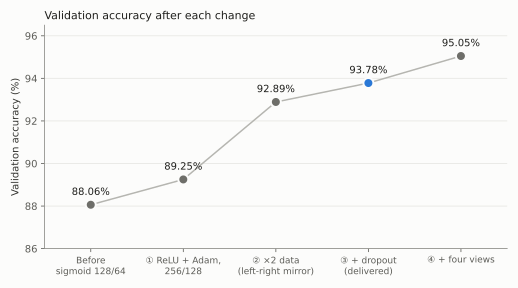
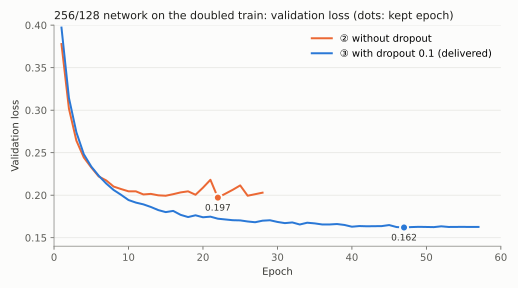

# Improving the delivered model: four changes

The previous delivered model (sigmoid, 777 → 128 → 64 → 3) reached 88.06%
validation accuracy. We tried four changes, one after the other, and measured
each on validation. The new delivered model keeps the first three:
**93.66% accuracy and 93.15% macro F1 on the test split**, evaluated once.

| Change | Network | Training positions | Validation accuracy |
| --- | --- | ---: | ---: |
| Before: sigmoid, SGD | 777 → 128 → 64 → 3 | 1,141,143 | 88.06% |
| ① ReLU + Adam, network doubled | 777 → 256 → 128 → 3 | 1,141,143 | 89.25% |
| ② Training data doubled | 777 → 256 → 128 → 3 | 2,275,774 | 92.89% |
| ③ Dropout 0.1 (**delivered**) | 777 → 256 → 128 → 3 | 2,275,774 | **93.78%** |
| ④ Four views of each position | same network, read 4 times | 2,275,774 | 95.05% |

## The four changes

**① ReLU + Adam, network doubled.** Sigmoid shrinks the signal at each layer, so
the network learns slowly ([activation comparison](2026-11-08-hidden-activations/README.md)).
ReLU with Adam, then 256/128 neurons instead of 128/64, give +1.2 points
([Adam report](2026-11-08-adam-optimizer/README.md)).

**② Training data doubled.** The rules of chess are the same if the board is
reflected left to right (a-file ↔ h-file): a check stays a check, a mate stays
a mate. [`mirror_files.py`](../../scripts/mirror_files.py) adds the reflection of
every training position ([dataset guide](../datasets.md#7-left-right-mirror-augmentation)).
We doubled the data because the network had learned positions rather than
rules: on reflected validation positions it fell from 89% to 81%. With the
doubled data it gains 3.6 points; three seeds give 92.87–92.95%. The learning
rate is also lowered (×0.3) when validation stops improving, at most three times.

**③ Dropout.** During training, each hidden neuron is switched off with
probability 0.1, so the network cannot rely on a few memorizing neurons.
Validation loss falls from 0.197 to 0.162, and accuracy rises by 0.9 points.

**④ Four views.** The network reads each position four times: as it is,
reflected left to right, with colors swapped (board turned around), and both.
The answer cannot change between views, so we average the four. A view only
reorders the first-layer inputs, so [`merge_networks.py`](../../scripts/merge_networks.py)
builds it into one ordinary network, 777 → 1024 → 512 → 3. It adds 1.3 points
but costs 5.7 times the computation and 11 MB instead of 2.4 MB, so we did not
deliver it.

## Delivered model

777 → 256 → 128 → 3, ReLU/softmax, Xavier, Adam (learning rate 0.001), batch
128, dropout 0.1, seed 49; epoch 47 of 57 kept. 232,451 parameters, 2.4 MB,
1.2 seconds for 71,555 predictions.

| Split | Accuracy | Macro F1 | Nothing F1 | Check F1 | Checkmate F1 |
| --- | ---: | ---: | ---: | ---: | ---: |
| Validation | 93.78% | 93.27% | 97.47% | 91.34% | 91.00% |
| **Test** | **93.66%** | **93.15%** | 97.37% | 91.17% | 90.90% |

Most remaining errors confuse Check and Checkmate: 2,985 of 4,537 test errors.

## Limits

- Dropout and the learning-rate decay ran from a local experimental build. They
  are now training options (`dropout` in the network YAML, `--lr-decay`), and
  [`train-delivered-model.yml`](../../configs/protocols/train-delivered-model.yml)
  retrains the recipe. Its dropout masks differ from the experimental build, so a
  rerun repeats the method, not the exact weights.
- Dropout was measured on one seed (+0.9 points, against a spread of 0.1 points
  between seeds without dropout).
- Validation chose these settings, so its scores are slightly optimistic. Before
  choosing the delivered size, the test split was also used for two larger
  variants (four views: 94.95%; two networks with four views: 95.06%).

## Evidence

- [Metrics, confusion matrices, hashes and training histories](data/2026-11-08-mirror-view-ensemble.json)
