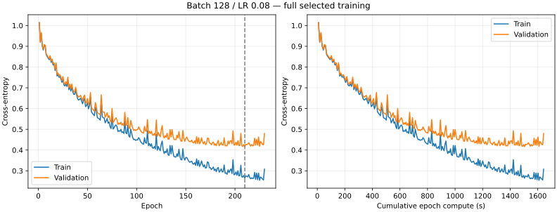

# Selected batch-128 training versus the previous reference

## Protocol

Train 777 → 128 → 64 → 3, sigmoid/softmax, from the original seed-43 Xavier weights: batch 128, learning rate 0.08, OpenBLAS one thread, maximum 500 epochs, patience 20 and min-delta 0.0001. Select the minimum-validation-loss checkpoint. All train/validation bytes, the analyzer, initial model and previous reference checkpoint are frozen and hash-checked. No test data are used.

This follows the [100-epoch comparison](../2026-11-07-batch-learning-rate-100epochs/README.md). The new run reproduces its first 100 epochs exactly. No automatic follow-on training or recurring Codex monitoring is scheduled.

## Candidate training

Completed **230 epochs**, stopping because of **patience**. The selected checkpoint is epoch **210**, validation loss **0.41632667528376327**. Epoch compute totals **1642.550 s**, process wall time **1650.251 s**. Epoch compute includes shuffling, SGD and full train/validation loss; parsing, saving and classification evaluation are excluded.

## Same-validation checkpoint comparison

Both saved models are reevaluated with the same frozen analyzer on the same 71,555 validation positions.

| Model | Validation macro F1 | Accuracy |
| --- | ---: | ---: |
| Previous reference, batch 32 / LR 0.01 | 81.96% | 82.57% |
| Candidate, batch 128 / LR 0.08 | 82.78% | 83.46% |

The candidate differs by **+0.81 macro-F1 percentage points**.

| Class | Previous reference F1 | Candidate F1 |
| --- | ---: | ---: |
| Nothing | 88.73% | 89.73% |
| Check | 76.41% | 77.58% |
| Checkmate | 80.76% | 81.02% |

## Interpretation and limits

The candidate improves the observed validation macro F1 of the previous checkpoint. Review the per-class scores and trajectory before deciding which checkpoint to retain. This is one seed after validation-based tuning, not an independent final test estimate.

The previous reference completed 100 initial epochs and 258 continuation epochs, selecting global epoch 338 at LR 0.01. Its recorded 4,120.75-second continuation duration excludes the first 100 epochs. It also resumed from a saved checkpoint, resetting the shuffle RNG. The candidate starts fresh and uses different hyperparameters and potentially a different stopping point. Consequently these totals do not establish a controlled full-convergence speedup. The earlier matched 100-epoch throughput result remains separate evidence.

CPU frequency, thermal state and other system workloads are not pinned. Early stopping indicates this protocol’s patience condition, not proof of the best possible architecture or global convergence. No model has been automatically promoted, and no test evaluation or additional training is launched.

## Evidence

- [Portable measurements](data.json)
- Local raw run: `results/training/2026-11-08-reference-b128-lr008-01/` (protocol, hashes, frozen data/tools/models, commands, logs, history, metrics and checkpoints).
