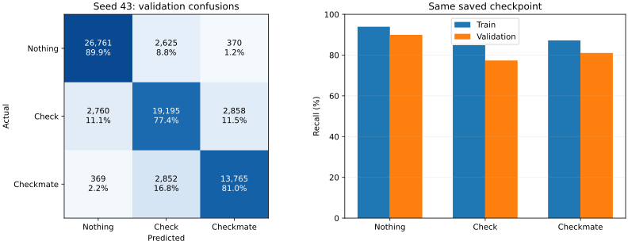
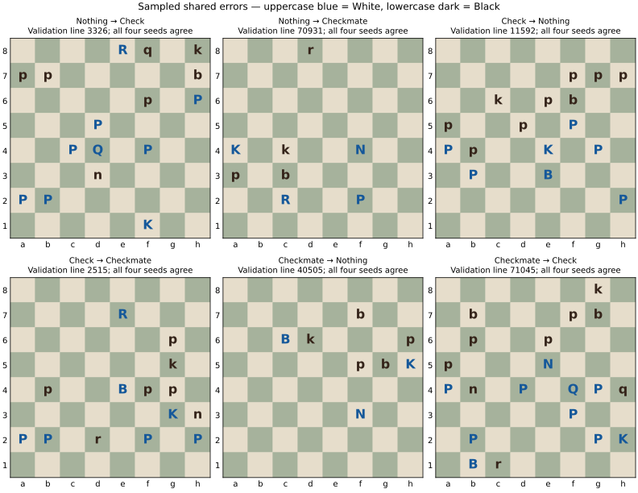

# Where the selected chess classifier makes errors

## Scope

Inference-only analysis of the selected seed-43 checkpoint (epoch 210, batch 128 / LR 0.08) and the three independently initialized seed-44–46 checkpoints. Labels from the school dataset are assumed correct; no label audit, relabeling, training, feature change or test evaluation is performed. All predictions use identical frozen validation bytes and analyzer; model/data hashes are checked. Seed 43 is also evaluated on the full training split to distinguish training performance from generalization.

## Main findings

- Validation errors: **11,834/71,555**. Check accounts for **5,618 missed true positions**, predicted Nothing 2,760 times and Checkmate 2,858 times.
- Check recall is **77.36% on validation** and **84.85% on train**. Thus the current checkpoint is well below 95% on both; a validation-only problem cannot explain the whole shortfall.
- **4,313 positions (6.03%) are wrong for all four seeds**. Randomness changes many errors, but there is a shared difficult set.
- Checkmate recall drops to **70.29% among positions with 21+ pieces** (2,104 actual mates), versus **89.69% with at most six pieces** (1,959 actual mates). This is a descriptive association, not proof of the cause.

## Class performance

| Class | Train precision | Train recall | Validation precision | Validation recall |
| --- | ---: | ---: | ---: | ---: |
| Nothing | 94.07% | 93.94% | 89.53% | 89.93% |
| Check | 85.36% | 84.85% | 77.80% | 77.36% |
| Checkmate | 86.27% | 87.22% | 81.00% | 81.04% |

Training macro F1 is 88.61%, versus 82.78% on validation. Both fitting the training examples and generalizing remain issues at this checkpoint; these measurements alone do not separate optimization, capacity, representation, and the effect of validation-based early stopping.

### Direction of errors

| Actual → predicted | Count | Share of all validation errors | Wrong for all four seeds |
| --- | ---: | ---: | ---: |
| Check → Checkmate | 2,858 | 24.15% | 1,204 |
| Checkmate → Check | 2,852 | 24.10% | 989 |
| Check → Nothing | 2,760 | 23.32% | 750 |
| Nothing → Check | 2,625 | 22.18% | 1,029 |
| Nothing → Checkmate | 370 | 3.13% | 216 |
| Checkmate → Nothing | 369 | 3.12% | 125 |

Nearly all errors involve Check. The model rarely jumps directly between Nothing and Checkmate; distinguishing Check from its two neighbors is the main measured weakness. Precision and recall of Check are both about 78%, so merely predicting Check more often would trade missed Checks against false alarms rather than solve the classification problem.

## Seeds: which errors survive?

| Actual class | Support | Wrong for all four seeds | Share of true class | Maximum recall if an oracle could choose any correct seed |
| --- | ---: | ---: | ---: | ---: |
| Nothing | 29,756 | 1,245 | 4.18% | 95.82% |
| Check | 24,813 | 1,954 | 7.87% | 92.13% |
| Checkmate | 16,986 | 1,114 | 6.56% | 93.44% |

The oracle column is an unattainable diagnostic bound for choosing among these four existing hard predictions. It is not a trained ensemble result and is not a ceiling for other models. It shows why just choosing another one of these seeds cannot yield 95% recall for every class.

A simple four-model majority vote, breaking ties with seed 43, achieves **84.45% macro F1**, **85.06% accuracy** and **79.78% Check recall** on the same validation set. It is an offline diagnostic only; no ensemble is deployed. It adds inference cost and still falls far short of 95% per class. This is validation-based exploration, not an independent gain estimate.

Against the previous reference, seed 43 fixes 5,072 errors but introduces 4,435 new errors. Its overall improvement does not mean it contains all the old model’s correct decisions.

## Position slices

These are prespecified descriptive slices, computed on the same validation positions. The table gives class support alongside recall to avoid confusing class mix with within-class performance. Piece count and king placement are correlated with other position properties; the results do not establish a causal feature to add.

| Slice | True Check support | Check recall | True Checkmate support | Checkmate recall |
| --- | ---: | ---: | ---: | ---: |
| piece_count: 13-20 | 9,619 | 75.63% | 8,339 | 80.15% |
| piece_count: 21+ | 5,338 | 81.68% | 2,104 | 70.29% |
| piece_count: 7-12 | 7,027 | 77.33% | 4,584 | 83.88% |
| piece_count: <=6 | 2,829 | 75.15% | 1,959 | 89.69% |
| side_to_move: b | 13,510 | 79.76% | 9,177 | 79.20% |
| side_to_move: w | 11,303 | 74.49% | 7,809 | 83.20% |
| kings_on_edge: 0 | 5,975 | 76.32% | 1,598 | 70.65% |
| kings_on_edge: 1 | 9,511 | 75.90% | 7,629 | 82.11% |
| kings_on_edge: 2 | 9,327 | 79.51% | 7,759 | 82.12% |

Kings-on-edge counts both kings, not specifically the checked king. No attacked-square or legal-move engine was used. En-passant-present cases number only 21, so they are not used to recommend a change. Detailed slices, including pawn presence, are retained in the portable JSON.

## Equivalent-color diagnostic

A derived validation file reverses rank order and swaps piece colors, side to move, castling rights and en-passant rank. The three class labels are preserved; optional White/Black label suffixes are swapped. This is the standard color-equivalent mirror operation described by the [python-chess documentation](https://python-chess.readthedocs.io/en/latest/core.html#chess.Board.mirror). Its transformation was implemented locally for analysis and checked to be an involution on every position; python-chess itself was not installed or used to check label correctness. Original train/validation files are unchanged.

Seed 43 changes its predicted class on **12,517/71,555 pairs (17.49%)** although the class should be invariant to this color-equivalent transformation. Original-correct → mirrored-wrong: 6,117; original-wrong → mirrored-correct: 5,769. Mirrored macro F1 is **82.29%**, versus **82.78%** originally.

The small aggregate F1 difference hides many individual changes in both directions. This motivates a controlled symmetry/representation experiment, but does not demonstrate that augmentation will improve recall or reach 95%. These derived positions are not independent validation or test samples. Pairwise disagreements between seeds are recorded separately in the JSON; a changed prediction is not unique evidence of a color bias.

## Concrete examples

Thirty examples were sampled deterministically (seed 43), five from each directed confusion, preferring positions for which all four models make the same incorrect prediction. They illustrate shared failures and are not a representative sample of the complete dataset. No claim is made about the tactical reason for a given mistake without a chess-rule analysis.

| Validation line | Actual → predicted by all four | FEN |
| --- | --- | --- |
| 3326 | Nothing → Check | `4Rq1k/pp5b/5p1P/3P4/2PQ1P2/3n4/PP6/5K2 b - - 0 41` |
| 70931 | Nothing → Checkmate | `3r4/8/8/8/K1k2N2/p1b5/2R2P2/8 w - - 3 55` |
| 11592 | Check → Nothing | `8/5ppp/2k1pb2/p2p1P2/Pp2K1P1/1P2B3/7P/8 w - - 0 38` |
| 2515 | Check → Checkmate | `8/4R3/6p1/6k1/1p2Bpp1/6Kn/PP1r1P1P/8 w - - 0 47` |
| 40505 | Checkmate → Nothing | `8/5b2/2Bk3p/5pbK/8/5N2/8/8 w - - 15 72` |
| 71045 | Checkmate → Check | `6k1/1b3pb1/1p2p3/p3N3/Pn1P1QPq/5P2/1P4PK/1Br5 w - - 2 37` |

## Next decision — no implementation yet

1. Finish Gustave’s controlled activation/initialization comparison. The current model has substantial errors even on training data, so optimization/representation deserve attention; these results do not prove that activation is the cause.
2. If that does not remove the main Check/Checkmate confusions, compare one representation or augmentation change at a time, using this baseline and the same validation protocol. The equivalent-color diagnostic supplies a concrete symmetry check; crowded Checkmate positions supply a concrete slice to monitor.
3. Track precision and recall together for each class. More seeds, a larger batch or a shifted decision threshold alone do not explain how to reach 95% in every class.

No targeted model, loss, encoder, dataset or training change has been made. No new training is started. Test data remain unused by this analysis.

## Evidence

- [Portable metrics, slices and sampled positions](data/2026-11-08-reference-error-analysis.json)
- Local reproducible analysis: `results/error-analysis/2026-11-08-reference-errors-01/` (frozen inputs/models, protocol, analyze.py, build_report.py, per-position predictions and metric exports).
