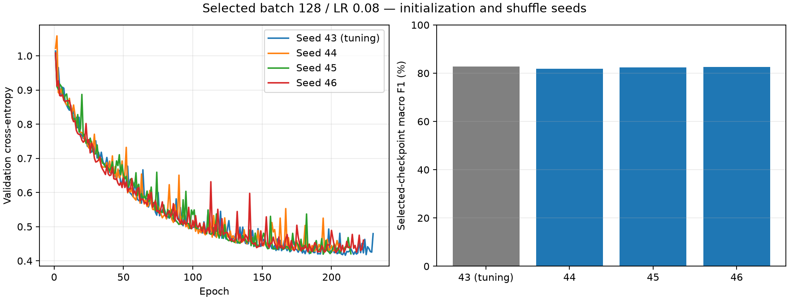

# Selected training configuration: seed robustness

## Protocol

The selected 777 → 128 → 64 → 3 sigmoid/softmax model uses Xavier initialization, batch 128, LR 0.08, one OpenBLAS thread, maximum 500 epochs, patience 20 and min-delta 0.0001. Seeds 44, 45 and 46 were declared before these runs and run sequentially from freshly generated weights. Both initialization and shuffle randomness change with the seed. The same frozen analyzer and full train/validation splits are used; hashes are checked. No test data are used.

Seed 43 was used for tuning and is shown separately. The primary mean, sample standard deviation and range below use only the three additional seeds. These are repetitions of one selected configuration, not comparisons against the old LR 0.01 across seeds.

## Results

| Seed | Completed epochs | Selected epoch | Epoch compute (s) | Validation macro F1 | Accuracy |
| --- | ---: | ---: | ---: | ---: | ---: |
| 43 (tuning, reused) | 230 | 210 | 1642.550 | 82.78% | 83.46% |
| 44 | 205 | 185 | 1471.626 | 81.84% | 82.38% |
| 45 | 214 | 194 | 1380.031 | 82.48% | 83.05% |
| 46 | 223 | 203 | 1437.091 | 82.54% | 83.19% |

Additional seeds 44–46: mean macro F1 **82.28%**, sample standard deviation **0.39 percentage points**, range **81.84–82.54%**. Mean epoch compute: **1429.583 s**.

## Per-class results

| Seed | Nothing F1 | Check F1 | Checkmate F1 |
| --- | ---: | ---: | ---: |
| 44 | 88.41% | 76.42% | 80.68% |
| 45 | 89.13% | 77.40% | 80.90% |
| 46 | 89.43% | 77.00% | 81.18% |

## Interpretation and limits

These repetitions quantify observed variability of the selected setting under initialization and shuffle seeds. Three additional seeds are a small sample, not a precise confidence guarantee. Their validation mean must not be compared as if it were a controlled multi-seed improvement over the old single-seed reference. A separate paired multi-seed campaign would be needed for that claim. The tuning seed is excluded from the primary aggregate to keep its role visible; validation positions themselves have already been used for selection.

Classification metrics evaluate each best-validation-loss checkpoint, not the final weights after patience. Epoch compute includes updates and full train/validation loss, but excludes loading, saving and classification evaluation. Process wall times are retained in raw manifests. CPU frequency and thermal conditions were not pinned. Early stopping is protocol-dependent and does not prove global convergence.

No checkpoint is promoted solely because it has the luckiest seed, and no final test or further training is launched automatically.

## Evidence

- [Portable metrics and histories](data/2026-11-08-reference-seed-robustness.json)
- Local run: `results/experiments/2026-11-08-reference-seeds-02/`.
- Each seed retains generated initial weights, network YAML, commands, logs, checkpoint, history and class metrics.
