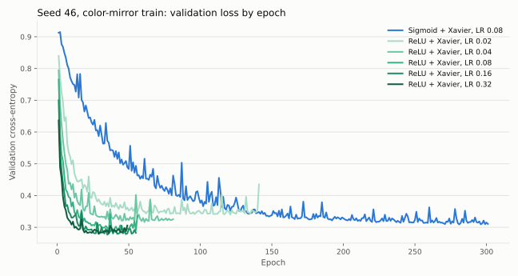
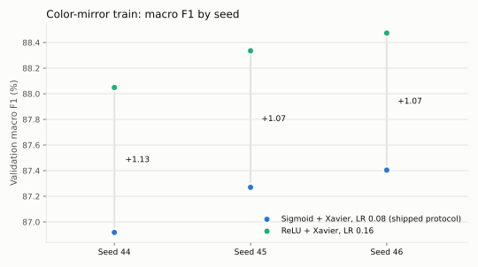

# ReLU on the color-mirror train: learning rate and seeds

## Purpose and protocol

The [activation comparison](2026-11-08-hidden-activations.md) found that ReLU
reaches sigmoid's quality in far fewer epochs on the original train. This report
asks whether that holds on the [color-mirror train](2026-11-08-color-mirror-augmentation.md)
used by the shipped model, and which learning rate suits ReLU there.

Every run repeats the color-mirror protocol and changes only the hidden activation
(ReLU, Xavier) and then the learning rate. All runs use the 777 → 128 → 64 → 3
network, softmax with cross-entropy, SGD, batch 128, at most 500 epochs, patience
20 and min_delta 0.0001. They use the same augmented train (1,141,143 positions,
SHA-256 `78481ab5…`) and the same validation split (`7628b122…`). The checkpoint
with minimum validation loss is saved. The test split is not used.

Two steps, each with a rule written in its protocol before the run:

1. **Learning rate, seed 46:** 0.02, 0.04, 0.08, 0.16 and 0.32. A rate counts as
   better than the previous best only if it gains more than 0.7 macro-F1 points,
   the seed spread observed in the 500-epoch sigmoid runs.
2. **Seeds 44 and 45 at the best rate.** ReLU is ahead of the augmented sigmoid
   only if all three ReLU seeds score above all three sigmoid seeds.

Runs used an Apple M5 on AC power with Accelerate BLAS limited to one thread.
Sigmoid values come from the color-mirror report, measured on Linux.

## Results

**Learning rate, seed 46**

| ReLU learning rate | Macro F1 | Accuracy | Selected validation loss | Training loss at that epoch | Selected / last epoch | Epoch compute |
| ---: | ---: | ---: | ---: | ---: | ---: | ---: |
| 0.02 | 86.22% | 86.94% | 0.3401 | 0.2038 | 121 / 141 | 2,374 s |
| 0.04 | 86.75% | 87.43% | 0.3165 | 0.2060 | 61 / 81 | 1,339 s |
| 0.08 | 87.80% | 88.48% | 0.2885 | 0.2036 | 36 / 56 | 936 s |
| **0.16** | **88.47%** | **89.11%** | **0.2767** | 0.1825 | 35 / 55 | 897 s |
| 0.32 | 88.34% | 88.98% | 0.2790 | 0.1926 | 29 / 49 | 817 s |

Each doubling from 0.02 to 0.16 improves macro F1. LR 0.32 is not better than
0.16 (−0.13 points), so 0.16 was kept for the seed runs.

**Seeds: ReLU LR 0.16 against the augmented sigmoid (LR 0.08)**

| Seed | ReLU macro F1 | Sigmoid macro F1 | Difference | ReLU selected epoch | Sigmoid selected epoch | ReLU updates to checkpoint | Sigmoid updates to checkpoint |
| ---: | ---: | ---: | ---: | ---: | ---: | ---: | ---: |
| 44 | 88.05% | 86.92% | +1.13 | 38 | 227 | 338,808 | 2,023,932 |
| 45 | 88.34% | 87.27% | +1.07 | 42 | 240 | 374,472 | 2,139,840 |
| 46 | 88.47% | 87.40% | +1.07 | 35 | 281 | 312,060 | 2,505,396 |
| **Mean** | **88.29 ± 0.22%** | 87.20 ± 0.25% | **+1.09** | 38 | 249 | | |

| Mean over seeds 44–46 | Accuracy | Nothing F1 / recall | Check F1 / recall | Checkmate F1 / recall |
| --- | ---: | ---: | ---: | ---: |
| Sigmoid + Xavier, LR 0.08 | 87.90% | 93.51% / 93.26% | 83.43% / 83.35% | 84.65% / 85.18% |
| ReLU + Xavier, LR 0.16 | **88.97%** | **94.24% / 93.85%** | **84.92% / 84.42%** | **85.70% / 87.06%** |

## Interpretation

- **ReLU at LR 0.16 is ahead on every seed.** The lowest ReLU seed, 88.05%, is above
  the highest sigmoid seed, 87.40%. The gain is regular, +1.07 to +1.13 points, and
  appears in every class. It is also above the best sigmoid continuation so far,
  87.57% ([SGD checkpoint continuation](2026-11-08-sgd-checkpoint-resume.md)).
- **Training is much shorter.** ReLU selects its checkpoint at epochs 35–42, against
  227–281 for sigmoid: 6.6× fewer optimizer updates on average. A full ReLU run takes
  15–17 minutes on the M5. Seconds are not compared, because the machines differ.
- **ReLU wants a larger learning rate than sigmoid.** A first guess was that 0.08
  was too high, because validation loss rises with spikes after the checkpoint.
  The opposite was measured: lower rates converge to a higher loss. The rise after
  the checkpoint is overfitting, which early stopping handles.
- **Limitations.**
  - The learning rate was chosen on seed 46 with the same validation split later
    used for the seed comparison, so validation is not a fresh estimate.
  - The test split stays reserved.
  - ReLU runs on macOS and sigmoid runs on Linux give different epoch orders for
    the same seed ([cross-platform note](2026-11-08-hidden-activations.md#reproducibility-across-platforms)).
    The comparison is therefore between seed sets, not identical trajectories.
- **Decision.** This report does not change the shipped model. Shipping ReLU would
  need a final training run under this protocol and a single test evaluation.

## Evidence

- [Portable measurements: protocols, hashes, histories, class metrics, confusion matrices and the sigmoid reference](data/2026-11-08-relu-color-mirror.json)
- Protocols, in run order:
  - [`train-relu-color-mirror.yml`](../../configs/protocols/train-relu-color-mirror.yml) (0.08);
  - [`compare-relu-color-mirror-lr.yml`](../../configs/protocols/compare-relu-color-mirror-lr.yml) (0.04, 0.02);
  - [`compare-relu-color-mirror-lr-high.yml`](../../configs/protocols/compare-relu-color-mirror-lr-high.yml) (0.16);
  - [`compare-relu-color-mirror-lr032.yml`](../../configs/protocols/compare-relu-color-mirror-lr032.yml) (0.32);
  - [`train-relu-color-mirror-lr016-seeds.yml`](../../configs/protocols/train-relu-color-mirror-lr016-seeds.yml) (seeds 44 and 45).
- Local runs: `results/experiments/2026-11-08-relu-color-mirror-*`.
