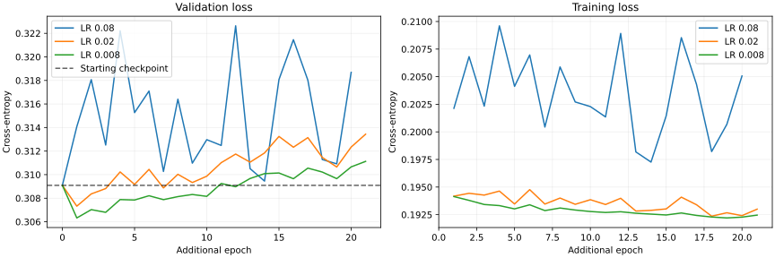

# SGD checkpoint continuation: three learning rates

## Result

Highest observed validation macro F1: **LR 0.008**, **87.57%**. Starting checkpoint: **87.40%**. Observed difference: **+0.165 percentage points**. All three comparisons are complete; no additional training or model promotion was performed.

| Model / LR | Completed additional epochs | Selected additional epoch | Validation loss | Macro F1 | Accuracy | Delta F1 (pp) |
| --- | ---: | ---: | ---: | ---: | ---: | ---: |
| Starting checkpoint | 0 | 0 | 0.309091 | 87.40% | 88.06% | — |
| 0.08 | 20 | 0 | 0.309091 | 87.40% | 88.06% | +0.000 |
| 0.02 | 21 | 1 | 0.307323 | 87.52% | 88.20% | +0.119 |
| 0.008 | 21 | 1 | 0.306324 | 87.57% | 88.23% | +0.165 |

Both reduced-rate arms select additional epoch 1, then stop after 20 stale epochs. Their later validation losses rise while training losses generally fall. This supports keeping the short adjustment; it provides no observed benefit from extending these trajectories. LR 0.008 improves F1 for all three classes, but Check recall falls from 83.76% to 83.53% (−0.23 pp). The gain is small and does not resolve the generalization gap.

## Protocol

Select the highest historical validation macro-F1 checkpoint among the three augmented seeds 44–46 before running any continuation: seed 46, original selected epoch 281. Its historical validation accuracy, macro F1, per-class metrics and complete confusion matrix reproduce exactly with the original frozen analyzer.

Each arm starts independently from the exact same weights and biases. Only model-config learning_rate changes: 0.08 (control), 0.02 and 0.008. Keep [777,128,64,3], sigmoid/softmax, SGD, seed 46, the same 1,141,143 augmented training positions and 71,555 validation positions. Batch 128, maximum 40 additional epochs per arm, patience 20, min_delta 0.0001; OpenBLAS/OMP environment limited to one thread. The original program and all input bytes are copied, made read-only and fingerprinted. Original and copied fingerprints are verified again after all runs.

Shuffle RNG and early-stopping state restart at each continuation; this is not an uninterrupted replay of the original training. Each saved checkpoint minimizes validation loss, including its epoch-zero starting model. Classification metrics evaluate these saved checkpoints; macro F1 was not measured at every epoch. Compare these checkpoints by macro F1; ties retain the starting checkpoint. No test split is read.

## Per-class validation scores

| Model / LR | Nothing F1 | Check F1 | Checkmate F1 | Nothing recall | Check recall | Checkmate recall |
| --- | ---: | ---: | ---: | ---: | ---: | ---: |
| Starting checkpoint | 93.50% | 83.69% | 85.03% | 92.86% | 83.76% | 85.93% |
| 0.08 | 93.50% | 83.69% | 85.03% | 92.86% | 83.76% | 85.93% |
| 0.02 | 93.61% | 83.76% | 85.20% | 93.47% | 83.38% | 85.98% |
| 0.008 | 93.62% | 83.83% | 85.26% | 93.40% | 83.53% | 86.05% |

## Durations and limits

| LR | Epoch compute (s) | Process wall (s) |
| --- | ---: | ---: |
| 0.08 | 322.625 | 331.217 |
| 0.02 | 339.280 | 346.452 |
| 0.008 | 323.202 | 330.133 |

Epoch compute includes updates and train/validation loss passes. Process wall also includes loading, overlap checks and saving. Other work/training may run concurrently, as explicitly authorized. Timing differences are descriptive and cannot establish an optimizer or LR speedup. Arms run sequentially within this campaign. Early stopping can produce unequal completed epoch counts; the common maximum is 40.

This is validation tuning of one already validation-selected checkpoint and seed. Small differences are not proof of a robust improvement or an independent final evaluation. The 40-epoch horizon cannot establish eventual convergence of the smaller rates. No longer run is started.

The first training process completed normally; the initial Python driver then failed to read completion diagnostics from stderr. The corrected driver recovered the already completed result, without repeating training or changing weights, and ran the two remaining arms. An orchestration test covered this recovery and checked that all arms started from identical weights with only the LR changed. The experiment-specific driver and its test are retained in the local raw-evidence archive.

Validation: the recovery/isolation test passed when the experiment was performed; every source/frozen input and shared-library hash was unchanged after the campaign. The saved control equals the original model after JSON parsing. Saved model configurations, selected/completed epoch counts, confusion-matrix sample totals, accuracy and macro F1 were independently checked against the raw artifacts. The SVG loss figure was visually inspected. No C++ implementation was changed.

## Evidence and reproduction

- [Portable protocol, histories, scores, hashes and environment](data.json)
- Raw evidence: `results/experiments/2026-11-08-sgd-resume-01/` in this checkout; frozen inputs, logs, CSV/SVG histories and each saved model.
- Highest-scoring model in the raw evidence: `lr-0008/model.nn`. This comparison does not replace a deployed/reference model.
- Local reproduction archive: `results/experiments/2026-11-08-sgd-resume-01/reproduction/` contains `sgd_resume.py`, `test_sgd_resume.py` and the report builder. These one-off scripts are not part of the versioned source tree.

The protocol above and the portable measurements retain the learning rates, stopping rules, original checkpoint identity, input fingerprints and exact analyzer commands. Replaying the experiment also requires the local frozen model, analyzer and datasets; those large artifacts are not stored in Git.
