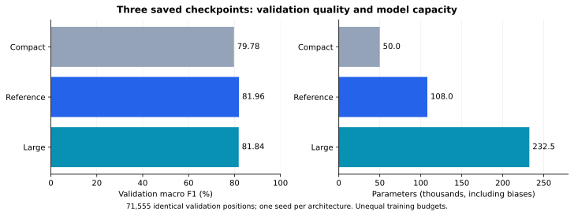
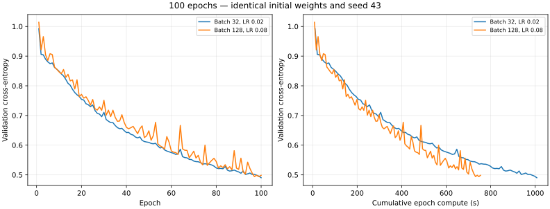
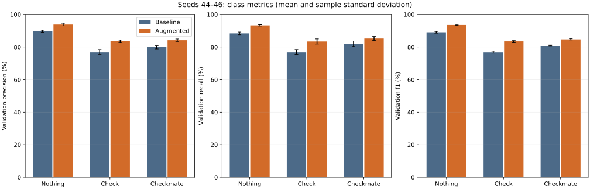
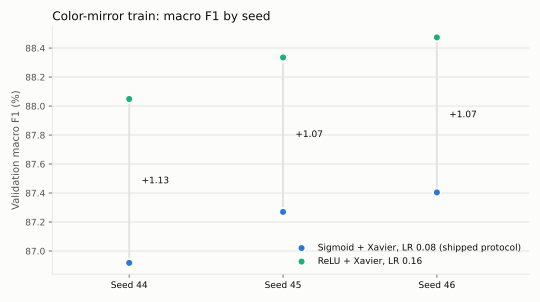
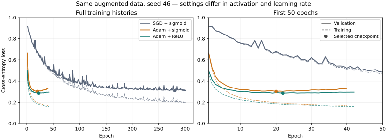

# Training performance history: from the first reference to the current candidates

This is the main reading path for presenting the training experiments at the
defense. It explains **what problem each experiment addressed, what changed,
what was measured and what we learned**. The dated reports retain the detailed
protocols and raw measurements. Evidence snapshot: **8 November 2026**; later
or ongoing trials are outside this history until their results are documented.

The progression has three main lessons: training the initial network longer
helped, tuning batch/LR made a useful quality/time compromise, and augmentation
then ReLU produced repeated quality gains. Large ReLU + Adam gives the highest
individual candidate score so far, with less evidence across seeds.

## 1. How to read the history

The task is to classify FEN positions as Nothing, Check or Checkmate, with a
777-input network and three outputs. The frozen original training set contains
572,445 positions; validation contains 71,555. Color-mirror augmentation later
increases train to 1,141,143 positions while preserving validation.

All headline scores below are **validation macro F1**, unless explicitly labeled
otherwise. Accuracy counts correct positions; macro F1 gives each class equal
weight. Always predicting Nothing would score 41.58% validation accuracy but
zero recall on both Check and Checkmate: an aggregate accuracy alone is not
enough to judge the classifier.

A saved checkpoint normally minimizes validation cross-entropy. Classification
metrics are computed on that checkpoint; F1 is not recorded at every epoch.
**Selected epoch** identifies the saved weights; **completed epochs** include
the later epochs needed to trigger early stopping. Epoch counts are not equal
work when dataset sizes change.

Costs also need a timer definition: **epoch compute** includes shuffling,
updates and full train/validation loss passes; **process wall time** additionally
includes loading and saving. Post-training classification is separate in the
recorded training protocols. Do not divide timings from different machines,
implementations or timer scopes to claim an optimizer speedup.

| Milestone | Validation macro F1 | What the number represents |
| --- | ---: | --- |
| Initial reference, epoch 100 | 72.28% | One historical checkpoint, seed 43 |
| Same network after continuation, epoch 338 | 81.96% | Same seed; partial original training metadata |
| Tuned sigmoid, batch 128 / LR 0.08 | 82.78% | Tuning seed 43; fresh initialization |
| Same setting, additional seeds | 82.28% ± 0.39 pp | Mean ± sample SD, seeds 44–46 |
| Color-mirror sigmoid | 87.20% ± 0.25 pp | Mean ± sample SD, paired seeds 44–46 |
| Color-mirror ReLU/SGD, LR 0.16 | 88.29% ± 0.22 pp | Mean ± sample SD, seeds 44–46; cross-platform comparison |
| Small color-mirror ReLU/Adam | 88.13% | One seed, 46 |
| Large color-mirror ReLU/Adam | 88.58% | One seed, 46; current shared candidate |

This is a development history, not a controlled ranking of every row. A
single-seed score and a three-seed mean do not provide the same strength of
evidence. Gains must be interpreted within the individual comparisons below.

## 2. Establishing a useful reference: train longer before changing everything

**Question.** Was the initial model already at a useful stopping point?

The first reference, trained on 5 November, uses 777 → 128 → 64 → 3,
sigmoid/softmax, Xavier, SGD LR 0.01, seed 43. On 7 November its epoch-100
checkpoint is continued with batch 32, up to 400 additional epochs, patience 20
and min_delta 0.0001. The best weights are selected at total epoch 338; training
actually reaches total epoch 358 before stopping.

| Measure | Epoch 100 | Selected epoch 338 |
| --- | ---: | ---: |
| Validation loss | 0.594914 | 0.432493 |
| Accuracy | 72.73% | 82.57% |
| Macro F1 | 72.28% | 81.96% |
| Check recall | 61.10% | 76.18% |

**Interpretation.** Longer training gives a substantial measured gain, especially
for Check, the weakest class. The network was not limited to its epoch-100
quality. The selected checkpoint also precedes the final epoch, illustrating why
the last weights are not automatically the best ones.

**Limit.** The continuation takes 68.68 minutes, but the first 100 epochs have no
recorded duration and incomplete training provenance. Do not call this a fully
controlled convergence benchmark or compare that duration with a fresh full run.
The continued reference's test result is 81.49% macro F1 at epoch 338; that result
belongs to this model only.

Source: [reference checkpoint history and per-class results](2026-11-07-reference-checkpoints/README.md).

## 3. Testing capacity: more parameters did not fix the early sigmoid model

**Question.** Would shrinking or widening the network improve its compromise?

| Hidden layers | Parameters, including biases | Validation macro F1 | Selected / completed epoch |
| --- | ---: | ---: | ---: |
| 64 | 49,987 | 79.78% | 494 / 500 |
| 128 / 64 | 108,035 | 81.96% | 338 / 358, including continuation |
| 256 / 128 | 232,451 | 81.84% | 324 / 344 |

**Read the figure.** The compact model removes 53.73% of the reference parameters
but loses 2.19 F1 points. The large model has 2.15× the parameters without an
aggregate gain. Its lower training loss and slightly worse validation loss are
consistent with a larger generalization gap.

**Decision.** Keep the reference as this experiment's compromise, then investigate
learning dynamics. This does not rule out larger networks under other settings:
there is only one seed, the reference has a different training history, and
the compact/large runners detected an executable change. Independent evaluation
with one frozen analyzer validates the saved-model comparison, not every earlier
training step. The later Adam width experiment revisits capacity more directly.

Source: [architecture comparison, curves and provenance incident](2026-11-07-three-models/README.md).

## 4. Tuning batch and learning rate: the control changed our conclusion

**Question.** Could training become faster without sacrificing useful learning?

The first five-epoch screen changes only batch size, keeping SGD LR 0.01 and
identical initial weights. Batches 128 and 256 shorten epochs, but their learning
is worse within the same compute budget. Fewer updates per epoch explain why
throughput alone is an insufficient criterion; the screen does not establish
final convergence.

The next trials tune batch 128's LR and select 0.08 from a short screen.
At twenty epochs it appears to improve both quality and time against the original
batch-32/LR-0.01 control. A stronger control then changes the interpretation:

| Twenty-epoch setting | Epoch compute | Saved-checkpoint macro F1 |
| --- | ---: | ---: |
| Batch 32 / LR 0.01 | 217.015 s | 58.02% |
| Batch 128 / LR 0.08 | 161.255 s | 62.73% |
| Batch 32 / LR 0.02 | 215.496 s | 63.96% |

**What we learned.** Tuning the smaller batch's LR recovers more quality than the
initial larger-batch gain. It would have been incorrect to attribute that gain
to batch size alone. At twenty epochs there is a quality/time tradeoff, not a
winner on every metric.

Both promising settings are then restarted from identical seed-43 Xavier weights
for exactly 100 epochs, with the same frozen data, executable and one BLAS thread:

| Matched setting | 100-epoch compute | Selected epoch | Macro F1 |
| --- | ---: | ---: | ---: |
| Batch 32 / LR 0.02 | 1,007.192 s | 100 | 77.72% |
| Batch 128 / LR 0.08 | 754.048 s | 99 | 77.71% |

**Read the figure.** The epoch axis shows learning per pass; the time axis shows
what that learning costs. Batch 128 saves 25.1% epoch compute at this horizon
with a −0.01-point observed F1 difference. This supports retaining the tuned
larger-batch setting for further training, not claiming statistical equivalence
or a pure batch-size effect.

A subsequent full seed-43 run selects epoch 210 out of 230 and reaches 82.78%
F1 in 1,642.55 seconds of epoch compute. Additional seeds 44–46 score
81.84%, 82.48% and 82.54%: mean 82.28%, sample SD 0.39 pp. The tuning seed is
excluded from that mean. This separates a favorable tuning result from the
variability seen on additional initializations.

Sources: [batch screen](2026-11-07-batch-size-screen/README.md),
[LR screening and twenty epochs](2026-11-07-batch-learning-rate-followup/README.md),
[stronger control](2026-11-07-batch-learning-rate-control/README.md),
[100-epoch comparison](2026-11-07-batch-learning-rate-100epochs/README.md),
[full run](2026-11-08-reference-b128-lr008/README.md),
[seed repetition](2026-11-08-reference-seed-robustness/README.md).

## 5. Improving the data: the largest repeated quality gain

**Question.** Could color-equivalent positions improve learning without changing
the architecture? Rank reflection plus color exchange preserves the class.
The augmentation keeps 568,698 new inputs after deduplication and exclusion of
validation/test overlaps. Only train grows; labels do not become input features.

Same-seed pairs start from identical weights. Sigmoid, SGD LR 0.08, batch 128,
maximum 500 epochs and the stopping policy remain fixed.

| Seed | Original-train F1 | Augmented-train F1 | Gain |
| --- | ---: | ---: | ---: |
| 44 | 81.84% | 86.92% | +5.08 pp |
| 45 | 82.48% | 87.27% | +4.79 pp |
| 46 | 82.54% | 87.40% | +4.87 pp |

**Read the figure.** Every paired seed improves, with gains in every class.
Mean F1 rises from 82.28 to 87.20%; mean Check recall rises from 76.95 to 83.35%.
This is stronger support than one favorable checkpoint.

**Cost and limit.** Augmented epochs contain almost twice as many positions:
8,916 updates rather than 4,473. Campaign epoch compute is 2.69× the historical
original-data campaign. The result combines new symmetric examples and additional
optimization under the stopping policy; it does not isolate those two effects.
Related mirrored positions also are not independent new observations.

Source: [augmentation protocol, costs, integrity checks and curves](2026-11-08-color-mirror-augmentation/README.md).

## 6. Diagnosing the plateau: overfitting and errors, not just more epochs

**Question.** Why does a model with more training data still make mistakes?

The augmented sigmoid checkpoints score 90.92% mean F1 on their own train versus
87.20% on validation: a mean paired gap of 3.72 points. Both residual training
errors and a generalization gap remain. This diagnostic alone cannot decide
whether optimization, architecture or representation is the cause.

Continuation tests restart the same seed-46 selected checkpoint independently:

| Continued SGD LR | Selected additional epoch | Validation macro F1 |
| --- | ---: | ---: |
| Starting model | 0 | 87.40% |
| 0.08 | 0 | 87.40% |
| 0.02 | 1 | 87.52% |
| 0.008 | 1 | 87.57% |

**Interpretation.** The same rate produces no better saved model. Reduced rates
give only a small gain, then validation worsens while train generally improves.
Extra epochs alone are not supported by these trajectories. The 0.008 aggregate
F1 gain also comes with slightly lower Check recall, so per-class metrics matter.

Sources: [train/validation diagnostic](2026-11-08-augmented-train-validation/README.md),
[continuation curves, recovery incident and class scores](2026-11-08-sgd-checkpoint-resume/README.md).

## 7. Changing learning dynamics: activations, then an appropriate LR

**Question.** Is sigmoid the best use of the training budget?

On the original train, a common 100-epoch maximum and seeds 42–44 compare
sigmoid, tanh, ReLU/Xavier and ReLU/He. Mean F1 is 77.94%, 81.98%, 82.28% and
81.75%, respectively. Every tanh/ReLU seed exceeds every sigmoid seed, while
the alternatives are not separated from each other under the predeclared rule.
ReLU/Xavier selects epochs 20–28; longer sigmoid training needs epochs 185–203
for the same 82.28% mean F1. Different machines prevent a wall-time speedup claim.

On augmented train, ReLU LR screening gives 86.22%, 86.75%, 87.80%, 88.47% and
88.34% F1 at rates 0.02, 0.04, 0.08, 0.16 and 0.32. Lowering the rate did not
solve the plateau; 0.16 is retained and tested on two additional seeds.

**Read the figure.** ReLU's mean is 88.29%, versus 87.20% for sigmoid, with
gains of 1.07–1.13 points per seed. Checkpoints need 6.6× fewer updates on average.
This supports the complete tuned ReLU setting. Runs use macOS versus historical
Linux sigmoid runs, so a shared seed does not guarantee identical trajectories
and seconds cannot be compared directly.

Sources: [activation/initialization comparison](2026-11-08-hidden-activations/README.md),
[augmented ReLU rates and seeds](2026-11-08-relu-color-mirror/README.md).

## 8. Adam and capacity: a promising candidate with an early optimum

**Question.** Could adaptive updates and more capacity improve the remaining errors?

The Adam follow-ups use augmented data, batch 128, Xavier and seed 46. A small
ReLU/Adam network at LR 0.001 selects epoch 22 of 42. Widening to 256/128 hidden
units changes only widths against that run; data/executable hashes and other
settings match. The larger network selects epoch 9 of 29.

| Same-seed ReLU/Adam model | Train / validation accuracy | Train / validation F1 | Full run wall time | Checkpoint bytes |
| --- | --- | --- | ---: | ---: |
| Small, 128 / 64 | 92.77 / 88.74% | 92.27 / 88.13% | 612.57 s | 10.92 MB |
| Large, 256 / 128 | 94.74 / 89.25% | 94.33 / 88.58% | 959.17 s | 23.54 MB |

**Interpretation.** The large model makes 365 fewer validation errors for about
57% longer training and a larger file including Adam state. More capacity helps
this setting, unlike the early sigmoid comparison. It does not help every
class: Checkmate F1 is essentially unchanged (85.90 → 85.86%).

**Read the figure.** This curve belongs to the **small** Adam model. Continuing
to reduce train loss after the validation minimum does not improve the retained
model. The large model's accuracy gap is wider (5.49 pp versus 4.03 pp), so its
quality gain does not mean that overfitting disappeared.

This is one seed on reused validation. The best recorded ReLU/SGD seed has 88.47%
F1; the large Adam candidate's 88.58% is only slightly higher. That difference
does not establish robust superiority. Earlier sigmoid/SGD and Adam timings also
use different storage implementations: do not attribute their time ratio to the
optimizer alone.

Source: [Adam experiments and controlled width follow-up](2026-11-08-adam-optimizer/README.md).

## 9. What remains difficult, and what is actually delivered

The large Adam candidate has 7,694 validation errors; 4,410 are Check↔Checkmate.
A separate ReLU/SGD audit finds errors concentrated on blocked attack lines and
checks with few legal replies. All 644,000 original train/validation labels
agree with the offline chess oracle, so bad labels are not supported as the main
explanation on those rows. This does not certify all positions as fully legal
or the dataset as representative of unseen games.

| Artifact in this snapshot | Validation accuracy / F1 | Status |
| --- | --- | --- |
| Root `my_torch_network.nn` | 93.78 / 93.27% | Delivered: ReLU + Adam 256/128, dropout 0.1, left-right ×4 train, seed 49, epoch 47; test 93.66 / 93.15% |
| `models/large-relu-adam-seed46-lr0.001.nn` | 89.25 / 88.58% | Shared candidate; not promoted |
| Previous root model | 88.06 / 87.40% | Color-mirror sigmoid, seed 46, epoch 281; replaced |

The delivered model adds the left-right mirrors and dropout to the large ReLU +
Adam setting ([four changes](2026-11-08-mirror-view-ensemble.md)). Its single test
evaluation gives 93.66% accuracy / 93.15% macro F1; 2,985 of its 4,537 test errors
confuse Check and Checkmate. The test split already has historical reference scores: it is
not a newly untouched holdout. Prepared generated-game datasets do not yet have
a quality gain documented in this history.

Sources: [error audit](2026-11-08-label-and-error-audit/README.md),
[delivered provenance](2026-11-08-mirror-view-ensemble.md),
[candidate identity](../../models/README.md).

## 10. Presenting the evidence at the defense

Use the following sequence rather than reading every experiment table aloud:

| Step | Evidence to show | Point to explain |
| --- | --- | --- |
| Starting point | Epoch-100 versus epoch-338 table | Training longer helped, especially on Check; incomplete original metadata stays explicit |
| Controlled optimization | Twenty-epoch control, then matched 100-epoch curves | A better control changed the explanation; selected batch/LR saves time at the tested horizon |
| Strongest repeated gain | Paired augmentation chart | All three seeds and every class improve, with a larger training-work budget |
| Better learning dynamics | ReLU seed chart | Tuned ReLU improves quality and needs fewer updates, without claiming a cross-machine timing speedup |
| Remaining limits | Adam capacity table, loss curve and class confusions | Higher aggregate quality costs more; early stopping limits later overfitting and errors remain |
| Delivery | Actual model filename, provenance and prediction demo | Experimental candidates and the artifact submitted to evaluation are distinct |

For each figure name the model, data, metric, axes, checkpoint-selection rule and
comparison limit. Keep full histories, failed runs and frozen inputs locally;
portable JSON/SVG evidence remains linked from the [report archive](README.md).
The [trial/failure log](../experiment-decisions.md) covers technical incidents;
the [hyperparameter guide](../hyperparameters.md) explains each setting.

CPU throughput is a separate engineering result: the full-data BLAS benchmark
measures 18.994 → 11.062 seconds per epoch (1.72×), with numerical equivalence
checks. It does not establish the quality of a trained model, inference latency
or peak memory. See the [CPU benchmark](../../benchmarks/cpu_blas/results/linux-2026-11-07/README.md)
if asked about execution efficiency.
