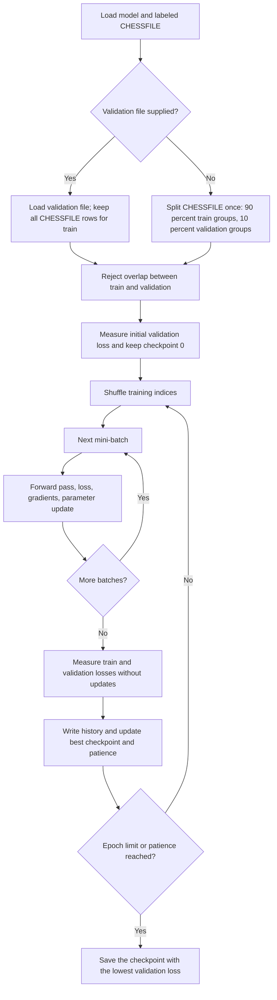
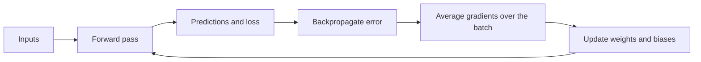

# Training

Train a saved model, follow its learning progress, and understand how the
parameters change. The C++ analyzer trains models end to end; the Python
experiment adapter still needs to be implemented.

| I want to… | Go to |
| --- | --- |
| Train and save a model | [1. Commands and options](#1-train-a-model) |
| Understand an epoch | [2. Training flow](#2-training-flow) |
| Know which model is saved | [3. Checkpoints and stopping](#3-checkpoints-and-stopping) |
| Read logs or diagnose a failure | [4. History and failures](#4-history-and-failures) |
| Understand backpropagation | [5. Neural calculations](#5-neural-calculations) |
| Connect automated experiments | [6. Experiment runner](#6-experiment-runner) |
| Find tests and remaining work | [7. Verification and limits](#7-verification-and-limits) |

> **Validation is always used:** supply `--validation FILE` to keep existing
> train/validation splits, or omit it to create an automatic 90/10 split from
> `CHESSFILE`. Both modes use the same early stopping and best-checkpoint rule.

## 1. Train a model

Run from the repository root after `make` and [dataset preparation](datasets.md).
Generate an initial model first (the generator skips existing filenames):

```sh
./my_torch_generator configs/basic_network.conf 1
```

Then train it. Replace `train.txt` and `validation.txt` with your prepared,
labeled split paths:

```sh
./my_torch_analyzer --train \
  --validation validation.txt \
  --save models/trained.nn \
  models/basic_network_1.nn train.txt
```

For a single labeled file, omit `--validation`:

```sh
./my_torch_analyzer --train --save models/trained.nn models/basic_network_1.nn positions.txt
```

`LOADFILE` must be an existing model with 777 inputs and 3 outputs. Both datasets
must contain six-field FENs followed by a class label. Train and validation must
have no shared model-visible positions; the command rejects overlap. Keep the
test set for final evaluation.

### Options

Place options before the two positional paths, `LOADFILE CHESSFILE`.
Unknown or repeated options, missing values, and training options in prediction
mode are rejected.

| Option | Default | Purpose |
| --- | --- | --- |
| `--validation FILE` | Automatic 90/10 split | Use a separate validation file instead of splitting `CHESSFILE`; never used for updates |
| `--epochs N` | `100` | Maximum epochs |
| `--batch-size N` | `32` | Training samples per update |
| `--patience N` | `10` | Epochs without sufficient improvement before stopping |
| `--min-delta X` | `0.0001` | Validation-loss improvement required to reset patience |
| `--history FILE` | Automatic path | CSV destination; an existing file is rejected |
| `--save FILE` | `LOADFILE` | Output model; use a distinct path to preserve the input model |

Epochs, batch size, and patience must be positive integers. Minimum improvement
must be finite and nonnegative. Learning rate and seed come from the loaded
model. The seed controls training order; reproducibility requires the same
inputs, settings, build, and runtime environment.

## 2. Training flow

| Term | Meaning |
| --- | --- |
| Loss | A numeric error score to minimize; it is different from classification accuracy |
| Gradient | How the loss changes when a weight or bias changes |
| Learning rate | Size of each parameter update; loaded from the model |
| Mini-batch | A small group of training samples used for one update |
| Epoch | One pass over every training sample |
| Checkpoint | An independent copy of a model's parameters |



**Train updates weights; validation selects checkpoints; test is reserved for
final evaluation.** The training command never loads the test set. Duplicate
training rows are allowed for class balancing; shared train/validation inputs
are rejected even when their FEN move counters differ.

### Automatic split rules

| Step | Rule |
| --- | --- |
| Group | Keep rows with the same encoded inputs together: board, side to move, and en passant file; castling rights and move counters do not distinguish inputs |
| Check labels | Reject different labels for the same model-visible input |
| Stratify | Split independently within each class present in the file |
| Select holdout | Shuffle groups using the model seed; reserve the nearest integer to 10% of groups per class, clamped to at least one group on each side |
| Preserve rows | Keep every row, including duplicates, on its group's side; preserve source order before epoch shuffling |
| Report | Print automatic/explicit mode, train and validation row counts, and seed to stderr |

Each class present needs at least **two distinct model-visible inputs**. Otherwise
training fails before updates or history creation; provide more data or an
independent `--validation FILE`. Absent classes are not invented.

The split is computed **once before training**, using its own seeded random
generator, and stays fixed across epochs. On the same build/runtime, the same
input file and model seed reproduce it. Rounding and unequal duplicate-group
sizes can make the row ratio differ from 90/10, especially on small datasets.
The operation happens in memory and never rewrites source files.

**For the frozen reference and comparable experiments, always pass
`--validation validation.txt` alongside the reference `train.txt`.** This keeps
the existing train/validation assignments intact and leaves the test set for
final evaluation. Omitting the option intentionally splits the loaded train
file again; the automatic-mode message makes that visible. The experiment
adapter must pass its supplied validation path explicitly.

The analyzer seeds one `std::mt19937` from the model seed. Each epoch shuffles
canonical sample indices, then processes every sample once, including the final
partial batch. Reproducibility requires identical data, settings, build, and
runtime; results are not promised to be identical across standard libraries.

## 3. Checkpoints and stopping

After each epoch, the command measures mean training and validation losses
without updating weights. It stops at the epoch limit or when patience runs out.
Patience resets when validation loss improves by more than `--min-delta`
relative to the last patience reset.

The saved model always has the lowest observed validation loss, including the
initial model if no epoch improves it. Checkpoint selection tracks every decrease,
including improvements smaller than `--min-delta`.

| Decision | Condition |
| --- | --- |
| Keep a new best checkpoint | `validation_loss < best_validation_loss` |
| Reset patience | `validation_loss < patience_reference - min_delta` |
| Stop | Epoch limit reached, or `patience` consecutive epochs without a reset |

The patience reference starts at the initial validation loss and changes only
on a reset. Small improvements can therefore accumulate enough to reset it.

With `--save`, the source model remains unchanged. Without it, successful training
replaces `LOADFILE`. Saving uses a temporary file and rename; failed training
does not replace the destination model.

## 4. History and failures

Each successful run writes `epoch,train_loss,validation_loss` to a CSV file. Without
`--history`, it creates a unique `logs/train_<date-time-id>/history.csv` and prints
the path on stderr. With an explicit path, missing parent directories are
created and existing files are never overwritten.

Each run also writes a human-readable log, `logs/train_<UTC time>.log`, with the
model, datasets, settings, epoch losses and durations, and the saved model; see
the [logging guide](logging.md).

Progress and errors go to stderr. Success returns `0`; invalid arguments,
invalid data, training failures, and history/save errors return `84`. A failed
run may retain a partial history for diagnosis.

A history file can contain only its header or completed epochs after a failure.
History paths must not alias model or dataset paths. Model paths must not overwrite
datasets; an alternate `--save` path must not alias the source model.
The output model is serialized to a reserved temporary file beside its destination,
then renamed. A failed run leaves the caller's model and an existing destination
unchanged; this is not a guarantee against power loss.

```csv
epoch,train_loss,validation_loss
1,1.12,1.18
2,0.93,1.01
```

Read the curves together: falling train loss with rising validation loss suggests
overfitting. Loss is the optimization objective; use the
[evaluation guide](evaluation.md) for accuracy, macro F1, and confusion matrices.

## 5. Neural calculations

The neural module operates on numeric vectors and has no knowledge of chess.
The analyzer converts FENs into 777 inputs and one-hot targets ordered
`Nothing`, `Check`, `Checkmate`.



| Entry point | Contract |
| --- | --- |
| `loss(samples) const` | Mean loss; never updates parameters |
| `gradients(samples) const` | Gradients for every weight and bias, shaped like `layers()`; no update |
| `trainBatch(batch)` | One SGD update; returns mean batch loss **before** the update |
| `validateSamples(samples) const` | Rejects invalid dimensions, values, or targets |
| `config()` / `layers()` | Read-only configuration / parameters; explicit parameters can be supplied to the constructor for checks |

A `TrainingSample` contains `inputs` and `target` numeric vectors. The analyzer
owns sample ordering and batches; the neural methods do not load files, shuffle,
log, or save models.

### Notation

For a layer with weights `W` and biases `b`, receiving the previous activations
`a_prev`:

```text
z = W · a_prev + b      values before the activation (logits for the output layer)
a = f(z)                activations, passed to the next layer
p                       output probabilities (softmax or sigmoid of the output logits)
y                       target values
N                       number of samples in the batch
```

### Loss

The loss depends on the output activation; any other output activation is
rejected.

| Output | Loss for one sample |
| --- | --- |
| `softmax` | Categorical cross-entropy: `-Σ_k y_k · log(p_k)` |
| `sigmoid` | Binary cross-entropy summed over outputs: `-Σ_k [y_k · log(p_k) + (1 - y_k) · log(1 - p_k)]` |

The loss of a collection is the **mean** over its samples. Train and validation
losses therefore use the same scale. Batch averaging avoids scaling gradients
with batch size; the best learning rate can still depend on the batch size.

#### Numerical stability

A probability can round to exactly 0 or 1 (for example `sigmoid(40)` is `1.0` in
double precision), and `log(0)` is infinite. The forward pass therefore keeps the
output logits, and the loss is computed from them without forming probabilities:

```text
softmax:  -log(p_k) = (m - z_k) + log(Σ_j exp(z_j - m))     with m = max_j z_j
sigmoid:  per output  max(z, 0) - z · y + log1p(exp(-|z|))
```

For finite logits with representable differences and totals, these formulas
avoid exponential overflow and `log(0)`. Non-finite computed losses are rejected.
For logits `[800, 0, 0]` and the third class expected, the loss is `800` instead
of infinity.

For one-hot targets the minimum loss is 0. Soft targets are accepted; their
minimum loss is the entropy of the target, not 0.

### Gradients

For each sample, backpropagation computes the derivative of its loss with respect
to every parameter:

1. **Forward pass**, keeping the activations of every layer.
2. **Output delta** `δ = p - y`. This is the derivative of the loss with respect
   to the output logits, both for softmax with cross-entropy (targets summing to 1)
   and for sigmoid with binary cross-entropy.
3. **For each layer, from the last to the first:**
   - weight gradient `∂L/∂W[j][k] = δ[j] · a_prev[k]`;
   - bias gradient `∂L/∂b[j] = δ[j]`;
   - delta of the previous hidden layer `δ_prev = (Wᵀ · δ) ⊙ f'(a_prev)`, where `⊙`
     multiplies element by element.

Derivatives are computed from the activations already stored by the forward pass:

| Hidden activation | `f'` from its output `a` |
| --- | --- |
| `sigmoid` | `a · (1 - a)` |
| `tanh` | `1 - a²` |
| `relu` | `1` if `a > 0`, else `0` (0 at the kink) |
| `linear` | `1` |

Softmax has no element-wise derivative and is rejected as a hidden activation.

The gradients of a batch are the **mean** of the sample gradients, divided by the
actual batch size: a final partial batch uses its own size.

### Update

`trainBatch` applies one step of plain mini-batch stochastic gradient descent:

```text
θ ← θ - η · ∂L_batch/∂θ        for every weight and bias θ, with η = config().learning_rate
```

The loss and the gradients come from the same forward pass, so the returned
pre-update loss costs nothing extra. The analyzer reports epoch losses with
`loss()` after each epoch instead of averaging these batch values, which were
measured with different parameters.

The new parameters are computed aside and installed only when all of them are
finite. **Whenever `trainBatch` throws, the network is unchanged.** Training only
changes weights and biases, never the configuration (architecture, activations,
learning rate, seed). Networks are plain values, so a copy is an independent
checkpoint.

### Errors

| Situation | Exception |
| --- | --- |
| Empty collection, wrong number of inputs or targets | `std::invalid_argument` |
| Non-finite input or target, target outside `[0, 1]` | `std::invalid_argument` |
| Softmax targets not summing to 1 (tolerance `1e-6`) | `std::invalid_argument` |
| Output activation other than softmax or sigmoid | `std::invalid_argument` |
| Hidden activation without derivative (softmax) | `std::invalid_argument` |
| Learning rate not finite and positive | `std::invalid_argument` |
| Non-finite loss, gradient, or updated parameter | `std::runtime_error` (suggests a lower learning rate) |

Messages name the faulty sample, for example `training sample 1: expected 3
inputs, got 2`. Samples are validated before any computation.

## 6. Experiment runner

**Pending:** the C++ training command works, but no adapter connects it to
`scripts/experiment.py`. Consequently, `training.command` and `training.settings`
remain `null` in `configs/experiment.json`. Full experiments fail before creating
an output directory; `--prepare` can already generate initial models.

See the [evaluation guide](evaluation.md) for campaigns, metrics, and notebooks.
The integration contract below is for implementing the adapter.

### Request and command

Set `training.command` to an **argument array**; it runs from the repository root
without a shell. It must consume `{initial_model}`, `{trained_model}`, and
`{training_config}`. Available placeholders:

| Placeholder | Value |
| --- | --- |
| `{initial_model}` | Generated input model; must remain unchanged |
| `{trained_model}` | Per-run `trained.nn` destination |
| `{training_config}` | Per-run `training.json`: seed, settings, train/validation paths and hashes |
| `{history}` | Per-run `history.csv` destination |
| `{seed}` | Requested seed, also recorded in `training.json` |
| `{train}`, `{validation}` | Prepared dataset paths |
| `{analyzer}`, `{root}` | Analyzer executable and repository root |

`training.settings` must be a nonempty object. The adapter must validate and
apply its fields, reject unknown settings, and ensure that the model seed matches
the request. The settings schema and command still need to be agreed. CLI
options for epochs, batch size, patience, and minimum improvement already exist;
passing `training.json` alone does not apply them.

### Result and history

The backend returns nonzero on failure. Success requires a valid model at
`{trained_model}`, with the original configuration and seed preserved. The runner
rejects a missing output, a modified initial model, a changed configuration, or
unchanged weights and biases. It then uses the analyzer for validation predictions.
These checks detect a no-op backend; model quality still requires evaluation.

For the analyzer, pass `{history}` through `--history`. Other backends may omit
history; if present it must use the [CSV format above](#4-history-and-failures),
with at least one epoch, strictly increasing positive integer epoch numbers, and
finite nonnegative losses. Missing history is reported by the notebook; malformed
history fails the run. Document the loss averaging and checkpoint policy.

The runner retains command arguments, working directory, stdout/stderr, and
elapsed time. Failure or interruption preserves completed results and logs. It
never substitutes an initial model for failed training, and never supplies test
data to the backend.

## 7. Verification and limits

### Where to look in the code

| Area | Implementation |
| --- | --- |
| CLI arguments and defaults | [`src/analyzer/Arguments.cpp`](../src/analyzer/Arguments.cpp), [`Arguments.hpp`](../src/analyzer/Arguments.hpp) |
| Epochs, batches, validation, checkpoints, history, saving | [`src/analyzer/Training.cpp`](../src/analyzer/Training.cpp) |
| Forward pass and sample validation | [`src/neural/NeuralNetwork.cpp`](../src/neural/NeuralNetwork.cpp) |
| Backpropagation and SGD | [`src/neural/Training.cpp`](../src/neural/Training.cpp) |
| Stable losses and activation derivatives | [`Loss.cpp`](../src/neural/Loss.cpp), [`Activation.cpp`](../src/neural/Activation.cpp) |
| Experiment requests and result checks | [`scripts/experiment.py`](../scripts/experiment.py) |

Run `make test` to build and run the checks:

| Tests | Evidence |
| --- | --- |
| `tests/Loss.cpp`, `tests/Activation.cpp` | Hand-computed losses and derivatives, extreme logits, numerical stability |
| `tests/Backpropagation.cpp` | Known gradients and updates, batch averaging, invalid inputs, unchanged parameters on failure, XOR learning |
| Finite differences in `tests/Backpropagation.cpp` | Perturb every weight and bias by `±1e-6`; compare the measured loss slope with backpropagation for all eight hidden/output activation pairs (test tolerance `1e-7`) |
| `tests/Training.cpp` | Scripted neural methods isolate scheduling, partial batches, shuffling, patience, checkpoint selection, and file failures; automatic split checks cover seed reproducibility, stratification, duplicate groups, coverage, and holdout exclusion from updates |
| `tests/cli.py` | Real training in explicit and automatic validation modes, minimal subject syntax, both save modes, repeatable outputs, and invalid split/argument errors |
| `tests/experiment.py`, `tests/comparison.py` | Runner failure handling, output validation, and history parsing |

The orchestration test substitutes scripted neural methods when linking; shipped
executables use the real backend. Its tests verify control flow, while the
backpropagation and CLI tests verify actual learning and integration.

### Practical limits and next work

| Topic | Current behavior / remaining work |
| --- | --- |
| Chess quality | An operational training pipeline does not establish good classification; run full validation comparisons before final test evaluation |
| CLI compatibility | Minimal subject invocation supported through automatic validation; explicit validation preserves reference splits |
| Automated campaigns | Implement the adapter and freeze its settings schema and comparison grid |
| Optimizer | Plain mini-batch SGD; momentum, Adam, dropout, and weight decay are not implemented |
| Activations | Training supports softmax/sigmoid outputs; hidden derivatives support sigmoid/tanh/ReLU/linear, while file configurations accept sigmoid/tanh/ReLU |
| Memory | Train and validation samples are loaded into memory as dense vectors |
| Speed | First-layer multiplication still visits zero inputs; sparse inputs and parallelism are possible follow-ups |

Gustave's development measurement on an Apple M5: eight epochs on 2,400 positions
with a `777 → 128 → 64 → 3` network took 2.3 seconds with `-O2`, versus 20.2
seconds without it, with identical losses. This is a small-run measurement,
not a benchmark of the full dataset; measure full-run time and memory on the
machine used for experiments.
