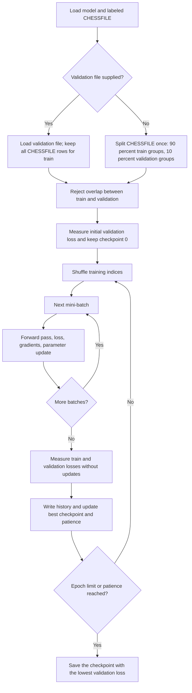
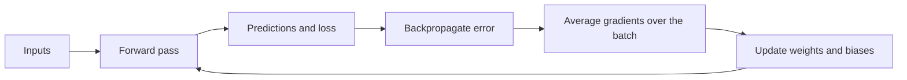
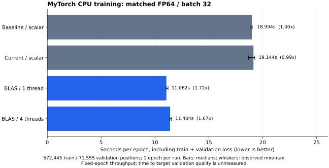

# Training

Train a saved model, follow its learning progress, and understand how the
parameters change. The C++ analyzer trains models end to end; the Python runner
uses it to execute reproducible protocols and collect results.

| I want to… | Go to |
| --- | --- |
| Train and save a model | [1. Commands and options](#1-train-a-model) |
| Understand an epoch | [2. Training flow](#2-training-flow) |
| Know which model is saved | [3. Checkpoints and stopping](#3-checkpoints-and-stopping) |
| Read logs or diagnose a failure | [4. History and failures](#4-history-and-failures) |
| Understand backpropagation | [5. Neural calculations](#5-neural-calculations) |
| Connect automated experiments | [6. Experiment runner](#6-experiment-runner) |
| Find tests and limits | [7. Verification and limits](#7-verification-and-limits) |
| Justify settings from measured results | [Model and training hyperparameters](hyperparameters.md) |
| Understand unsuccessful trials and corrections | [Trial and failure log](experiment-decisions.md) |

> **Validation is always used:** supply `--validation FILE` to keep existing
> train/validation splits, or omit it to create an automatic 90/10 split from
> `CHESSFILE`. Both modes use the same early stopping and best-checkpoint rule.

## 1. Train a model

Run from the repository root after `make` and [dataset preparation](datasets.md).
Generate an initial model first (the generator skips existing filenames):

```sh
./my_torch_generator configs/networks/basic-network.yml 1
```

Then train it. Replace `train.txt` and `validation.txt` with your prepared,
labeled split paths:

```sh
./my_torch_analyzer --train \
  --validation validation.txt \
  --save models/trained.nn \
  models/basic-network_1.nn train.txt
```

For a single labeled file, omit `--validation`:

```sh
./my_torch_analyzer --train --save models/trained.nn models/basic-network_1.nn positions.txt
```

`LOADFILE` must be an existing model with 777 inputs and 3 outputs. Both datasets
must contain six-field FENs followed by a class label. Train and validation must
have no shared model-visible positions; the command rejects overlap. Keep the
test set for final evaluation.

### Options

Place options before the two positional paths, `LOADFILE CHESSFILE`.
Unknown or repeated options, missing values, and training options in prediction
mode are rejected.

| Option | Default | Purpose |
| --- | --- | --- |
| `--validation FILE` | Automatic 90/10 split | Use a separate validation file instead of splitting `CHESSFILE`; never used for updates |
| `--epochs N` | `100` | Maximum epochs |
| `--batch-size N` | `32` | Training samples per update |
| `--threads N` | Library/environment | CPU BLAS thread limit; scalar builds accept only `1` |
| `--patience N` | `10` | Epochs without sufficient improvement before stopping |
| `--min-delta X` | `0.0001` | Validation-loss improvement required to reset patience |
| `--lr-decay F` | off | On a plateau, restart from the best epoch with the learning rate multiplied by `F` (0 < `F` < 1) |
| `--decay-patience N` | `5` | Epochs without sufficient improvement before each decay; requires `--lr-decay` |
| `--max-decays N` | `3` | Decays allowed; the next plateau then ends training; requires `--lr-decay` |
| `--history FILE` | Automatic path | CSV destination; an existing file is rejected |
| `--save FILE` | `LOADFILE` | Output model; use a distinct path to preserve the input model |

Epochs, batch size, and patience must be positive integers. Minimum improvement
must be finite and nonnegative. Learning rate, dropout and seed come from the loaded
model, as does the optimizer (`sgd` or `adam`). Learning-rate decay changes the rate
only during the run: the saved model keeps its configured learning rate. The seed
controls training order; reproducibility requires the same inputs, settings, build,
and runtime environment.

Architecture, activations, initialization, optimizer, learning rate, dropout and seed
are defined in the [network YAML](architecture.md#network-configuration), then stored
in the generated model. Training options control the run budget, validation and
learning-rate decay, not those model settings. The basic YAML uses sigmoid/SGD;
ReLU/Adam experiments declare their changes in [protocols](evaluation.md#network-configuration).

## 2. Training flow

| Term | Meaning |
| --- | --- |
| Loss | A numeric error score to minimize; it is different from classification accuracy |
| Gradient | How the loss changes when a weight or bias changes |
| Learning rate | Size of each parameter update; loaded from the model |
| Mini-batch | A small group of training samples used for one update |
| Epoch | One pass over every training sample |
| Checkpoint | An independent copy of a model's parameters |



**Train updates weights; validation selects checkpoints; test is reserved for
final evaluation.** The training command never loads the test set. Duplicate
training rows are allowed for class balancing; shared train/validation inputs
are rejected even when their FEN move counters differ.

### Automatic split rules

| Step | Rule |
| --- | --- |
| Group | Keep rows with the same encoded inputs together: board, side to move, and en passant file; castling rights and move counters do not distinguish inputs |
| Check labels | Reject different labels for the same model-visible input |
| Stratify | Split independently within each class present in the file |
| Select holdout | Shuffle groups using the model seed; reserve the nearest integer to 10% of groups per class, clamped to at least one group on each side |
| Preserve rows | Keep every row, including duplicates, on its group's side; preserve source order before epoch shuffling |
| Report | Print automatic/explicit mode, train and validation row counts, and seed to stderr |

Each class present needs at least **two distinct model-visible inputs**. Otherwise
training fails before updates or history creation; provide more data or an
independent `--validation FILE`. Absent classes are not invented.

The split is computed **once before training**, using its own seeded random
generator, and stays fixed across epochs. On the same build/runtime, the same
input file and model seed reproduce it. Rounding and unequal duplicate-group
sizes can make the row ratio differ from 90/10, especially on small datasets.
The operation happens in memory and never rewrites source files.

**For the frozen reference and comparable experiments, always pass
`--validation validation.txt` alongside the reference `train.txt`.** This keeps
the existing train/validation assignments intact and leaves the test set for
final evaluation. Omitting the option intentionally splits the loaded train
file again; the automatic-mode message makes that visible. The built-in experiment
adapter passes its supplied validation path explicitly.

The analyzer seeds one `std::mt19937` from the model seed. Each epoch shuffles
canonical sample indices, then processes every sample once, including the final
partial batch. Reproducibility requires identical data, settings, build, and
runtime; results are not promised to be identical across standard libraries.

## 3. Checkpoints and stopping

After each epoch, the command measures mean training and validation losses
without updating weights. It stops at the epoch limit or when patience runs out.
Patience resets when validation loss improves by more than `--min-delta`
relative to the last patience reset.

The saved model always has the lowest observed validation loss, including the
initial model if no epoch improves it. Checkpoint selection tracks every decrease,
including improvements smaller than `--min-delta`.

| Decision | Condition |
| --- | --- |
| Keep a new best checkpoint | `validation_loss < best_validation_loss` |
| Reset patience | `validation_loss < patience_reference - min_delta` |
| Stop | Epoch limit reached, or `patience` consecutive epochs without a reset |

The patience reference starts at the initial validation loss and changes only
on a reset. Small improvements can therefore accumulate enough to reset it.

With `--save`, the source model remains unchanged. Without it, successful training
replaces `LOADFILE`. Saving uses a temporary file and rename; failed training
does not replace the destination model.

## 4. History and failures

Each successful run writes `epoch,train_loss,validation_loss` to a CSV file. Without
`--history`, it creates a unique `logs/train_<date-time-id>/history.csv` and prints
the path on stderr. With an explicit path, missing parent directories are
created and existing files are never overwritten.

Each run also writes a human-readable log, `logs/train_<UTC time>.log`, with the
model, datasets, settings, epoch losses and durations, and the saved model; see
the [logging guide](logging.md).

Progress and errors go to stderr. Success returns `0`; invalid arguments,
invalid data, training failures, and history/save errors return `84`. A failed
run may retain a partial history for diagnosis.

A history file can contain only its header or completed epochs after a failure.
History paths must not alias model or dataset paths. Model paths must not overwrite
datasets; an alternate `--save` path must not alias the source model.
The output model is serialized to a reserved temporary file beside its destination,
then renamed. A failed run leaves the caller's model and an existing destination
unchanged; this is not a guarantee against power loss.

```csv
epoch,train_loss,validation_loss
1,1.12,1.18
2,0.93,1.01
```

Read the curves together: falling train loss with rising validation loss suggests
overfitting. Loss is the optimization objective; use the
[evaluation guide](evaluation.md) for accuracy, macro F1, and confusion matrices.

## 5. Neural calculations

The neural module operates on numeric vectors and has no knowledge of chess.
The analyzer converts FENs into 777 inputs and one-hot targets ordered
`Nothing`, `Check`, `Checkmate`.



| Entry point | Contract |
| --- | --- |
| `loss(samples) const` | Mean loss; never updates parameters |
| `gradients(samples) const` | Gradients for every weight and bias, shaped like `layers()`; no update |
| `trainBatch(batch)` | One SGD or Adam update; returns mean batch loss **before** the update |
| `trainBatch(samples, order, begin, count)` | Same update over a slice of shuffled indices; borrows samples instead of copying a mini-batch |
| `validateSamples(samples) const` | Rejects invalid dimensions, values, or targets |
| `config()` / `layers()` | Read-only configuration / parameters; explicit parameters can be supplied to the constructor for checks |

A `TrainingSample` contains a target vector and either dense numeric inputs or
exact sparse binary inputs (`activeInputs`, `binaryInputSize`). The analyzer
uses sparse storage for chess data to reduce memory without changing features.
It owns sample ordering and batches; the neural methods do not load files,
shuffle, log, or save models.

### Notation

For a layer with weights `W` and biases `b`, receiving the previous activations
`a_prev`:

```text
z = W · a_prev + b      values before the activation (logits for the output layer)
a = f(z)                activations, passed to the next layer
p                       output probabilities (softmax or sigmoid of the output logits)
y                       target values
N                       number of samples in the batch
```

### Loss

The loss depends on the output activation; any other output activation is
rejected.

| Output | Loss for one sample |
| --- | --- |
| `softmax` | Categorical cross-entropy: `-Σ_k y_k · log(p_k)` |
| `sigmoid` | Binary cross-entropy summed over outputs: `-Σ_k [y_k · log(p_k) + (1 - y_k) · log(1 - p_k)]` |

The loss of a collection is the **mean** over its samples. Train and validation
losses therefore use the same scale. Batch averaging avoids scaling gradients
with batch size; the best learning rate can still depend on the batch size.

#### Numerical stability

A probability can round to exactly 0 or 1 (for example `sigmoid(40)` is `1.0` in
double precision), and `log(0)` is infinite. The forward pass therefore keeps the
output logits, and the loss is computed from them without forming probabilities:

```text
softmax:  -log(p_k) = (m - z_k) + log(Σ_j exp(z_j - m))     with m = max_j z_j
sigmoid:  per output  max(z, 0) - z · y + log1p(exp(-|z|))
```

For finite logits with representable differences and totals, these formulas
avoid exponential overflow and `log(0)`. Non-finite computed losses are rejected.
For logits `[800, 0, 0]` and the third class expected, the loss is `800` instead
of infinity.

For one-hot targets the minimum loss is 0. Soft targets are accepted; their
minimum loss is the entropy of the target, not 0.

### Gradients

For each sample, backpropagation computes the derivative of its loss with respect
to every parameter:

1. **Forward pass**, keeping the activations of every layer.
2. **Output delta** `δ = p - y`. This is the derivative of the loss with respect
   to the output logits, both for softmax with cross-entropy (targets summing to 1)
   and for sigmoid with binary cross-entropy.
3. **For each layer, from the last to the first:**
   - weight gradient `∂L/∂W[j][k] = δ[j] · a_prev[k]`;
   - bias gradient `∂L/∂b[j] = δ[j]`;
   - delta of the previous hidden layer `δ_prev = (Wᵀ · δ) ⊙ f'(a_prev)`, where `⊙`
     multiplies element by element.

Derivatives are computed from the activations already stored by the forward pass:

| Hidden activation | `f'` from its output `a` |
| --- | --- |
| `sigmoid` | `a · (1 - a)` |
| `tanh` | `1 - a²` |
| `relu` | `1` if `a > 0`, else `0` (0 at the kink) |
| `linear` | `1` |

Softmax has no element-wise derivative and is rejected as a hidden activation.

The gradients of a batch are the **mean** of the sample gradients, divided by the
actual batch size: a final partial batch uses its own size.

### Dropout

Set `dropout: 0.1` in the network YAML to zero each hidden activation with
probability 0.1 during training and scale the others by 1 / (1 − 0.1).
Backpropagation uses the same masks. Prediction and loss evaluation use every
neuron. Masks come from a generator seeded with the model seed. The rate is saved
in the model; models without it use 0.

### Update

Set `optimizer: adam` in the generator's network YAML to use Adam, with
`learning_rate: 0.001` as a starting candidate. Missing `optimizer` selects
`sgd`, including for existing `.nn` files. The optimizer and learning rate are
saved in the model configuration; inference is unchanged.

Adam uses the mean mini-batch gradients with beta1 = 0.9, beta2 = 0.999,
epsilon = 1e-8 (outside the square root), and bias correction at every batch:

```text
m ← 0.9 m + 0.1 g
v ← 0.999 v + 0.001 g²
θ ← θ − learning_rate × [m / (1 − 0.9^t)] / [sqrt(v / (1 − 0.999^t)) + 1e-8]
```

Both moments start at zero. They and the batch counter are copied with the
network and persisted in Adam checkpoints, so loading a trained checkpoint
continues its optimizer state. Freshly generated models have no accumulated
moments. Adam allocates two additional parameter-sized tensors; rejected updates
preserve parameters and optimizer state. No weight decay or learning-rate schedule
is applied. See the [Adam paper](https://arxiv.org/abs/1412.6980).

Adam adapts each parameter's update using gradient moments, at the cost of two
extra parameter-sized state tensors and larger checkpoints. SGD is a simpler
baseline with less optimizer memory. Neither is guaranteed to score better;
compare saved validation results and cost under a declared protocol.

With the default `optimizer: sgd`, `trainBatch` applies plain mini-batch stochastic gradient descent:

```text
θ ← θ - η · ∂L_batch/∂θ        for every weight and bias θ, with η = config().learning_rate
```

The loss and the gradients come from the same forward pass, so the returned
pre-update loss costs nothing extra. The analyzer reports epoch losses with
`loss()` after each epoch instead of averaging these batch values, which were
measured with different parameters.

The new parameters are computed aside and installed only when all of them are
finite. **Whenever `trainBatch` throws, the network is unchanged.** Training only
changes weights, biases and optimizer state, never the configuration (architecture, activations,
learning rate, optimizer, seed). Networks are plain values, so a copy is an independent
checkpoint.

### CPU implementation

For each layer, the forward pass collects nonzero input indices in ascending
order. When the inputs are sufficiently sparse, both its weighted sums and
weight-gradient accumulation visit only those indices. Dense inputs retain
the contiguous loop. This benefits the sparse chess encoding and sparse ReLU
hidden outputs; sigmoid hidden layers are generally dense. Zero deltas also
skip gradient contributions. Parameter update order and batch averaging are
unchanged.

Forward activations, nonzero indices, logits, and backpropagation deltas are
allocated once per batch and reused for its samples. Loss evaluation reuses its
forward buffers across the evaluated dataset. Activation derivatives multiply
deltas in place, and the original sample inputs are borrowed rather than copied.
Buffers are local to each call; they are not shared mutable network state.

The analyzer passes slices of its shuffled index array to `trainBatch`, avoiding
copies of the samples' input/target vectors. Invalid slices are rejected before
updates. The contiguous-batch API remains available. Gradients and candidate
parameters are still separate from the live model, preserving the guarantee
that a failed update leaves it unchanged.

### Errors

| Situation | Exception |
| --- | --- |
| Empty collection, wrong number of inputs or targets | `std::invalid_argument` |
| Non-finite input or target, target outside `[0, 1]` | `std::invalid_argument` |
| Softmax targets not summing to 1 (tolerance `1e-6`) | `std::invalid_argument` |
| Output activation other than softmax or sigmoid | `std::invalid_argument` |
| Hidden activation without derivative (softmax) | `std::invalid_argument` |
| Learning rate not finite and positive | `std::invalid_argument` |
| Non-finite loss, gradient, or updated parameter | `std::runtime_error` (suggests a lower learning rate) |

Messages name the faulty sample, for example `training sample 1: expected 3
inputs, got 2`. Samples are validated before any computation.

## 6. Experiment runner

The runner has a built-in adapter for the real C++ analyzer. Set
`training.command` to `"builtin"` and provide exactly these settings:

```json
{"epochs": 400, "batch_size": 32, "patience": 20, "min_delta": 0.0001}
```

Integer settings must be positive; min_delta must be finite and nonnegative.
Unknown keys are rejected before execution. The runner passes the explicit
validation path and all settings to the analyzer and saves `model.nn`,
`history.csv` and `training.log` in the run directory.
See the [evaluation guide](evaluation.md) for the directory conventions, standalone
training, continuation protocols and before/after validation scores.

### Optional external backend

#### Request and command

Set `training.command` to an **argument array**; it runs from the repository root
without a shell. It must consume `{initial_model}`, `{trained_model}`, and
`{training_config}`. Available placeholders:

| Placeholder | Value |
| --- | --- |
| `{initial_model}` | Generated input model; must remain unchanged |
| `{trained_model}` | Per-run `model.nn` destination |
| `{training_config}` | Temporary request JSON: seed, settings, train/validation paths and hashes |
| `{history}` | Per-run `history.csv` destination |
| `{seed}` | Requested seed, also recorded in `config.json` |
| `{train}`, `{validation}` | Prepared dataset paths |
| `{analyzer}`, `{root}` | Analyzer executable and repository root |

`training.settings` must be a nonempty object. The adapter must validate and
apply its fields, reject unknown settings, and ensure that the model seed matches
the request. External backends define their own settings schema. Passing `training.json`
alone does not apply any settings.

#### Result and history

The backend returns nonzero on failure. Success requires a valid model at
`{trained_model}`, with the original configuration and seed preserved. The runner
rejects a missing output, a modified initial model, a changed configuration, or
unchanged weights and biases for external backends. With the built-in trainer,
keeping the original checkpoint is valid if training finishes without a lower
validation loss; a complete history and checkpoint diagnostic are required.
It then evaluates both input and selected models on the same validation data.
These checks detect a no-op backend; model quality still requires evaluation.

For the analyzer, pass `{history}` through `--history`. Other backends may omit
history; if present it must use the [CSV format above](#4-history-and-failures),
with at least one epoch, strictly increasing positive integer epoch numbers, and
finite nonnegative losses. Missing history is reported by the notebook; malformed
history fails the run. Document the loss averaging and checkpoint policy.

The runner records command arguments and elapsed time in `config.json`, and
combines execution diagnostics in `training.log`. Training output is also streamed
live to the terminal: each run shows its campaign index, epoch/maximum epochs,
training and validation losses, and elapsed time per epoch. Evaluation and run
completion are announced too. Custom trainers must flush their output to display
it immediately. Failure or interruption preserves completed results and logs. It
never substitutes an initial model for failed training, and never supplies test
data to the backend.

## 7. Verification and limits

### Where to look in the code

| Area | Implementation |
| --- | --- |
| CLI arguments and defaults | [`src/analyzer/Arguments.cpp`](../src/analyzer/Arguments.cpp), [`Arguments.hpp`](../src/analyzer/Arguments.hpp) |
| Epochs, batches, validation, checkpoints, history, saving | [`src/analyzer/Training.cpp`](../src/analyzer/Training.cpp) |
| Forward pass and sample validation | [`src/neural/NeuralNetwork.cpp`](../src/neural/NeuralNetwork.cpp) |
| Backpropagation and SGD/Adam | [`src/neural/Training.cpp`](../src/neural/Training.cpp), [`Batch.cpp`](../src/neural/Batch.cpp) |
| Stable losses and activation derivatives | [`Loss.cpp`](../src/neural/Loss.cpp), [`Activation.cpp`](../src/neural/Activation.cpp) |
| Experiment requests and result checks | [`scripts/experiment.py`](../scripts/experiment.py) |

Run `make test` to build and run the checks:

| Tests | Evidence |
| --- | --- |
| `tests/Loss.cpp`, `tests/Activation.cpp` | Hand-computed losses and derivatives, extreme logits, numerical stability |
| `tests/Backpropagation.cpp` | Known gradients and updates, batch averaging, invalid inputs, unchanged parameters on failure, XOR learning; finite differences with zero/sparse/dense inputs and dead ReLU neurons; indexed/copy batch agreement and invalid index ranges |
| Finite differences in `tests/Backpropagation.cpp` | Perturb every weight and bias by `±1e-6`; compare the measured loss slope with backpropagation for all eight hidden/output activation pairs (test tolerance `1e-7`) |
| `tests/Adam.cpp`, `tests/ModelSerializer.cpp`, `tests/BinaryTraining.cpp` | Adam updates and saved state, serialization, dense/sparse binary agreement and validation |
| `tests/Training.cpp` | Scripted neural methods isolate scheduling, partial batches, shuffling, patience, checkpoint selection, and file failures; automatic split checks cover seed reproducibility, stratification, duplicate groups, coverage, and holdout exclusion from updates |
| `tests/cli.py` | Real training in explicit and automatic validation modes, minimal subject syntax, both save modes, repeatable outputs, and invalid split/argument errors |
| `tests/experiment.py`, `tests/comparison.py` | Runner failure handling, output validation, and history parsing |

The orchestration test substitutes scripted neural methods when linking; shipped
executables use the real backend. Its tests verify control flow, while the
backpropagation and CLI tests verify actual learning and integration.

### Practical limits

| Topic | Current behavior / limitation |
| --- | --- |
| Chess quality | Completed comparisons and audits are in the [reports](report/README.md); quality claims must identify the evaluated checkpoint, data and metric |
| CLI compatibility | Minimal subject invocation supported through automatic validation; explicit validation preserves reference splits |
| Automated campaigns | Built-in adapter and reports available; the runner does not select or export a final delivered model |
| Optimizer | Mini-batch SGD (default) or Adam; standalone momentum, dropout and weight decay are not implemented |
| Activations | Training supports softmax/sigmoid outputs; hidden derivatives support sigmoid/tanh/ReLU/linear, while file configurations accept sigmoid/tanh/ReLU |
| Memory | Chess train/validation inputs store only active binary feature indices; mini-batches reconstruct the exact double inputs. Generic numeric training still accepts dense vectors. |
| Speed | Whole-block CPU BLAS training/loss evaluation when available; scalar sparse fallback and scalar prediction retained; no GPU dependency |

Gustave's development measurement on an Apple M5: eight epochs on 2,400 positions
with a `777 → 128 → 64 → 3` network took 2.3 seconds with `-O2`, versus 20.2
seconds without it, with identical losses. This is a small-run measurement,
not a benchmark of the full dataset; measure full-run time and memory on the
machine used for experiments.

### CPU optimization measurement

Development snapshot, **5 November 2026**, AMD Ryzen 7 7840HS, Linux, GCC with
`-std=c++17 -O2` for both builds. Baseline: `b3c31fb`, before the CPU optimization.
The local Makefile override was not used for either measurement.

A temporary harness uses the first **2,048 train rows and 512 validation rows**
from the prepared splits, a fresh `777 → 128 → 64 → 3` network for each repeat,
sigmoid hidden layers, softmax output, Xavier initialization, seed **43**,
learning rate **0.01**, batch size **32**, and **three epochs**. Each epoch
shuffles with the same seeded generator, performs all updates, then evaluates
train and validation losses. Both versions were run three times; reported
times are medians. Parsing, initialization, and model serialization are excluded.
There is one before/after comparison for the combined changes.

| Metric for three epochs | Before | After |
| --- | ---: | ---: |
| Median elapsed time | 1.325 s | 0.202 s |
| Allocation calls during the measured loop | 192,960 | 41,910 |
| Cumulative allocated bytes | 320.31 MiB | 162.65 MiB |
| Final train loss | 1.0695116042098685 | 1.0695116042098685 |
| Final validation loss | 1.0709363287179801 | 1.0709363287179801 |

This is approximately **6.5× faster**, with **78% fewer allocation calls** on
this subset. Allocated bytes are the sum of allocation requests counted by the
harness, **not peak memory or resident RAM**. Final serialized model files were
byte-identical. Full-dataset timing, different activations, and different input
densities can produce different gains.

Fixture SHA-256 hashes (UTF-8 rows copied unchanged from the prepared splits):

```text
train:      2064f8819727aafa7d2c083443d35fede56efbd3cf2291d7ad22775c554af11c
validation: 1dc35a438600fc452f053f7130e15584662f56a8e0908947436c9011787541f2
```

### CPU BLAS backend

The accelerated backend processes dense layers together as contiguous matrices.
Forward uses `A * W^T`, weight gradients use `D^T * A`, and hidden deltas use
`D * W`. Sparse first-layer inputs retain indexed forward/gradient accumulation,
avoiding dense multiplications by the zeros in the chess encoding. Mixed sparse
and dense blocks still contribute to the same logical batch gradient.
Activations, stable losses, backpropagation and SGD/Adam remain our own code;
BLAS provides matrix multiplication only. Arithmetic stays FP64 (`double`), with
the same mean batch gradient, learning rate, shuffle and model format. Different
addition orders can cause small floating-point differences.

Training and full train/validation loss evaluation both use this backend.
Temporary matrices are bounded to 256 positions and reused within each call;
larger logical batches accumulate their gradients over blocks and perform only
one parameter update. Dense weights are packed once per call; sparse first-layer
weights need no packed copy. Prediction retains the
portable scalar sparse path, so deployed models do not require a BLAS backend.
Failed updates still leave all live parameters unchanged.

On Ubuntu/Debian, install the optional development dependency:

```sh
sudo apt-get install libopenblas-dev pkg-config
make BLAS=openblas
./my_torch_analyzer --train --threads 1 --validation validation.txt \
  --save models/trained.nn models/initial.nn train.txt
```

The Linux reference measurements below favor `--threads 1` for this architecture.
Compare 1, 2, 4 and 8 on the actual training machine; more threads can slow small
products. The best thread limit on macOS has not been measured here.
`--threads N` takes a positive integer and logs the backend and requested thread
limit. Without it, library/environment defaults apply. The scalar backend
accepts only `--threads 1`. Libraries may use fewer threads for small products.
Environment controls remain available: `OPENBLAS_NUM_THREADS` for pthread builds,
`OMP_NUM_THREADS` for OpenMP builds, and `VECLIB_MAXIMUM_THREADS` for Accelerate.

On macOS, the system Accelerate framework is used by default:

```sh
make BLAS=accelerate
./my_torch_analyzer --train --threads 1 --validation validation.txt \
  --save models/trained.nn models/initial.nn train.txt
```

Plain `make` selects Accelerate on macOS, OpenBLAS when `pkg-config` finds it on
Linux, or the scalar backend otherwise. `make BLAS=none` explicitly builds the
portable fallback. Backend objects are kept in separate build directories, and
executables are relinked when switching backends. For nonstandard installations,
override `BLAS_CFLAGS` and `BLAS_LIBS`. A BLAS-linked binary requires that library
at runtime; build with `BLAS=none` for deployment on machines without it.

The Linux benchmark validation records successful `make test` runs with OpenBLAS
and `BLAS=none`, including finite differences, overflow/rollback, indexed
batches and XOR. Additional tests compare batched loss with scalar predictions
and batched gradients/updates with the mean of per-sample gradients across a
256-position block boundary for all eight activation pairs. Gustave's activation
experiments use macOS/Accelerate; their [report](report/2026-11-08-hidden-activations.md)
records cross-platform random-number differences. A common seed does not imply
identical initial weights or shuffles across C++ standard libraries.

### CPU BLAS measurements

The independent protocol and harness live in
[`benchmarks/cpu_blas/`](../benchmarks/cpu_blas/README.md). Preserve the evidence
directory separately from experiment outputs when reorganizing the project.
Baseline and optimized source snapshots are frozen before either is timed.

<!-- cpu-blas-measurements:start -->

Measured on an AMD Ryzen 7 7840HS with GCC and OpenBLAS 0.3.26 (pthread).
Both versions use `-O2`, FP64, `777 → 128 → 64 → 3`, sigmoid/softmax, seed 43,
learning rate 0.01 and batch 32. All timings started after the existing experiment exited.
Every run starts from the same fresh Xavier initialization, not the continued
experiment's trained checkpoint.

**Full dataset:** 572,445 train / 71,555 validation positions, one epoch,
three runs per configuration. Times include all SGD updates and complete train/validation
loss evaluation; parsing, initialization, warm-up and serialization are excluded.

| Backend | Thread limit | Median epoch (s) | Min–max (s) | Speedup |
| --- | ---: | ---: | ---: | ---: |
| baseline | 1 | 18.994 | 18.828–19.032 | 1.00× |
| candidate-scalar | 1 | 19.144 | 18.677–19.271 | 0.99× |
| candidate-blas | 1 | 11.062 | 11.023–11.212 | 1.72× |
| candidate-blas | 4 | 11.404 | 11.366–11.533 | 1.67× |

**Use `--threads 1` for this reference network on this Linux machine.** More threads did not help.
Maximum absolute final parameter difference: `7.77e-16`; validation-loss difference:
`0`. All comparisons have identical validation accuracy.



**Thread sweep on a subset:** 8,192 train / 2,048 validation positions, five epochs,
five runs per configuration. Median time for all five epochs:

| Backend | Thread limit | Median (s) | Speedup |
| --- | ---: | ---: | ---: |
| baseline | 1 | 1.404846 | 1.00× |
| candidate-scalar | 1 | 1.405156 | 1.00× |
| candidate-blas | 1 | 0.827516 | 1.70× |
| candidate-blas | 2 | 0.860165 | 1.63× |
| candidate-blas | 4 | 0.883152 | 1.59× |
| candidate-blas | 8 | 0.931980 | 1.51× |

The dense-only BLAS prototype reached approximately 1.50× on the same subset;
retaining sparse first-layer work improved the best result to approximately 1.70×.
The scalar candidate agrees exactly with the baseline, isolating the BLAS/hybrid changes.

Versioned [raw timings, manifests and figures](../benchmarks/cpu_blas/results/linux-2026-11-07/README.md)
are kept apart from experiment outputs. Larger local evidence, source snapshots, fixture bytes
and final models: `/home/mathys/3/CNA/mytorch-blas-evidence/`.

Limits: fixed-epoch throughput, not time to a validation-quality target. Thermal state and
CPU governor were not pinned; observed timing ranges are retained. macOS/Accelerate speed
has not been measured. Keep explicit thread settings when reproducing these results.

<!-- cpu-blas-measurements:end -->

## Saved training charts

Direct `--train` writes a loss chart next to its history CSV (`history.svg` for
`history.csv`, or the basename of a custom `--history` path). It marks the selected
checkpoint and final training epoch, including retention of epoch-zero weights.
It needs no Python runtime. Existing chart files are protected; export errors do
not discard a successfully saved model.

The Python experiment runner also exports loss charts, evaluated confusion
matrices, and comparisons of completed trials. See [chart exports and backfill](evaluation.md#charts-and-existing-results)
for regenerating charts from recorded results without retraining.

## Experiment reports

Training comparisons, measurements and interpretation are kept in the
[training performance history](report/training-history.md). It explains the
progression from the first reference to the current candidates; the
[report archive](report/README.md) retains each detailed protocol and measurement.
